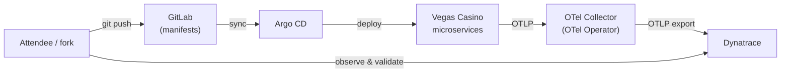

# 🎰 Beyond the Honeymoon — OpenTelemetry in Practice

A hands-on **OpenTelemetry + Dynatrace** training built around the **Vegas Casino**
microservices app. You run a real observability environment, find planted problems in
Dynatrace, and fix them step by step — instrumentation, pipelines, cost, cardinality,
PII, and sampling.

> 📖 **Workshop guide (step-by-step):** https://henrikrexed.github.io/Otel-Training/
> — all instructions, exercises, and Dynatrace checkpoints live there. This README is
> just the on-ramp.

---

## 🚀 Getting started

### 1. Dynatrace tokens

You need a Dynatrace tenant and two API tokens:

- **Data ingest** token — scopes: `openTelemetryTrace.ingest`, `metrics.ingest`, `logs.ingest`.
- **Operator / API** token for the Dynatrace Operator (Kubernetes monitoring).

How to create them: [Dynatrace — Access tokens](https://docs.dynatrace.com/docs/manage/access-control/access-tokens)
and [OpenTelemetry ingest](https://docs.dynatrace.com/docs/ingest-from/opentelemetry).
Keep them handy — you inject them into the Codespace when you bring the environment up.

### 2. Fork this repository

Fork **[henrikrexed/Otel-Training](https://github.com/henrikrexed/Otel-Training)** into your
own account (the workshop uses a GitOps loop, so you push changes to your fork).

### 3. Start your Codespace

From your fork: **Code → Codespaces → Create codespace on `main`**. The devcontainer
pre-provisions a local `kind` cluster plus the training toolchain. Then follow the
workshop guide to deploy the environment.

---

## 🧭 The environment

- **App** — the Vegas Casino microservices (`services/`, Kubernetes manifests).
- **GitLab + Argo CD** — GitOps: your committed manifests are synced and deployed.
- **OpenTelemetry Operator** — manages the collectors that gather traces, metrics, and logs.
- **Dynatrace** — where you observe the planted issues and validate every fix.

---

## 📚 The training

Work through the guide at **https://henrikrexed.github.io/Otel-Training/**.

**Core track (M0–M5)** — guided 3-hour arc: deploy the environment, read the signals in
Dynatrace, and hunt the planted defects (trace-context, high-cardinality metrics, PII in logs),
fixing each through the GitOps loop.

**Advanced self-paced track** — the deeper engineering arc:

1. **Instrument with AI agents** — improve the instrumentation, then validate the new structure in Dynatrace.
2. **Weaver pipeline** — guard semantic conventions so instrumentation can't silently regress.
3. **Cost of observability** — inject the Dynatrace cost-center into telemetry and read the ingest/cost data.
4. **High-cardinality metrics** — find and resolve the expensive metrics.
5. **PII in logs** — redact sensitive data in the collector; escalate to BindPlane via the OTel Operator + OpAMP bridge.
6. **Tail sampling** — keep the traces that matter.

---

## 🛠️ Repo layout

| Path | What |
|---|---|
| `services/` | Vegas Casino microservices (the app under test) |
| `k8s/`, `helm/` | Kubernetes manifests / charts for the app |
| `docs/`, `mkdocs.yml` | Workshop documentation source (published to the guide site) |
| `codespace/` | Devcontainer / Codespace bring-up |

> The full training environment (OTel collector topology, Dynatrace Operator, GitOps/Argo CD,
> and the advanced lab assets) is delivered through the workshop's training branches and
> described in the guide site above.

---

Maintained for the Dynatrace Perform OpenTelemetry training by
[Henrik Rexed / IsItObservable](https://github.com/henrikrexed).
