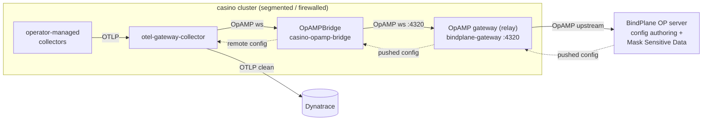

# Central config: the OpAMP bridge + a BindPlane gateway

_Advanced-track appendix. Prerequisite: [Step 6 — PII in logs](step-6-pii-logs.md).
This page's assets live under `labs/advanced/step5-pii-redaction/bindplane-opamp/`._

**Goal:** replace hand-rolled, per-collector redaction with **centrally authored**
config that BindPlane pushes to the fleet over OpAMP — and learn where the
**OpAMP gateway (relay)** fits between your collectors and the BindPlane server.
Budget 40 minutes. This is a reproducible stretch path; the BindPlane OpAMP
Gateway is **alpha**, so pin every version and treat the flags as version-sensitive.

!!! info "Optional / stretch"
    Step 6's collector-side redaction already satisfies its Definition of done.
    This appendix is for cohorts who want to see fleet-wide config management —
    the pattern you reach for when regex-by-hand stops scaling.

## 1. Why central config

Step 6 masked PII by hand-editing OTTL in `gateway.yaml`. That works for one
collector and three PII shapes. It stops scaling the moment you have:

- **New PII shapes** — every new field means another regex, re-reviewed and
  re-deployed per collector.
- **Per-service rules** — the player service and the dealer service need
  different masking; one YAML file becomes a pile of conditionals.
- **An audit trail** — compliance wants to know *who* changed a redaction rule
  and *when*. A git diff on a collector ConfigMap is not that.

**BindPlane OP** authors the config once (a reusable **Mask Sensitive Data**
processor) and **pushes** it to every connected collector over the **OpAMP**
protocol. You stop editing collector YAML; you edit a central config and roll it
out. Cardinality is the enemy and so is config sprawl — this is how you keep the
second one in check.

## 2. Architecture — bridge vs gateway



Two distinct roles are easy to conflate:

- **OpAMPBridge** (the *bridge*) runs **in your cluster**. It is the OTel
  Operator CRD that speaks OpAMP on behalf of the operator-managed collectors:
  it reports their effective config up and applies remote config down. It is a
  **client** only.
- **OpAMP gateway** (the *relay*) is a BindPlane extension that is **both** an
  OpAMP **server** facing downstream (your bridges/collectors connect to it,
  typically on **`:4320`**) **and** an OpAMP **client** upstream to the BindPlane
  server. It relays registration and config between the two.

**When do you need the relay?** Only when the collectors cannot reach the
BindPlane server directly — **segmented or firewalled clusters**, or a fleet
spanning many networks where you want a single egress point. The relay gives you
one upstream connection to manage and secure instead of N.

**When can you skip it?** If the bridge can open a connection straight to the
BindPlane server's OpAMP endpoint (`:3001`), point the bridge there and drop the
relay entirely. The lab ships the relay as the default (it is the more general,
more realistic topology) and keeps the direct `:3001` endpoint as a commented
fallback.

## 3. Deploy BindPlane OP

Install the server in the `observability` namespace with a **pinned** chart
version — alpha software drifts, and a reproducible lab must not float:

```bash
helm repo add bindplane https://observiq.github.io/bindplane-op-helm
helm repo update

# Pin the chart version for the training (do not float to latest).
helm upgrade --install bindplane bindplane/bindplane \
  -n observability --create-namespace \
  --version 1.24.0
```

Wait for the server, then grab the UI (port-forward for the lab):

```bash
kubectl -n observability rollout status deploy/bindplane
kubectl -n observability port-forward svc/bindplane 3001:3001
```

The BindPlane UI is now at `http://localhost:3001`. Create the initial admin
account when prompted.

## 4. Deploy the OpAMP gateway (relay)

The relay exposes a downstream OpAMP endpoint on **`:4320`** and registers
upstream to the BindPlane server. Deploy it from the lab asset:

```bash
# Upstream connection token: from BindPlane → Settings → OpAMP (install command).
kubectl -n observability create secret generic bindplane-gateway \
  --from-literal=BINDPLANE_OPAMP_TOKEN='<token-from-bindplane>'

kubectl apply -f labs/advanced/step5-pii-redaction/bindplane-opamp/opamp-gateway.yaml
kubectl -n observability rollout status deploy/bindplane-gateway
```

The relay dials the BindPlane server with that token (its **upstream client**
side) and starts listening on `:4320` for downstream bridges (its **server**
side). It appears in the BindPlane UI as a connected agent/gateway.

!!! note "Pin and re-check version-sensitive flags"
    The OpAMP Gateway is **alpha**. The env/flag names (`BINDPLANE_*`) and the
    chart version above are the ones verified for this lab — confirm them against
    the release you pin before a live run; alpha releases rename flags.

## 5. Deploy the OpAMP bridge

The bridge is the OTel Operator `OpAMPBridge` CRD. Point its `endpoint` at the
**relay** on `:4320` (not the server) and give it the same connection token:

```bash
# Connection token the bridge presents to the relay.
kubectl -n observability create secret generic bindplane-opamp \
  --from-literal=BINDPLANE_OPAMP_TOKEN='<token-from-bindplane>'
kubectl -n observability set env opampbridge/casino-opamp-bridge \
  --from=secret/bindplane-opamp

kubectl apply -f labs/advanced/step5-pii-redaction/bindplane-opamp/opampbridge.yaml
```

Key fields in `opampbridge.yaml`:

- `image: ghcr.io/open-telemetry/opentelemetry-operator/operator-opamp-bridge:0.162.0`
  — the tag tracks the operator release line (`OTEL_OPERATOR_VERSION=v0.162.0`
  in `observability/versions.env`; the image omits the leading `v`). Keep them in
  lockstep when you bump the operator.
- `endpoint: ws://bindplane-gateway.observability.svc.cluster.local:4320/v1/opamp`
  — the relay's downstream OpAMP endpoint. A commented `:3001` line in the file
  is the direct-to-server fallback for clusters that do not need the relay.
- `componentsAllowed` — an **allow-list** of receiver/processor/exporter types
  the bridge will accept from remote config. BindPlane cannot push a component
  the bridge does not permit: a safety rail for the training cluster.

## 6. Connect & verify

1. **Collector appears in BindPlane.** In the UI, the `otel-gateway-collector`
   shows up under the connected agents once the bridge reports its effective
   config upstream through the relay.
2. **Attach *Mask Sensitive Data*.** Add the processor to the casino log source
   in BindPlane, configure it for email / PAN / SSN, and **push** the rollout.
3. **Verify the push landed — `ReportsEffectiveConfig`.** The bridge has
   `ReportsEffectiveConfig: true`, so BindPlane shows the live, running config of
   `otel-gateway-collector` — confirm it now contains the pushed masking
   processor, no manual YAML edit involved.
4. **Verify clean PII in Dynatrace.** Re-run the Step 6 leak-scan DQL; it must
   still return `leaks == 0`, now driven by the pushed config rather than the
   hand-rolled processors:

    ```dql
    fetch logs, from: now() - 1h
    | filter k8s.namespace.name == "casino"
    | filter matchesValue(content, "*@*.*") or matchesValue(content, "*-**-****")
    | summarize leaks = count()
    ```

## 7. Gotchas

- **Tag / operator consistency.** `operator-opamp-bridge:0.162.0` must match the
  operator release line. A bridge newer or older than the operator can speak a
  different CRD/OpAMP revision and silently fail to apply config.
- **The allow-list is a safety rail, not a nuisance.** Keep `componentsAllowed`
  tight. It is the one thing standing between a central-config mistake and an
  arbitrary component running in your cluster.
- **This supersedes the hand-rolled redaction.** Once BindPlane owns the config,
  the Step 6 `redaction` / `transform/pii` processors are the *"before BindPlane"*
  baseline — keep them for the exercise, but in a real fleet BindPlane is the
  single source of truth. Running both means two owners for one rule.
- **Gateway vs direct endpoint.** Use the relay (`:4320`) for segmented /
  firewalled fleets; point the bridge straight at the server (`:3001`) when the
  cluster can reach it and you do not need a single egress hop. Do not run both
  paths for the same bridge.
- **Alpha means version-sensitive.** Pin the BindPlane chart and the gateway
  image; re-verify `BINDPLANE_*` flag names on every bump.

## Definition of done

- [ ] BindPlane OP deployed (pinned chart) in `observability`
- [ ] OpAMP gateway (relay) running and registered upstream to the server
- [ ] OpAMPBridge connected to the relay on `:4320`; collector visible in BindPlane
- [ ] A *Mask Sensitive Data* config pushed; `ReportsEffectiveConfig` shows it live
- [ ] Leak-scan DQL still returns `leaks == 0`, now driven by the pushed config

Back to the ladder: [Step 7 — Tail sampling](step-7-tail-sampling.md).
