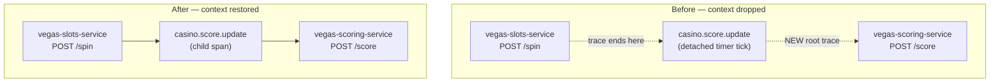

# Catalog A1 — Fix a broken distributed trace

!!! abstract "At a glance"
    **Theme:** traces · **Time:** 25 min · **Difficulty:** medium ·
    **Skill:** `otel-instrumentation` ·
    **Reference:** `labs/advanced/catalog-a1-broken-trace/`

**Goal:** a planted async hop between the slots and scoring services drops the
trace context, so the distributed trace **splits** into two. You will use
`opencode` with the `otel-instrumentation` skill to restore context propagation
across the async boundary — and watch the trace reconnect end-to-end in
Dynatrace. You run the **Problem → Opencode → Verify** loop, driving the agent
with a numbered prompt **ladder** rather than one mega-prompt.

## The concept



## ① Problem — the trace splits at the async hop

After a spin settles, the slots service records the result on
`vegas-scoring-service` (`SCORING_SERVICE_URL`, port 8085). To keep `/spin` fast
it does **not** await the call — it pushes a job onto an in-process queue drained
by a `setInterval` timer. Planted state:
`labs/advanced/catalog-a1-broken-trace/before.slots-score-hop.js`.

The break is subtle and extremely common: the drain tick is a **fresh async
context with no active span**. OpenTelemetry context lives in Node's
`AsyncLocalStorage`; it follows `await` chains inside one operation but does
**not** flow into a `setInterval`/`setTimeout` callback. The HTTP client
instrumentation only injects a `traceparent` header when a span is active in the
*current* context — so the score call goes out header-less and scoring opens a
**brand-new root trace**.

Confirm the symptom — run the [checkpoint DQL](#verify) now: scoring spans appear
as **parentless roots**, and the `/spin` trace has no downstream scoring child.

## ② Understand the change

The fix is **not** "add a span" — it is *carry the context across the async
boundary*. Two halves, both in the slots service:

1. **Capture** `context.active()` at enqueue time, next to the payload.
2. **Restore** it at drain time with `context.with(...)`, and open an explicit
   `casino.score.update` child span, so the outgoing `fetch` has an active span
   to propagate from.

Target shape (`after.slots-score-hop.js`):

```diff
- scoreQueue.push({ player, game: 'slots', outcome: outcome.kind, payout });
+ scoreQueue.push({ job: { player, game: 'slots', outcome: outcome.kind, payout },
+                   ctx: context.active() });        // capture
  ...
- const job = scoreQueue.shift();
- await fetch(`${SCORING_URL}/score`, { ... });
+ const item = scoreQueue.shift();
+ await context.with(item.ctx, async () => {         // restore
+   const span = tracer.startSpan('casino.score.update', { attributes: { ... } });
+   await context.with(trace.setSpan(context.active(), span), async () => {
+     await fetch(`${SCORING_URL}/score`, { ... });  // traceparent now injected
+     span.end();
+   });
+ });
```

## ③ Drive opencode — the prompt ladder

Climb the ladder one rung at a time. After each rung, read what the agent did
before you let it continue.

=== "P1 · Orient (read-only)"

    ```text
    Using the otel-instrumentation skill, read the slots service only — do not
    edit yet. Where does /spin hand work to the scoring service, and in what
    async context does the outgoing HTTP call actually run? Tell me why a
    traceparent header would NOT be injected on that call.
    ```
    **What you should see:** the agent identifies the `setInterval` drain loop and
    explains the call runs with no active span / no context.
    **Review check:** it names the detached timer tick as the cause — not "a
    missing span".

=== "P2 · Core fix"

    ```text
    Now fix it: capture the active context where the score job is enqueued, and
    restore it with context.with(...) in the drain loop before the fetch, so the
    HTTP call propagates traceparent to vegas-scoring-service. Use
    @opentelemetry/api. Keep /spin non-blocking.
    ```
    **What you should see:** `context.active()` captured at enqueue; `context.with`
    wrapping the fetch at drain.
    **Review check:** `/spin` still returns before the score call runs.

=== "P3 · Deepen"

    ```text
    Add an explicit child span 'casino.score.update' around the fetch, with
    attributes casino.game.name, casino.outcome and peer.service =
    vegas-scoring-service, and end it in a finally so errors still close it.
    ```
    **What you should see:** a named client span wrapping the call, ended in
    `finally`.
    **Review check:** the span is created *inside* the restored context (so it is a
    child, not a new root).

=== "P4 · Steer"

    ```text
    Confirm the scoring call now inherits the /spin trace: show me that the span
    is a child of the request context and that no new root trace is created for
    the score update.
    ```
    **What you should see:** the agent reasons that `trace.setSpan` on the restored
    context makes the hop a child of the spin.
    **Review check:** no `context.active()` is captured *inside* the timer (that
    would re-root it).

## ④ Review & apply

Read the diff against `after.slots-score-hop.js`, then ship via GitOps:

```bash
git add . && git commit -m "fix(slots): propagate trace context across the scoring hop"
git push            # to your fork's main — Argo CD syncs the slots service
```

Play a few rounds of slots so new traces flow.

## Verify

Run in a Grail **Notebook**, filtered to your cluster.

**Before — scoring spans are parentless roots** (this should collapse to ~0):

```dql
fetch spans, from: now() - 30m
| filter service.name == "vegas-scoring-service" and endpoint.name == "POST /score"
| filter isNull(span.parent_id)
| summarize orphan_roots = count(), by: { bin(timestamp, 1m) }
```

**After — slots and scoring share one trace** (reconnected end-to-end):

```dql
fetch spans, from: now() - 30m
| filter span.name == "casino.score.update"
| fieldsAdd has_parent = isNotNull(span.parent_id)
| summarize reconnected = countIf(has_parent == true), by: { bin(timestamp, 1m) }
```

- **Before:** `orphan_roots` is non-zero; `reconnected` is empty — the trace is split.
- **After:** `orphan_roots` drops to zero and `reconnected` climbs — opening any
  `/spin` trace now shows `casino.score.update` → `vegas-scoring-service` as
  children of the spin.

!!! warning "If the agent gets it wrong — steer it back"
    - **Adds a span but no context carry** (trace still splits): *"the fix must
      capture context.active() at enqueue and restore it with context.with before
      the fetch — a span alone does not cross the setInterval boundary."*
    - **Captures context inside the timer tick:** *"capturing context inside the
      drain loop re-roots the trace — capture it where the job is enqueued."*
    - **Makes /spin await the score call:** *"keep /spin non-blocking; the hop
      stays asynchronous, we only carry the context into it."*

## Definition of done

- [ ] Context captured at enqueue and restored with `context.with` at drain
- [ ] A `casino.score.update` child span wraps the scoring call, ended in `finally`
- [ ] `orphan_roots` DQL drops to zero after the fix
- [ ] A `/spin` trace shows `casino.score.update` → `vegas-scoring-service` as children

Back to the [catalog menu](catalog.md).
