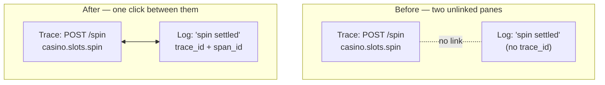

# Catalog A2 — Log ↔ trace correlation

!!! abstract "At a glance"
    **Theme:** traces / logs · **Time:** 20 min · **Difficulty:** medium ·
    **Skill:** `otel-instrumentation` ·
    **Reference:** `labs/advanced/catalog-a2-log-trace-correlation/`

**Goal:** the slots service logs each spin as a structured JSON line, but the
line carries no trace context — so in Dynatrace a log record and the span it was
emitted during are unlinked. You will use `opencode` with the
`otel-instrumentation` skill to inject `trace_id` / `span_id` into every log
line, then watch Dynatrace pivot from a slow `/spin` trace **straight to its
logs** — and back. You run the **Problem → Opencode → Verify** loop, driving the
agent with a numbered prompt **ladder** rather than one mega-prompt.

## The concept



## ① Problem — the log line has no trace context

After a spin settles, the slots service writes a structured JSON log line to
stdout — scraped by the DaemonSet filelog collector and shipped to Dynatrace.
Planted state: `labs/advanced/catalog-a2-log-trace-correlation/before.slots-logger.js`.
The line is emitted **while** the `casino.slots.spin` span is active, yet it
records none of that span's identity:

```json
{ "timestamp": "…", "level": "info", "message": "spin settled",
  "service.name": "vegas-slots-service", "casino.outcome": "jackpot" }
```

No `trace_id`, no `span_id`. In Dynatrace the log and the span live in two
separate panes with nothing linking them: opening a slow `/spin` trace cannot
pivot to "the logs for THIS request", and a suspicious log line cannot jump to
the trace that produced it.

Confirm the symptom — run the [checkpoint DQL](#verify) now: the share of
slots log records with a `trace_id` is **zero**.

## ② Understand the change

The fix is to read the **active** span's `SpanContext` and stamp its ids onto
every log line. Two facts make this work:

1. `trace_id` and `span_id` are the OpenTelemetry **log data-model** trace-context
   fields. Dynatrace correlates a log record to a span when they are present —
   no extra configuration.
2. A logger that writes plain JSON to stdout does **not** attach them
   automatically. You read them from
   `trace.getSpan(context.active()).spanContext()` and inject them yourself.

Target shape (`after.slots-logger.js`):

```diff
+ const { trace, context } = require('@opentelemetry/api');

  function log(level, message, fields = {}) {
+   const span = trace.getSpan(context.active());
+   const sc = span && span.spanContext();
+   const correlation = sc
+     ? { trace_id: sc.traceId, span_id: sc.spanId, trace_flags: sc.traceFlags }
+     : {};
    process.stdout.write(JSON.stringify({
      timestamp: new Date().toISOString(), level, message,
      'service.name': 'vegas-slots-service',
+     ...correlation,
      ...fields,
    }) + '\n');
  }
```

!!! note "Use the standard keys, top-level"
    The correlation keys Dynatrace recognises are the lower-snake-case
    **`trace_id`** / **`span_id`**, as **top-level** fields on the log record.
    Nesting them under an object, or renaming to `traceId` / `dt.trace_id`,
    breaks the link. When no span is active, omit the fields — never log a
    fabricated or all-zero id.

## ③ Drive opencode — the prompt ladder

Climb the ladder one rung at a time. After each rung, read what the agent did
before you let it continue.

=== "P1 · Orient (read-only)"

    ```text
    Using the otel-instrumentation skill, read the slots service logger only — do
    not edit. The service logs each spin while a casino.slots.spin span is active,
    yet the log line has no trace_id. Explain why Dynatrace cannot link that log
    record to its span.
    ```
    **What you should see:** the agent identifies that the logger never reads the
    active span context, so the ids are absent from the record.
    **Review check:** it names `trace_id` / `span_id` as the missing correlation
    fields — not "a missing log attribute" in general.

=== "P2 · Core fix"

    ```text
    Now fix it: read the active span's SpanContext via
    trace.getSpan(context.active()) and inject trace_id, span_id and trace_flags
    as top-level fields on every structured log line. Use @opentelemetry/api.
    If no span is active, omit the fields — do not log zeros.
    ```
    **What you should see:** `trace.getSpan(context.active())` read inside the log
    helper; the three ids spread onto the JSON object.
    **Review check:** the keys are exactly `trace_id` / `span_id` (snake_case),
    top-level — not nested, not camelCase.

=== "P3 · Deepen"

    ```text
    Make it safe: when there is no active span (startup, background ticks) the
    line must still be valid JSON with no correlation keys. Confirm trace_flags is
    included so sampled/unsampled is visible on the record.
    ```
    **What you should see:** a guarded branch that omits the ids when no span is
    active; `trace_flags` present when one is.
    **Review check:** no all-zero `00000000...` id is ever emitted.

=== "P4 · Steer"

    ```text
    Confirm the correlation keys match what Dynatrace expects: top-level trace_id
    and span_id in lower snake_case. Show me they are NOT nested under an object
    and NOT renamed to traceId / dt.trace_id.
    ```
    **What you should see:** the agent re-reads the emitted object and confirms the
    key names and placement.
    **Review check:** the ids survive as top-level fields after `...fields` spread
    (a later field cannot clobber them).

## ④ Review & apply

Read the diff against `after.slots-logger.js`, then ship it through **Gitea** from
inside your casino clone (`~/casino`). Let opencode run the git loop, or do it by
hand:

```bash
gitea-pr.sh "feat(slots): inject trace_id/span_id into logs for correlation"
```

`gitea-pr.sh` branches `opencode/<slug>`, commits with a DCO sign-off, pushes, and
prints the PR URL. **Review and merge the PR in the Gitea UI**
(`http://localhost:30001/casino/casino/pulls`). This is **casino application
code**, so merging kicks off the image CI — do not expect Argo CD to sync until
the new image exists:

!!! tip "Ship it — Branch B (`apps/casino/**` code)"
    Open the PR, **wait for the image CI (Gitea Actions `casino-images`) to go
    green**, merge, then **wait for the image build + `:<sha>` write-back commit**
    before Argo CD syncs and the slots pods roll to the new image. Full flow:
    [the GitOps loop](../setup.md#ship-it).

Once the new image is rolled out, play a few rounds of slots so new, correlated
log lines flow.

## Verify

Run in a Grail **Notebook**, filtered to your cluster.

**Share of slots logs carrying a trace id** (climbs from 0 toward 1.0):

```dql
fetch logs, from: now() - 30m
| filter service.name == "vegas-slots-service"
| fieldsAdd correlated = isNotNull(trace_id)
| summarize correlated = countIf(correlated == true), total = count(), by: { bin(timestamp, 1m) }
| fieldsAdd ratio = correlated / total
```

**The pivot that proves it** — pick one spin's `trace_id` and fetch its logs:

```dql
fetch logs, from: now() - 30m
| filter service.name == "vegas-slots-service" and isNotNull(trace_id)
| fields timestamp, trace_id, span_id, content
| sort timestamp desc
| limit 20
```

- **Before:** `ratio` is 0 — every slots log is orphaned from its trace.
- **After:** `ratio` climbs toward 1.0, and in the trace view opening any `/spin`
  trace now shows a **Logs** tab scoped to that `trace_id` — one click from span
  to the exact lines it produced, and the log view links back to the trace.

!!! warning "If the agent gets it wrong — steer it back"
    - **Logs the ids nested or renamed** (`{ otel: { traceId } }`, `dt.trace_id`):
      *"the correlation keys are top-level trace_id and span_id in lower
      snake_case — Dynatrace does not recognise nested or camelCase variants."*
    - **Reads the span at module load, not per-call:** *"read the active span
      inside the log function, per line — the active span changes every request."*
    - **Emits an all-zero id when no span is active:** *"omit the correlation keys
      entirely when there is no active span; never log an all-zero trace_id."*
    - **Puts `...correlation` after `...fields`:** *"spread correlation last-ish but
      ensure a caller field cannot overwrite trace_id/span_id."*

## Definition of done

- [ ] `trace_id`, `span_id`, `trace_flags` injected as top-level log fields
- [ ] Ids read from the **active** span per log call (not at module load)
- [ ] No correlation keys (and no all-zero ids) when no span is active
- [ ] `ratio` DQL climbs toward 1.0 after the fix
- [ ] Opening a `/spin` trace in Dynatrace shows its logs scoped to that `trace_id`

Back to the [catalog menu](catalog.md).
