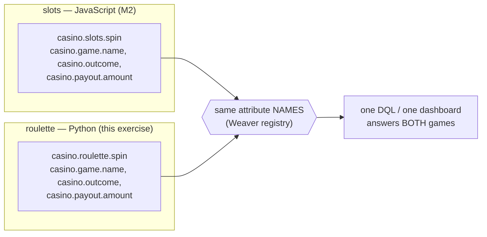

# Catalog A3 — Multi-language instrumentation

!!! abstract "At a glance"
    **Theme:** traces · **Time:** 25 min · **Difficulty:** medium ·
    **Skill:** `otel-instrumentation` ·
    **Reference:** `labs/advanced/catalog-a3-multi-language/`

**Goal:** M2 instrumented slots in **JavaScript**. Here you apply the *same*
span pattern to a **second SDK** — the Python **roulette** service — proving the
`casino.*` semantic-convention contract is language-agnostic. You will use
`opencode` with the `otel-instrumentation` skill to open a `casino.roulette.spin`
span carrying the identical attribute **names** slots uses, then watch one DQL
answer both games. You run the **Problem → Opencode → Verify** loop, driving the
agent with a numbered prompt **ladder** rather than one mega-prompt.

## The concept



!!! tip "Target choice — roulette (Python) or dice (Go)"
    This page uses the Python **roulette** service. The Go **dice** service is the
    equivalent alternative: same attributes, `go.opentelemetry.io/otel` instead of
    the Python SDK, `tracer.Start(ctx, "casino.dice.roll")`. Pick whichever SDK
    you want the practice in — the contract is identical.

## ① Problem — roulette is invisible to the money-path DQL

Slots (M2) emits a `casino.slots.spin` span with `casino.game.name`,
`casino.bet.amount`, `casino.outcome` and `casino.payout.amount`, so Dynatrace
can slice the money path by game / outcome / payout. The Python roulette service
runs every spin under a **generic `http_request` span only** — no domain span,
none of the casino.* attributes. Planted state:
`labs/advanced/catalog-a3-multi-language/before.roulette-spin.py`.

Confirm the symptom — run the [checkpoint DQL](#verify) now: there is no
`casino.roulette.spin` span, and roulette does not appear in any
`casino.outcome` roll-up.

## ② Understand the change

The fix is **not** new conventions for Python — it is the **same** contract,
ported. Open an explicit `casino.roulette.spin` child span and set the identical
attribute **names** slots uses (only the **values** differ: `roulette` vs
`slots`). Mapping across the two SDKs:

| JavaScript (M2) | Python (this exercise) |
|---|---|
| `trace.getTracer('casino-slots', '1.0.0')` | `trace.get_tracer("casino-roulette", "2.1.0")` |
| `tracer.startActiveSpan('casino.slots.spin', fn)` | `with tracer.start_as_current_span("casino.roulette.spin")` |
| `span.setAttribute('casino.game.name', 'slots')` | `spin.set_attribute("casino.game.name", "roulette")` |
| `span.setStatus({ code: ERROR })` | `spin.set_status(StatusCode.ERROR, …)` |

Target shape (`after.roulette-spin.py`):

```diff
+ from opentelemetry import trace
+ from opentelemetry.trace import StatusCode
+ tracer = trace.get_tracer("casino-roulette", "2.1.0")

  def _handle_spin(self, span=None):
      if span: add_http_attributes(span, "POST", "/spin")
      data = self._read_body()
-     winning_number = random.randint(0, 36)
-     payout = calculate_payout(bet_type, data.get("BetValue"), winning_number)
-     self._send_json_response({ ... })
+     with tracer.start_as_current_span("casino.roulette.spin") as spin:
+         spin.set_attribute("casino.game.name", "roulette")
+         spin.set_attribute("casino.bet.amount", data.get("BetAmount", 0))
+         winning_number = random.randint(0, 36)
+         payout = calculate_payout(bet_type, data.get("BetValue"), winning_number)
+         outcome = "win" if payout > 0 else "lose"
+         spin.set_attribute("casino.outcome", outcome)
+         spin.set_attribute("casino.payout.amount", payout)
+         self._send_json_response({ ... })
```

!!! note "The names are the contract"
    Diverge the attribute names (`game`, `bet_amount`, `casino.roulette.outcome`)
    and you get two of everything — two dashboard tiles, two DQL filters — and
    nothing rolls up. Matching slots exactly means M4's Weaver registry check
    guards roulette too, and the whole casino answers one query.

## ③ Drive opencode — the prompt ladder

Climb the ladder one rung at a time. After each rung, read what the agent did
before you let it continue.

=== "P1 · Orient (read-only)"

    ```text
    Using the otel-instrumentation skill, read the Python roulette _handle_spin
    only — do not edit. It runs under a generic http_request span. Compare it to
    how the slots service (JavaScript, M2) records casino.slots.spin, and tell
    me which casino.* attributes roulette is missing.
    ```
    **What you should see:** the agent lists `casino.game.name`,
    `casino.bet.amount`, `casino.outcome`, `casino.payout.amount` as absent.
    **Review check:** it references the slots pattern as the contract to match —
    not inventing new Python-specific names.

=== "P2 · Core fix"

    ```text
    Add an explicit casino.roulette.spin child span around the draw and payout,
    using tracer.start_as_current_span. Set casino.game.name='roulette',
    casino.bet.amount, casino.outcome and casino.payout.amount — the SAME attribute
    names the slots service uses. Keep it a child of the http_request span.
    ```
    **What you should see:** a `with tracer.start_as_current_span(...)` block
    wrapping the settlement, with the four casino.* attributes.
    **Review check:** the attribute **names** match slots exactly; only values
    differ (`roulette`).

=== "P3 · Deepen"

    ```text
    Make the span honest on failure: set status ERROR and record_exception on an
    error, and re-raise. Add a jackpot event when payout is a 30x+ win, matching
    the slots jackpot event.
    ```
    **What you should see:** `set_status(StatusCode.ERROR, ...)` +
    `record_exception` in an `except`, and an `add_event("jackpot", ...)`.
    **Review check:** the `with` context-manager ends the span automatically (no
    manual `end()` needed, unlike a bare `start_span`).

=== "P4 · Steer"

    ```text
    Confirm the roulette span rolls up with slots: show me that a single DQL
    filtering casino.outcome returns BOTH games, and that the Weaver registry from
    M3/3 would accept casino.roulette.spin without new attribute definitions.
    ```
    **What you should see:** the agent reasons that identical names mean one query
    covers both, and no registry change is needed.
    **Review check:** no attribute was renamed into a roulette-specific namespace.

## ④ Review & apply

Read the diff against `after.roulette-spin.py`, then ship it through **Gitea** from
inside your casino clone (`~/casino`). Let opencode run the git loop, or do it by
hand:

```bash
gitea-pr.sh "feat(roulette): add casino.roulette.spin span matching the slots contract"
```

`gitea-pr.sh` branches `opencode/<slug>`, commits with a DCO sign-off, pushes, and
prints the PR URL. **Review and merge the PR in the Gitea UI**
(`http://localhost:30001/casino/casino/pulls`). This is **casino application
code**, so merging kicks off the image CI — do not expect Argo CD to sync until
the new image exists:

!!! tip "Ship it — Branch B (`apps/casino/**` code)"
    Open the PR, **wait for the image CI (Gitea Actions `casino-images`) to go
    green**, merge, then **wait for the image build + `:<sha>` write-back commit**
    before Argo CD syncs and the roulette pods roll to the new image. Full flow:
    [the GitOps loop](../setup.md#ship-it).

Once the new image is rolled out, play a few rounds of roulette so new spans flow.

## Verify

Run in a Grail **Notebook**, filtered to your cluster.

**Roulette now emits the domain span** (was empty before):

```dql
fetch spans, from: now() - 30m
| filter span.name == "casino.roulette.spin"
| summarize spins = count(), by: { casino.outcome }
```

**The cross-language roll-up** — one query, both SDKs, by game:

```dql
fetch spans, from: now() - 30m
| filter isNotNull(casino.game.name)
| summarize spins = count(), by: { casino.game.name, casino.outcome }
```

- **Before:** `casino.roulette.spin` returns nothing; the roll-up shows only
  `slots`.
- **After:** roulette appears alongside slots under the **same** `casino.game.name`
  / `casino.outcome` dimensions — one DQL, one dashboard tile, both languages.
  The contract crossed the SDK boundary.

!!! warning "If the agent gets it wrong — steer it back"
    - **Invents Python-specific names** (`game`, `casino.roulette.outcome`): *"match
      the slots attribute names exactly — casino.game.name, casino.outcome — only
      the value changes to 'roulette'."*
    - **Uses `start_span` without a context manager** (span never ends): *"use
      `with tracer.start_as_current_span(...)` so the span ends and becomes a child
      of http_request."*
    - **Makes it a new root** instead of a child: *"start the span inside the active
      http_request context so it is a child, not a second root trace."*
    - **Skips error status:** *"set status ERROR and record_exception on failure,
      then re-raise — the span must reflect the outcome."*

## Definition of done

- [ ] `casino.roulette.spin` child span wraps the draw + payout settlement
- [ ] Attribute **names** (`casino.game.name` / `.bet.amount` / `.outcome` / `.payout.amount`) match slots exactly
- [ ] Span ended via `with` context-manager; ERROR status + `record_exception` on failure
- [ ] `casino.roulette.spin` DQL returns data after the fix
- [ ] The cross-language roll-up shows **both** slots and roulette under one query

Back to the [catalog menu](catalog.md).
