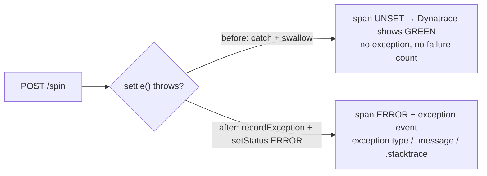

# Catalog A4 — Exceptions / span-events done right

!!! abstract "At a glance"
    **Theme:** traces · **Time:** 20 min · **Difficulty:** medium ·
    **Skill:** `otel-instrumentation` ·
    **Reference:** `labs/advanced/catalog-a4-exceptions-span-events/`

**Goal:** Step 1 gave slots a `casino.slots.spin` span on the happy path. But
when settlement **throws**, the current code swallows the error — the span stays
green and the failure is invisible. Here you make the span tell the truth:
record the exception as a **span event** carrying the semantic-convention
attributes (`exception.type` / `exception.message` / `exception.stacktrace`) and
flip the span **status to ERROR**. You drive the fix with `opencode` + the
`otel-instrumentation` skill, then prove the red span and its exception
attributes in Dynatrace. You run the **Problem → Opencode → Verify** loop with a
numbered prompt **ladder**, not one mega-prompt.

## The concept



## ① Problem — a failing money path that looks healthy

The slots `/spin` handler wraps settlement in a `try/catch`. On error it does the
intuitive-but-wrong thing: `console.error(...)` and `res.status(500)`. The active
`casino.slots.spin` span is never told — no `recordException`, status left
**UNSET** (which Dynatrace renders as success). Planted state:
`labs/advanced/catalog-a4-exceptions-span-events/before.slots-settle.js`.

Confirm the symptom — run the [checkpoint DQL](#verify) now: `casino.slots.spin`
has **zero** ERROR spans even while `/spin` is returning 500s, and there is no
`exception.*` attribute anywhere on the span.

## ② Understand the change

Three things change, all on the `catch` path — and the subtle one is that you
need **both** of the first two, not either alone:

| Step | Call | Why |
|---|---|---|
| Record | `span.recordException(err)` | Adds an `exception` span **event** with `exception.type` / `exception.message` / `exception.stacktrace` (OTel exception semconv). |
| Mark | `span.setStatus({ code: SpanStatusCode.ERROR })` | Flips the span **red** so it counts toward failure rate, alerting, and Step 7's error-trace retention. |
| Don't swallow | re-throw, or return 500 **after** recording | Never silently continue — the response and the trace must agree. |

Target shape (`after.slots-settle.js`):

```diff
- const { trace } = require('@opentelemetry/api');
+ const { trace, SpanStatusCode } = require('@opentelemetry/api');
  ...
    } catch (err) {
-     console.error('spin failed:', err.message);
-     res.status(500).json({ error: 'internal error' });
+     span.recordException(err);
+     span.setStatus({ code: SpanStatusCode.ERROR, message: err.message });
+     res.status(500).json({ error: 'internal error' });
    }
```

!!! note "recordException does NOT set the status"
    This trips everyone up. `span.recordException(err)` only adds the event — an
    otherwise **UNSET** span with a recorded exception still renders as a
    **success** in Dynatrace. You must *also* call `setStatus({ code: ERROR })`.
    Record **and** mark; one without the other is a half-fix.

!!! warning "The semconv names are the contract"
    Use `exception.type` / `exception.message` / `exception.stacktrace` — which is
    exactly what `recordException()` emits. Hand-rolling your own event with
    `error_type` / `err.msg` means Dynatrace's exception analytics and Davis never
    recognise it. Let the SDK do it: `recordException(err)`.

## ③ Drive opencode — the prompt ladder

Climb one rung at a time. After each rung, read what the agent did before you let
it continue.

=== "P1 · Orient (read-only)"

    ```text
    Using the otel-instrumentation skill, read the slots /spin handler only — do
    not edit. The settle() call is wrapped in try/catch. Tell me exactly what the
    catch block does to the active casino.slots.spin span today, and whether a
    failed spin would show as an error in Dynatrace.
    ```
    **What you should see:** the agent reports the catch only logs + returns 500,
    never calls `recordException` or `setStatus`, so the span is UNSET → renders
    green. **Review check:** it names the span as UNSET, not "there is no span".

=== "P2 · Core fix"

    ```text
    In the catch block, record the exception as a span event using
    span.recordException(err) so it carries the exception.type / exception.message
    / exception.stacktrace semconv attributes, and set the span status to ERROR
    with SpanStatusCode.ERROR. Keep returning the 500 after recording.
    ```
    **What you should see:** `recordException(err)` **and**
    `setStatus({ code: SpanStatusCode.ERROR, ... })` added to the catch, plus the
    `SpanStatusCode` import. **Review check:** BOTH calls are present — not just
    `recordException`.

=== "P3 · Deepen"

    ```text
    Explain why recordException alone is not enough — show me that without
    setStatus the span still renders as a success. Confirm we are not swallowing:
    the HTTP 500 and the span ERROR status must agree. Do not catch-and-continue.
    ```
    **What you should see:** the agent articulates that `recordException` records
    an event but leaves status UNSET, and confirms response + span status agree.
    **Review check:** no path where the error is logged but the request returns 200.

=== "P4 · Steer"

    ```text
    Confirm the exception attributes use the OpenTelemetry semantic-convention
    names (exception.type / exception.message / exception.stacktrace) emitted by
    recordException — not hand-rolled names — so Dynatrace exception analytics
    and Davis pick them up automatically.
    ```
    **What you should see:** the agent confirms it relies on `recordException()`'s
    built-in semconv attributes and did not invent a custom event.
    **Review check:** no custom `addEvent('error', { error_type: ... })`.

## ④ Review & apply

Read the diff against `after.slots-settle.js`, then ship via GitOps:

```bash
git add . && git commit -m "fix(slots): record exceptions as span events + ERROR status on the spin path"
git push            # to your fork's main — Argo CD syncs the slots service
```

Trigger a few failing spins (an out-of-range bet, or point slots at a
down scoring endpoint) so error spans flow.

## Verify

Run in a Grail **Notebook**, filtered to your cluster. Field names follow
Dynatrace Grail semantics — adjust `span.status_code` to your tenant's captured
field if it differs.

**Failed spins are now ERROR** (were green before):

```dql
fetch spans, from: now() - 30m
| filter span.name == "casino.slots.spin"
| summarize total = count(), errors = countIf(span.status_code == "ERROR"), by: { casino.outcome }
```

**The exception reached the span** — type / message now visible:

```dql
fetch spans, from: now() - 30m
| filter span.name == "casino.slots.spin" and span.status_code == "ERROR"
| fields timestamp, exception.type, exception.message, span.status_code
| sort timestamp desc
```

- **Before:** `errors == 0` even while `/spin` returns 500s; the second query is
  empty — no `exception.*` attributes anywhere.
- **After:** `errors > 0` for the failing outcomes, and the second query lists
  each failure's `exception.type` / `exception.message`. The span is red, the
  failure is counted, and the stack trace is one click away.

!!! warning "If the agent gets it wrong — steer it back"
    - **Records but doesn't mark** (`recordException` only): *"also call
      setStatus with SpanStatusCode.ERROR — recordException does not change the
      status, so the span still shows as success."*
    - **Marks but doesn't record** (status only): *"also call
      span.recordException(err) so the exception.type / message / stacktrace land
      on the span, not just a red status with no detail."*
    - **Hand-rolls the event** (`addEvent('error', {...})`): *"use
      span.recordException(err) so it emits the standard exception.* semconv
      attributes Dynatrace recognises."*
    - **Still swallows** (logs, returns 200): *"do not catch-and-continue — the
      HTTP response and the span status must both reflect the failure."*

## Definition of done

- [ ] `span.recordException(err)` is called on the settlement error path
- [ ] `span.setStatus({ code: SpanStatusCode.ERROR })` is **also** called (both, not either)
- [ ] Exception attributes use semconv names (`exception.type` / `.message` / `.stacktrace`)
- [ ] No swallowed error — HTTP status and span status agree
- [ ] ERROR-status DQL returns rows after the fix; the exception attributes are visible on the span

Back to the [catalog menu](catalog.md).
