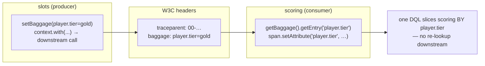

# Catalog A5 — Baggage propagation (`player.tier`)

!!! abstract "At a glance"
    **Theme:** traces · **Time:** 25 min · **Difficulty:** medium ·
    **Skill:** `otel-instrumentation` ·
    **Reference:** `labs/advanced/catalog-a5-baggage-propagation/`

**Goal:** The slots service knows the player's loyalty **tier** at the entry of
every request, but scoring — a separate downstream service — has no idea. Here
you use **OpenTelemetry Baggage** to carry `player.tier` across the hop: set it
upstream in slots, let the propagator ride it in the `baggage` header, then read
it downstream in scoring and enrich scoring's spans with it. You drive both ends
with `opencode` + the `otel-instrumentation` skill, then prove in Dynatrace that
a *single* DQL can slice scoring by a tier scoring never looked up. You run the
**Problem → Opencode → Verify** loop with a numbered prompt **ladder**.

## The concept



## ① Problem — downstream is blind to the player's tier

Slots reads `player.tier` (gold / silver / bronze) the moment a request lands,
but keeps it as a **local variable** — it never enters baggage. The downstream
scoring call therefore carries `traceparent` (context propagates) but **no**
`baggage` header. To group scoring latency or payouts by tier you would have to
re-look-up the tier inside scoring — an extra DB hit and a coupling you do not
want. Planted state:
`labs/advanced/catalog-a5-baggage-propagation/before.slots-set-baggage.js`.

Confirm the symptom — run the [checkpoint DQL](#verify) now: **no** span carries
`player.tier`; scoring spans have no tier dimension at all.

## ② Understand the change

This exercise touches **both ends of the hop**:

| End | File | What changes |
|---|---|---|
| **Producer** (slots) | `after.slots-set-baggage.js` | Set `player.tier` into baggage on the active context; run the downstream call inside `context.with(ctxWithBaggage, …)` so the propagator injects the `baggage` header. Also `setAttribute('player.tier', …)` on the slots span. |
| **Consumer** (scoring) | `after.scoring-read-baggage.js` | Read `player.tier` from the propagated baggage and `setAttribute` it onto the `casino.scoring.evaluate` span. |

Producer shape (`after.slots-set-baggage.js`):

```diff
- const { trace } = require('@opentelemetry/api');
+ const { trace, propagation, context } = require('@opentelemetry/api');
  ...
    const tier = req.header('x-player-tier') || 'bronze';
+   const baggage = propagation.getActiveBaggage() || propagation.createBaggage();
+   const ctxWithBaggage = propagation.setBaggage(
+     context.active(),
+     baggage.setEntry('player.tier', { value: tier }),
+   );
+   span.setAttribute('player.tier', tier);      // baggage alone does NOT attribute the span
-   const score = await fetch('http://scoring:8080/score', { ... });
+   const score = await context.with(ctxWithBaggage, () =>
+     fetch('http://scoring:8080/score', { ... }),  // propagator injects `baggage` header here
+   );
```

Consumer shape (`after.scoring-read-baggage.js`):

```diff
+ const entry = propagation.getBaggage(context.active())?.getEntry('player.tier');
+ if (entry) span.setAttribute('player.tier', entry.value);
```

!!! note "Baggage is a channel, not a span attribute"
    The single biggest gotcha: setting `player.tier` into baggage does **not**
    put it on any span. Baggage *propagates*; to make the value queryable you must
    explicitly **read it and `setAttribute`** — on the producer span if you want
    it there, and on the consumer span downstream. Forget this and the DQL stays
    empty even though the header is on the wire.

!!! warning "Keep baggage low-cardinality and PII-free"
    Baggage travels in a header on **every** hop. A bounded enum (`gold` /
    `silver` / `bronze`) is ideal. **Never** put `player.id` or PII in baggage: it
    becomes a high-cardinality attribute on every downstream span (see
    [M6](step-5-high-cardinality.md)) and leaks across service boundaries.

!!! tip "The propagator must be registered"
    Propagation is automatic **only if** the baggage propagator is active. The
    default composite (`tracecontext` + `baggage`) includes it; if your SDK pins a
    custom propagator list, ensure `baggage` is in it — otherwise the header is
    never injected and scoring sees nothing.

## ③ Drive opencode — the prompt ladder

Climb one rung at a time. After each rung, read what the agent did before you let
it continue.

=== "P1 · Orient (read-only)"

    ```text
    Using the otel-instrumentation skill, read the slots /spin handler and the
    scoring /score handler — do not edit. player.tier is known in slots. Trace
    whether it reaches scoring today: is it put into baggage, and does the
    downstream call carry a `baggage` header? Tell me what scoring can and cannot
    see about the player.
    ```
    **What you should see:** the agent reports slots keeps `tier` local, never
    sets baggage, so only `traceparent` propagates and scoring is blind to tier.
    **Review check:** it distinguishes context propagation (present) from baggage
    (absent).

=== "P2 · Producer — set baggage"

    ```text
    In slots, put player.tier into OpenTelemetry baggage on the active context,
    then make the downstream scoring call inside context.with(...) so the baggage
    propagator injects the `baggage` header alongside traceparent. Also set
    player.tier as an attribute on the slots span.
    ```
    **What you should see:** `propagation.setBaggage(...)` + `baggage.setEntry
    ('player.tier', ...)`, the fetch wrapped in `context.with(ctxWithBaggage, …)`,
    and `span.setAttribute('player.tier', tier)`. **Review check:** the downstream
    call is INSIDE the baggage context — not outside it.

=== "P3 · Consumer — read + attribute"

    ```text
    In scoring, read player.tier from the propagated baggage on the active context
    and set it as an attribute on the casino.scoring.evaluate span. If the baggage
    entry is absent, omit the attribute — do not fabricate a default.
    ```
    **What you should see:** `propagation.getBaggage(context.active())?.getEntry
    ('player.tier')` guarded by an `if`, then `span.setAttribute`. **Review
    check:** the attribute is only set when the entry exists.

=== "P4 · Steer — cardinality & correctness"

    ```text
    Confirm player.tier is a bounded enum safe for baggage, and that we are NOT
    putting player.id or any PII into baggage. Explain why reading baggage into a
    span attribute is required for it to be queryable, and confirm the baggage
    propagator is registered so the header is actually injected.
    ```
    **What you should see:** the agent confirms the tier is low-cardinality,
    refuses PII in baggage, and explains baggage ≠ span attribute.
    **Review check:** no `player.id` / email / PII anywhere near baggage.

## ④ Review & apply

Read the diffs against `after.slots-set-baggage.js` and
`after.scoring-read-baggage.js`, then ship them through **Gitea** from inside your
casino clone (`~/casino`). Let opencode run the git loop, or do it by hand:

```bash
gitea-pr.sh "feat(casino): propagate player.tier via baggage; scoring enriches spans from it"
```

`gitea-pr.sh` branches `opencode/<slug>`, commits with a DCO sign-off, pushes, and
prints the PR URL. **Review and merge the PR in the Gitea UI**
(`http://localhost:30001/casino/casino/pulls`). This is **casino application
code**, so merging kicks off the image CI — do not expect Argo CD to sync until
the new images exist:

!!! tip "Ship it — Branch B (`apps/casino/**` code)"
    Open the PR, **wait for the image CI (Gitea Actions `casino-images`) to go
    green**, merge, then **wait for the image build + `:<sha>` write-back commit**
    before Argo CD syncs and **both** services' pods roll to the new image. Full
    flow: [the GitOps loop](../setup.md#ship-it).

Once the new images are rolled out, play a few spins as different tiers (set the
`x-player-tier` header to `gold` / `silver` / `bronze`) so tiered spans flow
through both services.

## Verify

Run in a Grail **Notebook**, filtered to your cluster.

**`player.tier` now rides across the hop** — and lands on more than one service:

```dql
fetch spans, from: now() - 30m
| filter isNotNull(player.tier)
| summarize spans = count(), services = countDistinct(service.name), by: { player.tier }
```

**Scoring specifically inherited the tier** (it never looked it up):

```dql
fetch spans, from: now() - 30m
| filter span.name == "casino.scoring.evaluate" and isNotNull(player.tier)
| summarize scored = count(), by: { player.tier, casino.outcome }
```

- **Before:** both queries are empty — `player.tier` exists on no span; scoring
  has no tier dimension.
- **After:** the first query shows each tier with `services > 1` (slots **and**
  scoring carry it) — proof the value crossed the boundary in baggage. The second
  shows scoring sliced by `player.tier` even though scoring never queried a
  player database. One DQL, one dimension, no re-lookup.

!!! warning "If the agent gets it wrong — steer it back"
    - **Sets baggage but never reads it into a span** (DQL empty): *"baggage is
      not a span attribute — read it with getBaggage().getEntry and setAttribute
      on the scoring span."*
    - **Makes the downstream call outside the baggage context:** *"wrap the fetch
      in context.with(ctxWithBaggage, …) so the propagator injects the baggage
      header for that call."*
    - **Puts player.id / PII in baggage:** *"only the bounded tier enum goes in
      baggage — never player.id or PII; it rides in a header on every hop."*
    - **Fabricates a tier when baggage is absent:** *"if the baggage entry is
      missing, omit the attribute — do not default it to bronze."*

## Definition of done

- [ ] slots sets `player.tier` into baggage on the active context
- [ ] The downstream call runs inside `context.with(...)` so the `baggage` header is injected
- [ ] scoring reads `player.tier` from baggage and sets it as a span attribute (guarded when absent)
- [ ] Only the bounded tier enum is in baggage — no `player.id` / PII
- [ ] The cross-service DQL shows `player.tier` on **both** slots and scoring spans (`services > 1`)

Back to the [catalog menu](catalog.md).
