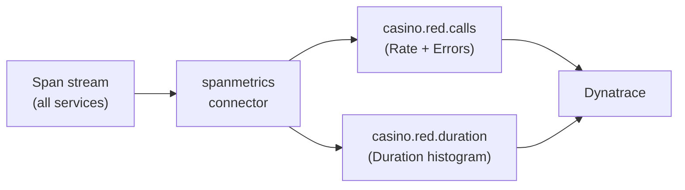

# Catalog B1 — RED metrics from spans

!!! abstract "At a glance"
    **Theme:** metrics / collector · **Time:** 20 min · **Difficulty:** medium ·
    **Skill:** `otel-collector` ·
    **Reference:** `labs/advanced/catalog-b1-spanmetrics/`

**Goal:** get **RED** metrics — Rate, Errors, Duration — for every casino
operation **without touching application code**, by adding the `spanmetrics`
connector to the gateway collector. You drive `opencode` with the
`otel-collector` skill through a prompt **ladder**, then chart the result.

## The concept



A connector is both an exporter and a receiver: it consumes the trace pipeline's
spans and produces a metrics stream. You get RED for free from telemetry you are
already sending — no SDK change, no redeploy of the casino services.

## ① Problem — rich traces, no RED rollup

The casino emits detailed spans, but there is **no cheap aggregate** of request
rate, error rate, or latency distribution per operation. Answering "what is the
p90 of `POST /spin` and how many are erroring per minute?" means scanning spans —
expensive and slow for a dashboard or SLO. Confirm it: run the
[checkpoint DQL](#verify) for `casino.red.calls` now — **no such metric**.

## ② Understand the change

Add the `spanmetrics` connector to `observability/collectors/gateway.yaml`
(reference: `labs/advanced/catalog-b1-spanmetrics/spanmetrics-connector.yaml`).
It is wired as an **exporter on the traces pipeline** and a **receiver on a new
metrics pipeline**:

```yaml
connectors:
  spanmetrics:
    histogram:
      explicit:
        buckets: [1ms, 5ms, 10ms, 25ms, 50ms, 100ms, 250ms, 500ms, 1s, 2s, 5s]
    dimensions:
      - name: casino.game.name
      - name: casino.outcome
    namespace: casino.red
service:
  pipelines:
    traces:
      exporters: [otlphttp/dynatrace, spanmetrics]   # feed the connector too
    metrics/spanmetrics:
      receivers: [spanmetrics]
      processors: [memory_limiter, batch]            # invariants hold here
      exporters: [otlphttp/dynatrace]
```

RED maps to: `casino.red.calls` (rate), the same metric split by
`status.code` (errors), and `casino.red.duration` (duration histogram). Keep the
dimensions **bounded** — `span.name`, `status.code`, and the two casino dims —
never `player.id`/`round.id`.

## ③ Drive opencode — the prompt ladder

=== "P1 · Orient (read-only)"

    ```text
    Using the otel-collector skill, read observability/collectors/gateway.yaml —
    do not edit. List the current pipelines and their exporters, and tell me
    where a spanmetrics connector would attach to derive RED metrics from spans.
    ```
    **What you should see:** the agent maps the traces pipeline and names the
    connector attach points (traces exporter + new metrics receiver).
    **Review check:** it does not propose any application-code change.

=== "P2 · Core — add the connector"

    ```text
    Add a spanmetrics connector under a connectors: block with namespace
    casino.red and a duration histogram. Wire it as an exporter on the traces
    pipeline and as the receiver of a new metrics/spanmetrics pipeline that
    exports to Dynatrace.
    ```
    **What you should see:** a `connectors:` block plus the two pipeline edits.
    **Review check:** the new metrics pipeline keeps `memory_limiter` first and
    `batch` last.

=== "P3 · Deepen — dimensions + buckets"

    ```text
    Add dimensions casino.game.name and casino.outcome to the connector, and set
    explicit histogram buckets from 1ms to 5s. Do NOT add player.id or round.id.
    ```
    **What you should see:** bounded `dimensions:` and an `explicit.buckets` list.
    **Review check:** no unbounded per-player/per-round dimension slipped in.

=== "P4 · Steer — verify the wiring"

    ```text
    Confirm the connector is both an exporter (traces) and a receiver
    (metrics/spanmetrics), and that the invariants hold on every pipeline:
    memory_limiter first, batch last.
    ```
    **What you should see:** the agent re-reads the service block and confirms both
    attachments and the invariant order.
    **Review check:** the traces pipeline still exports to Dynatrace *and*
    spanmetrics — not one or the other.

## ④ Review & apply

Diff against the reference, then apply the collector:

```bash
kubectl apply -f observability/collectors/gateway.yaml
kubectl -n observability rollout status deploy/otel-gateway-collector
```

Drive some load (the k6 loadgen is already running) so spans flow through the
connector.

## Verify

```dql
// R + E — call rate per operation, with error isolation
timeseries calls = sum(casino.red.calls), by: { span.name, status.code }, from: now() - 1h

// D — p90 request duration per operation
timeseries d_p90 = percentile(casino.red.duration, 90), by: { span.name }, from: now() - 1h
```

- **Before:** `casino.red.*` does not exist — both queries return nothing.
- **After:** `casino.red.calls` returns a series per `span.name` (× `status.code`,
  so errors are isolated), and `casino.red.duration` returns a p90 per operation —
  a full RED view, built entirely at the collector.

!!! warning "If the agent gets it wrong — steer it back"
    - **Puts spanmetrics on the metrics receiver side only:** *"spanmetrics is a
      connector — it must be an exporter on the traces pipeline AND the receiver of
      the new metrics pipeline."*
    - **Drops the Dynatrace exporter from traces:** *"the traces pipeline must keep
      exporting to Dynatrace as well as feeding spanmetrics."*
    - **Adds unbounded dimensions:** *"only span.name, status.code, casino.game.name
      and casino.outcome — no player.id or round.id."*
    - **Breaks the invariant:** *"memory_limiter must be first and batch last on the
      new metrics/spanmetrics pipeline."*

## Definition of done

- [ ] `spanmetrics` connector added with `namespace: casino.red` and a duration histogram
- [ ] Wired as traces exporter + `metrics/spanmetrics` pipeline receiver
- [ ] Invariants hold on every pipeline (memory_limiter first, batch last)
- [ ] `casino.red.calls` and `casino.red.duration` return data in Grail
- [ ] No casino application code changed

Back to the [catalog menu](catalog.md).
