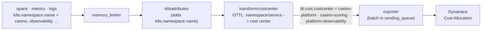

# Catalog B2 — Derive the cost center from topology (cost-center tagging)

!!! abstract "At a glance"
    **Theme:** metrics / collector · **Time:** 20 min · **Difficulty:** med ·
    **Skill:** `otel-collector` + `otel-ottl` ·
    **Reference:** `labs/advanced/catalog-b2-cost-center/`

**Goal:** finance and platform cannot tell which team or game drives ingest volume
and cost, because one shared gateway tags everything with — at best — a single
static cost center ([Step 4](step-4-cost-of-observability.md)). You will drive
`opencode` (`otel-collector` + `otel-ottl` skills) to add a `transform` processor
that **derives** the Dynatrace cost-allocation attributes from each signal's **own
topology** (`k8s.namespace.name` / `service.name`) — stamped on **traces, metrics,
and logs** at the gateway — then verify every record is attributed. This is the
**B2** half of the cost-allocation pair: the collector tags ingest once here so
[Catalog C4](catalog-c4-dynatrace-cost-center.md) can allocate and report on it in
Dynatrace. *Instrument once, allocate everywhere.*

## The concept



A single `transform` processor runs an **OTTL** rule set at **resource** scope: read
`k8s.namespace.name` (and `service.name`) and `set` `dt.cost.costcenter` /
`dt.cost.product`. The same rule set is attached to all three pipelines, so one
place attributes every signal.

!!! note "Why `dt.cost.costcenter` and not a bare `cost_center`"
    Dynatrace **Cost Allocation** recognizes the resource attributes
    `dt.cost.costcenter` and `dt.cost.product` as the showback/chargeback contract —
    the same attributes [Step 4](step-4-cost-of-observability.md) stamps statically.
    A plain `cost_center` string would group in DQL but would **not** feed Cost
    Allocation. Instrument the *concept* "cost center"; stamp the *vendor contract*.

## ① Problem — a shared gateway can't attribute ingest

[Step 4](step-4-cost-of-observability.md) stamps **one static** cost center from an
env var — correct when one team owns the gateway. But this gateway ingests for
**many** namespaces/teams at once (casino, scoring, the observability platform). A
static value lumps them into one bucket, so finance cannot answer "what share of
ingest does the **casino** team drive versus the **platform**?" Confirm it: run the
[cost-center DQL](#verify) now — either the attribute is absent, or every record
carries the same single value.

## ② Understand the change

Add a `transform` processor to `observability/collectors/gateway.yaml` (reference:
`labs/advanced/catalog-b2-cost-center/cost-center-processor.yaml`) and wire it onto
**all three** pipelines, **right after `k8sattributes`**:

```yaml
processors:
  transform/costcenter:
    error_mode: ignore                 # missing namespace => keeps the default, never errors the batch
    trace_statements: &costcenter
      - context: resource              # a RESOURCE attribute — the attributes processor can't write these
        statements:
          - set(attributes["dt.cost.costcenter"], "shared-unallocated") where attributes["dt.cost.costcenter"] == nil
          - set(attributes["dt.cost.product"], "shared")                where attributes["dt.cost.product"] == nil
          - set(attributes["dt.cost.costcenter"], "casino-platform")       where attributes["k8s.namespace.name"] == "casino"
          - set(attributes["dt.cost.product"], "vegas-casino")             where attributes["k8s.namespace.name"] == "casino"
          - set(attributes["dt.cost.costcenter"], "platform-observability") where attributes["k8s.namespace.name"] == "observability"
          - set(attributes["dt.cost.product"], "otel-platform")            where attributes["k8s.namespace.name"] == "observability"
          - set(attributes["dt.cost.costcenter"], "casino-scoring") where attributes["k8s.namespace.name"] == "casino" and IsString(attributes["service.name"]) and IsMatch(attributes["service.name"], "^scoring.*")
    metric_statements: *costcenter
    log_statements: *costcenter
service:
  pipelines:
    traces:  { processors: [memory_limiter, k8sattributes, transform/costcenter] }
    metrics: { processors: [memory_limiter, k8sattributes, transform/costcenter, cumulative_to_delta] }
    logs:    { processors: [memory_limiter, k8sattributes, transform/costcenter] }
```

!!! danger "Invariants still hold"
    `memory_limiter` stays **first**. This gateway has **no `batch` processor** —
    batching is on the exporter (`sending_queue.batch`), which is still effectively
    "last"; nothing enriches records after export. The transform must run **after
    `k8sattributes`** because it reads `k8s.namespace.name`, an attribute
    `k8sattributes` adds — place it before and every record falls through to
    `shared-unallocated`.

!!! note "Why `transform` (resource context), not `attributes`"
    The cost center is a **resource** attribute, read by Dynatrace at the resource
    level. The `attributes` processor only writes **signal-level** attributes, not
    resource ones. For a derived (mapped) resource attribute you need `transform`
    with `context: resource`. Pick the processor by the **scope** you are writing.

## ③ Drive opencode — the prompt ladder

Climb one rung at a time. Read what the agent did before you let it continue.

=== "P1 · Orient (read-only)"

    ```text
    Using the otel-collector skill, read observability/collectors/gateway.yaml — do
    not edit. List the processors on each of the traces, metrics and logs pipelines
    in order, and tell me where a processor that derives a resource attribute from
    k8s.namespace.name must go so memory_limiter stays first and it runs after
    k8sattributes. Note whether this gateway has a batch processor.
    ```
    **What you should see:** the agent names all three pipelines, places the new
    processor after `k8sattributes`, and notes there is **no** batch processor
    (exporter-level batching).
    **Review check:** it does not propose the `attributes` processor for a resource
    attribute, and does not put the processor before `k8sattributes`.

=== "P2 · Core — derive the cost center"

    ```text
    Using the otel-ottl skill, add a transform/costcenter processor (context:
    resource) that sets dt.cost.costcenter and dt.cost.product from
    k8s.namespace.name: casino -> casino-platform / vegas-casino, observability ->
    platform-observability / otel-platform, everything else -> shared-unallocated /
    shared. Attach the same statements to traces, metrics and logs, right after
    k8sattributes. Use error_mode: ignore.
    ```
    **What you should see:** one `transform/costcenter` block reused across all three
    pipelines via a YAML anchor, each wired after `k8sattributes`.
    **Review check:** it stamps `dt.cost.costcenter` (the Dynatrace contract), not a
    bare `cost_center`; `memory_limiter` first; metrics keeps `cumulative_to_delta` last.

=== "P3 · Deepen — default-first + a team refinement"

    ```text
    Make it robust: set the shared-unallocated default FIRST (only where the
    attribute is nil) so nothing is ever unattributed, then let the namespace rules
    override it. Add one refinement: in the casino namespace, services whose
    service.name starts with "scoring" get cost center casino-scoring. Guard the
    regex with IsString(service.name).
    ```
    **What you should see:** default statements first, namespace overrides next, a
    service-name refinement last, guarded by `IsString`.
    **Review check:** ordering is default → namespace → service; no record can end
    up with no cost center.

=== "P4 · Steer — prove it's on every signal"

    ```text
    Confirm the same cost-center rule set is attached to all three pipelines (not
    just traces) and that dt.cost.costcenter is a resource attribute. Re-read the
    service block and confirm the invariant order on each pipeline.
    ```
    **What you should see:** the agent re-reads the service block and confirms the
    transform is on traces, metrics **and** logs, after `k8sattributes` each time.
    **Review check:** logs and metrics are not left out — allocation must cover all
    ingest, not just spans.

## ④ Review & apply

Diff against the reference, then apply the collector:

```bash
kubectl apply -f observability/collectors/gateway.yaml
kubectl -n observability rollout status deploy/otel-gateway-collector
```

The k6 loadgen keeps exercising the casino, so every cost center populates within a
minute.

## Verify

Run in a Grail **Notebook**, filtered to your cluster.

**Cost-center split on spans — several buckets, not one:**

```dql
fetch spans, from: now() - 30m
| summarize spans = count(), by: { dt.cost.costcenter }
| sort spans desc
```

**Allocation covers all three signals — same attribute on metrics and logs:**

```dql
fetch logs, from: now() - 30m
| summarize logs = count(), by: { dt.cost.costcenter }
| sort logs desc
```

**"Nothing unallocated" guard — the shared bucket should be a thin remainder:**

```dql
fetch spans, from: now() - 30m
| summarize total = count(), unallocated = countIf(dt.cost.costcenter == "shared-unallocated")
| fieldsAdd unallocated_pct = toDouble(unallocated) / total * 100
```

- **Before:** `dt.cost.costcenter` is absent, or every record carries the same
  single static value — you cannot split ingest by team.
- **After:** records split across `casino-platform`, `casino-scoring`,
  `platform-observability` on spans **and** logs **and** metrics, and
  `unallocated_pct` is small — ingest is attributed by topology, ready for
  [C4](catalog-c4-dynatrace-cost-center.md) to allocate cost.

!!! warning "If the agent gets it wrong — steer it back"
    - **Uses the `attributes` processor** (writes a signal-level attr, Cost
      Allocation never sees it): *"the cost center is a **resource** attribute — use
      a transform with context: resource, not the attributes processor."*
    - **Stamps a bare `cost_center`** instead of the contract: *"Dynatrace Cost
      Allocation reads `dt.cost.costcenter` / `dt.cost.product` — stamp those."*
    - **Only tags traces:** *"attach the same rule set to metrics and logs too —
      allocation must cover all ingest."*
    - **Places it before `k8sattributes`** (namespace not set yet): *"it reads
      k8s.namespace.name, which k8sattributes adds — put it after k8sattributes."*
    - **Forgets the default** (records with no namespace vanish from allocation):
      *"set shared-unallocated first where the attribute is nil, then override."*

## Definition of done

- [ ] `transform/costcenter` derives `dt.cost.costcenter` / `dt.cost.product` from `k8s.namespace.name` / `service.name`
- [ ] Attached to **traces, metrics and logs**, each **after `k8sattributes`**
- [ ] Invariants hold (`memory_limiter` first; exporter-level batching still last; metrics keeps `cumulative_to_delta`)
- [ ] Cost-center DQL returns several buckets on spans **and** logs
- [ ] `unallocated_pct` is a thin remainder, not the bulk of ingest

Back to the [catalog menu](catalog.md) · pair with [C4 — Dynatrace cost centers](catalog-c4-dynatrace-cost-center.md).
