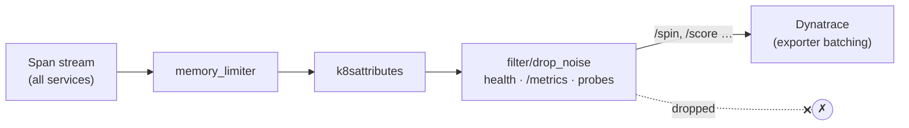

# Catalog B3 — Drop noise (filter processor)

!!! abstract "At a glance"
    **Theme:** metrics / collector · **Time:** 15 min · **Difficulty:** easy ·
    **Skill:** `otel-collector` ·
    **Reference:** `labs/advanced/catalog-b3-filter-drop-noise/`

**Goal:** health-check and `/metrics` scrape spans fire every few seconds on every
pod — pure volume with no diagnostic signal that inflates ingest cost and buries
the money-path traces. You will use `opencode` with the `otel-collector` skill to
add a `filter` processor to the gateway that drops them **before** export, then
verify the noise collapses while real `/spin` spans keep flowing. You run the
**Problem → Opencode → Verify** loop, driving the agent with a numbered prompt
**ladder** rather than one mega-prompt.

## The concept



The `filter` processor evaluates an **OTTL** condition per span: match a
health/scrape span and drop it here, so Dynatrace never ingests (or bills for) it.

## ① Problem — scrape noise drowns the signal

Every pod answers liveness/readiness probes (`/health`, `/healthz`, `/readyz`)
and a Prometheus scrape (`/metrics`) on a tight interval. Each becomes a span.
They carry **no diagnostic value** — but they dominate span volume, inflate
ingest cost, and make the trace list a wall of `/health`. Confirm it: run the
[checkpoint DQL](#verify) now — health/scrape spans are a large, steady share of
ingest.

## ② Understand the change

Add a `filter` processor to `observability/collectors/gateway.yaml`
(reference: `labs/advanced/catalog-b3-filter-drop-noise/filter-drop-noise-processor.yaml`)
and wire it onto the **traces** pipeline **after `k8sattributes`**:

```yaml
processors:
  filter/drop_noise:
    error_mode: ignore          # a span missing an attr => "no match", not an error
    traces:
      span:
        # DROP when ANY condition is true (OTTL):
        - 'attributes["http.route"] == "/health"'
        - 'attributes["http.route"] == "/healthz"'
        - 'attributes["http.route"] == "/readyz"'
        - 'attributes["http.route"] == "/metrics"'
        - 'IsMatch(attributes["url.path"], "^/(health|healthz|readyz|metrics)$")'
        - 'IsMatch(attributes["user_agent.original"], "^(kube-probe|Prometheus)/.*")'
service:
  pipelines:
    traces:
      processors: [memory_limiter, k8sattributes, filter/drop_noise]
```

!!! danger "Invariants still hold"
    `memory_limiter` stays **first** (it must sit ahead of anything that fans out
    work) and there is **no `batch` processor** (batching happens in the exporter, after every
    processor has run). The filter goes right after enrichment, so a
    dropped span never reaches the exporter. Only the traces pipeline changes; metrics and
    logs are untouched.

!!! note "Prefer `http.route` over `url.path`"
    `http.route` is the SDK-normalised, low-cardinality template (`/health`), so
    match on it when present. `url.path` is the raw request path — the regex
    fallback covers SDKs that only set that. Matching the **route** avoids
    accidentally dropping a real endpoint that merely contains "health" in a query
    string.

## ③ Drive opencode — the prompt ladder

Climb the ladder one rung at a time. After each rung, read what the agent did
before you let it continue.

=== "P1 · Orient (read-only)"

    ```text
    Using the otel-collector skill, read observability/collectors/gateway.yaml —
    do not edit. List the traces pipeline processors in order, and tell me where a
    filter processor that drops health-check and /metrics spans must go so the
    memory_limiter-first / no-batch-processor invariants still hold.
    ```
    **What you should see:** the agent names the traces pipeline order and places
    the filter after `k8sattributes`.
    **Review check:** it does not propose dropping spans at the app or downstream of the gateway.

=== "P2 · Core — add the filter"

    ```text
    Add a filter/drop_noise processor that DROPS spans whose http.route is
    /health, /healthz, /readyz or /metrics. Use error_mode: ignore. Wire it onto
    the traces pipeline after k8sattributes. Do not touch metrics or
    logs.
    ```
    **What you should see:** a `filter/drop_noise` block with `traces.span`
    conditions, added to the traces pipeline in the right position.
    **Review check:** `memory_limiter` first, no `batch` processor, filter placed after `k8sattributes`.

=== "P3 · Deepen — robust matching"

    ```text
    Make matching robust: add a url.path regex fallback for SDKs that only set the
    raw path, and drop spans whose user_agent.original starts with kube-probe/ or
    Prometheus/. Keep health-named real endpoints safe by preferring http.route.
    ```
    **What you should see:** `IsMatch` conditions on `url.path` and
    `user_agent.original` alongside the route checks.
    **Review check:** the conditions anchor the regex (`^…$`) so they don't match
    a real path that merely contains "health".

=== "P4 · Steer — prove no over-drop"

    ```text
    Confirm the filter drops ONLY noise: POST /spin and POST /score spans must
    still flow. Re-read the traces pipeline and confirm the invariant order, and
    that metrics/logs pipelines are unchanged.
    ```
    **What you should see:** the agent re-reads the service block and confirms
    `/spin` is unaffected and the order holds.
    **Review check:** no condition matches an operational endpoint; metrics/logs
    pipelines untouched.

## ④ Review & apply

Diff against the reference, then apply the collector:

```bash
kubectl apply -f observability/collectors/gateway.yaml
kubectl -n observability rollout status deploy/otel-gateway-collector
```

The k6 loadgen and the kubelet probes keep running, so both signal and noise
flow — you will see the noise drop within a minute.

## Verify

Run in a Grail **Notebook**, filtered to your cluster.

**Noise — health/scrape spans reaching Dynatrace** (collapses toward zero):

```dql
fetch spans, from: now() - 30m
| filter matchesPhrase(endpoint.name, "health") or matchesPhrase(endpoint.name, "metrics")
| summarize noise = count(), by: { bin(timestamp, 1m) }
```

**Signal — real operations still flow** (must stay non-zero — the over-drop guard):

```dql
fetch spans, from: now() - 30m
| filter endpoint.name == "POST /spin" or endpoint.name == "POST /score"
| summarize operations = count(), by: { bin(timestamp, 1m) }
```

- **Before:** `noise` is a large, steady band; it dwarfs the operational spans.
- **After:** `noise` drops to ~0 at the moment the collector rolls out, while
  `operations` is unchanged — you removed volume, not signal.

!!! warning "If the agent gets it wrong — steer it back"
    - **Drops a real endpoint** (`/spin` disappears): *"the filter must match only
      health/metrics/probe spans — anchor the regex and prefer http.route so
      operational endpoints are never dropped."*
    - **Breaks the invariant** (batch processor re-added, or memory_limiter not first):
      *"memory_limiter first, no batch processor (it is deprecated); the filter goes right after
      k8sattributes."*
    - **Edits the metrics or logs pipeline:** *"only the traces pipeline changes —
      leave metrics and logs untouched."*
    - **Omits `error_mode: ignore`** (spans missing the attr fail the condition instead of being skipped):
      *"set error_mode: ignore so a span without http.route evaluates as no-match
      instead of failing."*

## Definition of done

- [ ] `filter/drop_noise` processor drops `/health`, `/healthz`, `/readyz`, `/metrics` spans
- [ ] Wired on the **traces** pipeline after `k8sattributes`
- [ ] Invariants hold (memory_limiter first, no batch processor); metrics/logs untouched
- [ ] `noise` DQL collapses to ~0 after apply
- [ ] `operations` DQL (`/spin`, `/score`) is unchanged — no signal loss

Back to the [catalog menu](catalog.md).
