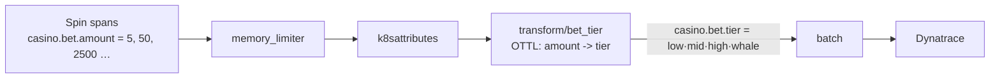

# Catalog B4 — Derive `casino.bet.tier` (OTTL enrichment)

!!! abstract "At a glance"
    **Theme:** metrics / collector · **Time:** 20 min · **Difficulty:** med ·
    **Skill:** `otel-collector` + `otel-ottl` ·
    **Reference:** `labs/advanced/catalog-b4-ottl-enrichment/`

**Goal:** the raw `casino.bet.amount` on each spin span is a continuous number —
high cardinality, useless as a group-by. You will use `opencode` with the
`otel-collector` and `otel-ottl` skills to add a `transform` processor that
derives a bounded `casino.bet.tier` bucket (`low`/`mid`/`high`/`whale`) **at the
gateway**, then verify the tier is present and genuinely low-cardinality. You run
the **Problem → Opencode → Verify** loop, driving the agent with a numbered prompt
**ladder** rather than one mega-prompt.

## The concept



The `transform` processor runs an **OTTL** statement per span: read the numeric
`casino.bet.amount` and `set` a `casino.bet.tier` bucket. Four values replace
thousands — now you can slice and alert on the tier cheaply.

## ① Problem — the bet amount is too granular to slice

`casino.bet.amount` is a raw number set on every `casino.slots.spin` span. Try to
group by it and you get one series per distinct wager — a cardinality explosion
with no analytical value. You cannot answer "what is the win-rate for **high
rollers**?" without a bounded bucket. Confirm it: run the
[cardinality DQL](#verify) now — `countDistinct(casino.bet.amount)` is large and
climbing, and `casino.bet.tier` does not exist yet.

## ② Understand the change

Add a `transform` processor to `observability/collectors/gateway.yaml`
(reference: `labs/advanced/catalog-b4-ottl-enrichment/ottl-bet-tier-processor.yaml`)
and wire it onto the **traces** pipeline **between `k8sattributes` and `batch`**:

```yaml
processors:
  transform/bet_tier:
    error_mode: ignore          # a span with no bet amount => skipped, not an error
    trace_statements:
      - context: span
        statements:
          # mutually-exclusive ranges => exactly one tier, order-independent
          - set(attributes["casino.bet.tier"], "low")   where attributes["casino.bet.amount"] != nil and Double(attributes["casino.bet.amount"]) < 10
          - set(attributes["casino.bet.tier"], "mid")   where attributes["casino.bet.amount"] != nil and Double(attributes["casino.bet.amount"]) >= 10 and Double(attributes["casino.bet.amount"]) < 100
          - set(attributes["casino.bet.tier"], "high")  where attributes["casino.bet.amount"] != nil and Double(attributes["casino.bet.amount"]) >= 100 and Double(attributes["casino.bet.amount"]) < 1000
          - set(attributes["casino.bet.tier"], "whale") where attributes["casino.bet.amount"] != nil and Double(attributes["casino.bet.amount"]) >= 1000
service:
  pipelines:
    traces:
      processors: [memory_limiter, k8sattributes, transform/bet_tier, batch]
```

!!! danger "Invariants still hold"
    `memory_limiter` stays **first** (it must sit ahead of anything that fans out
    work) and `batch` stays **last** (nothing enriches spans after they are
    batched for export). The transform slots **between** them — right after
    enrichment. Only the traces pipeline changes; metrics and logs are untouched.

!!! note "Why `Double()` and `!= nil`"
    `Double(...)` coerces the amount whether the SDK emitted an int or a double,
    so the thresholds compare cleanly. The `!= nil` guard means a bare server span
    that never settled a bet is simply skipped — it does not match any range and
    gets no tier. `error_mode: ignore` keeps such a span from erroring the batch.

## ③ Drive opencode — the prompt ladder

Climb the ladder one rung at a time. After each rung, read what the agent did
before you let it continue.

=== "P1 · Orient (read-only)"

    ```text
    Using the otel-collector skill, read observability/collectors/gateway.yaml —
    do not edit. List the traces pipeline processors in order, and confirm where a
    transform processor that derives an attribute from another attribute must go
    so the memory_limiter-first / batch-last invariants still hold.
    ```
    **What you should see:** the agent names the traces pipeline order and places
    the transform between `k8sattributes` and `batch`.
    **Review check:** it does not propose enriching in the app or after batch.

=== "P2 · Core — bucket the amount"

    ```text
    Using the otel-ottl skill, add a transform/bet_tier processor on the traces
    pipeline that sets casino.bet.tier from casino.bet.amount: low <10, mid 10–99,
    high 100–999, whale >=1000. Use error_mode: ignore. Wire it between
    k8sattributes and batch. Do not touch metrics or logs.
    ```
    **What you should see:** a `transform/bet_tier` block with four `set(... )
    where` statements, added to the traces pipeline in the right position.
    **Review check:** `memory_limiter` first, `batch` last, transform in between.

=== "P3 · Deepen — make it robust"

    ```text
    Make the buckets robust: guard each statement with casino.bet.amount != nil,
    coerce the value with Double() so int or double both compare correctly, and
    make the four ranges mutually exclusive so statement order cannot double-set a
    tier.
    ```
    **What you should see:** `Double(...)` coercion, `!= nil` guards, and
    non-overlapping ranges.
    **Review check:** no amount can match two ranges; a missing amount matches none.

=== "P4 · Steer — prove low cardinality"

    ```text
    Confirm casino.bet.tier is low-cardinality by design: it can only ever be one
    of low/mid/high/whale. Re-read the traces pipeline and confirm the invariant
    order and that metrics/logs pipelines are unchanged.
    ```
    **What you should see:** the agent re-reads the service block and confirms the
    tier is a closed set and the order holds.
    **Review check:** no raw amount leaks into the tier; metrics/logs untouched.

## ④ Review & apply

Diff against the reference, then apply the collector:

```bash
kubectl apply -f observability/collectors/gateway.yaml
kubectl -n observability rollout status deploy/otel-gateway-collector
```

The k6 loadgen keeps placing bets across all sizes, so every tier populates
within a minute.

## Verify

Run in a Grail **Notebook**, filtered to your cluster.

**Tier distribution — exactly the four buckets** (never a raw number):

```dql
fetch spans, from: now() - 30m
| filter isNotNull(casino.bet.tier)
| summarize spans = count(), by: { casino.bet.tier }
| sort spans desc
```

**Cardinality guard — tier stays tiny vs the amount it came from:**

```dql
fetch spans, from: now() - 30m
| summarize tiers = countDistinct(casino.bet.tier), amounts = countDistinct(casino.bet.amount)
```

**Payoff — slice the money-path by tier** (the thing the raw number could not do):

```dql
fetch spans, from: now() - 30m
| filter isNotNull(casino.bet.tier)
| summarize bets = count(), avg_payout = avg(toDouble(casino.payout.amount)), by: { casino.bet.tier }
```

- **Before:** `casino.bet.tier` does not exist; `countDistinct(casino.bet.amount)`
  is large and climbing.
- **After:** `tiers` is `<= 4` while `amounts` stays large — you collapsed a
  high-cardinality number into a bounded dimension you can group and alert on.

!!! warning "If the agent gets it wrong — steer it back"
    - **Writes the raw number into the tier** (`set(casino.bet.tier,
      casino.bet.amount)`): *"the tier must be a bounded string bucket, not the
      amount — set it to low/mid/high/whale from a range comparison."*
    - **Overlapping ranges double-set the tier:** *"make the four ranges mutually
      exclusive (e.g. 10–99, 100–999) so a value can match only one."*
    - **Breaks the invariant** (transform after batch, or memory_limiter not
      first): *"memory_limiter first, batch last; the transform goes between
      k8sattributes and batch."*
    - **Omits `error_mode: ignore`** (a span with no amount errors the batch):
      *"set error_mode: ignore and guard with casino.bet.amount != nil so bare
      spans are skipped, not failed."*

## Definition of done

- [ ] `transform/bet_tier` derives `casino.bet.tier` from `casino.bet.amount`
- [ ] Wired on the **traces** pipeline between `k8sattributes` and `batch`
- [ ] Invariants hold (memory_limiter first, batch last); metrics/logs untouched
- [ ] Tier DQL returns only `low`/`mid`/`high`/`whale`
- [ ] Cardinality guard: `tiers` stays `<= 4` while `amounts` is large

Back to the [catalog menu](catalog.md).
