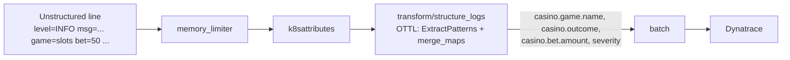

# Catalog B5 — Structure unstructured logs (OTTL)

!!! abstract "At a glance"
    **Theme:** metrics / collector · **Time:** 25 min · **Difficulty:** med ·
    **Skill:** `otel-collector` + `otel-ottl` ·
    **Reference:** `labs/advanced/catalog-b5-ottl-log-structuring/`

**Goal:** the slots service logs one opaque line per spin — Dynatrace stores it as
a single string you cannot filter, group, or classify. You will use `opencode`
with the `otel-collector` and `otel-ottl` skills to add a `transform` processor
that **parses** the line into typed `casino.*` attributes and lifts the level into
the real OTLP severity, then verify the fields are queryable. You run the
**Problem → Opencode → Verify** loop, driving the agent with a numbered prompt
**ladder** rather than one mega-prompt.

## The concept



`ExtractPatterns` runs a regex with named groups over the log `body`,
`merge_maps` folds the captured fields into attributes, and `set(severity_number,
…)` classifies the line — all in OTTL, at the gateway.

## ① Problem — the log is text, not data

The slots service emits:

```text
level=INFO msg="spin settled" game=slots bet=50 outcome=win payout=150
```

In Dynatrace this is one `content` string. You cannot answer "how many **jackpot**
log lines in the last hour?" or "show me only **ERROR** logs" — there are no
fields and no severity. Confirm it: run the [checkpoint DQL](#verify) now —
`casino.outcome` is null and `loglevel` is `NONE`/unknown.

## ② Understand the change

Add a `transform` processor to `observability/collectors/gateway.yaml`
(reference: `labs/advanced/catalog-b5-ottl-log-structuring/ottl-structure-logs-processor.yaml`)
and wire it onto the **logs** pipeline **between `k8sattributes` and `batch`**:

```yaml
processors:
  transform/structure_logs:
    error_mode: ignore          # a non-matching line passes through untouched
    log_statements:
      - context: log
        statements:
          # 1. extract the logfmt fields into temp keys (only if it's a spin line)
          - merge_maps(attributes, ExtractPatterns(body, "level=(?P<lvl>\\w+)\\s+msg=\"(?P<msg>[^\"]*)\"\\s+game=(?P<game>\\S+)\\s+bet=(?P<bet>\\d+)\\s+outcome=(?P<outcome>\\S+)\\s+payout=(?P<payout>\\d+)"), "insert") where IsString(body) and IsMatch(body, "game=\\S+")
          # 2. promote to casino.* semconv keys, typed
          - set(attributes["casino.game.name"], attributes["game"])      where attributes["game"] != nil
          - set(attributes["casino.outcome"], attributes["outcome"])     where attributes["outcome"] != nil
          - set(attributes["casino.bet.amount"], Int(attributes["bet"]))    where attributes["bet"] != nil
          - set(attributes["casino.payout.amount"], Int(attributes["payout"])) where attributes["payout"] != nil
          # 3. lift the level into OTLP severity so Dynatrace classifies it
          - set(severity_text, attributes["lvl"]) where attributes["lvl"] != nil
          - set(severity_number, SEVERITY_NUMBER_INFO)  where attributes["lvl"] == "INFO"
          - set(severity_number, SEVERITY_NUMBER_WARN)  where attributes["lvl"] == "WARN"
          - set(severity_number, SEVERITY_NUMBER_ERROR) where attributes["lvl"] == "ERROR"
          # 4. clean up: body := message, drop temp keys
          - set(body, attributes["msg"]) where attributes["msg"] != nil
          - delete_key(attributes, "lvl")
          - delete_key(attributes, "msg")
          - delete_key(attributes, "game")
          - delete_key(attributes, "bet")
          - delete_key(attributes, "outcome")
          - delete_key(attributes, "payout")
service:
  pipelines:
    logs:
      processors: [memory_limiter, k8sattributes, transform/structure_logs, batch]
```

!!! danger "Invariants still hold"
    `memory_limiter` stays **first** and `batch` stays **last**. The transform
    slots **between** them on the **logs** pipeline only — traces and metrics are
    untouched.

!!! note "Named groups can't contain dots"
    Go RE2 capture-group names must be identifiers (`lvl`, `game`) — no dots. So
    you extract into **temp** keys, then `set` the dotted `casino.*` semantic keys
    from them and `delete_key` the temps. `Int(...)` types the numeric fields so
    DQL can `avg()`/`sum()` them.

!!! warning "Parse, don't drop"
    `error_mode: ignore` plus the `IsMatch(body, "game=…")` guard means a line
    that is **not** a casino spin record (JSON, a banner, a stack trace) does not
    match the regex and is passed through **unchanged**. Structuring must never
    silently discard logs it does not recognise.

## ③ Drive opencode — the prompt ladder

Climb the ladder one rung at a time. After each rung, read what the agent did
before you let it continue.

=== "P1 · Orient (read-only)"

    ```text
    Using the otel-collector skill, read observability/collectors/gateway.yaml —
    do not edit. List the logs pipeline processors in order and tell me where a
    transform processor that parses the log body must go so the
    memory_limiter-first / batch-last invariants still hold.
    ```
    **What you should see:** the agent names the logs pipeline order and places the
    transform between `k8sattributes` and `batch`.
    **Review check:** it targets the logs pipeline, not traces or metrics.

=== "P2 · Core — extract the fields"

    ```text
    Using the otel-ottl skill, add a transform/structure_logs processor on the
    logs pipeline. From a body like
    'level=INFO msg="spin settled" game=slots bet=50 outcome=win payout=150',
    use ExtractPatterns + merge_maps to capture level, msg, game, bet, outcome,
    payout into attributes. Use error_mode: ignore and only match lines containing
    game=. Wire it between k8sattributes and batch.
    ```
    **What you should see:** an `ExtractPatterns(body, …)` with named groups folded
    in via `merge_maps`, added in the right pipeline position.
    **Review check:** `memory_limiter` first, `batch` last, transform in between.

=== "P3 · Deepen — type + classify + rename"

    ```text
    Promote the captured fields to semantic-convention keys: casino.game.name,
    casino.outcome, casino.bet.amount (Int), casino.payout.amount (Int). Lift level
    into severity_text and severity_number (INFO/WARN/ERROR). Set body to the msg
    and delete the temporary extraction keys.
    ```
    **What you should see:** `set(attributes["casino.*"], …)`, `set(severity_number,
    SEVERITY_NUMBER_*)`, and `delete_key` for the temp keys.
    **Review check:** numeric fields use `Int(...)`; the dotted keys are set from
    the temp keys, then the temps are removed.

=== "P4 · Steer — don't drop non-matching lines"

    ```text
    Confirm non-casino log lines (JSON, a startup banner, a stack trace) pass
    through unchanged — the transform must only structure lines it recognises and
    never drop a log. Re-read the logs pipeline and confirm the invariant order and
    that traces/metrics are unchanged.
    ```
    **What you should see:** the agent explains the `IsMatch` guard + `error_mode:
    ignore` behaviour and confirms the order.
    **Review check:** no statement deletes/filters a whole log record; traces and
    metrics pipelines untouched.

## ④ Review & apply

Diff against the reference, then apply the collector:

```bash
kubectl apply -f observability/collectors/gateway.yaml
kubectl -n observability rollout status deploy/otel-gateway-collector
```

The slots service keeps logging every spin, so structured lines appear within a
minute.

## Verify

Run in a Grail **Notebook**, filtered to your cluster.

**Fields are queryable — group by a parsed attribute:**

```dql
fetch logs, from: now() - 30m
| filter isNotNull(casino.outcome)
| summarize lines = count(), by: { casino.game.name, casino.outcome }
| sort lines desc
```

**Severity was lifted — the log is now classified:**

```dql
fetch logs, from: now() - 30m
| filter isNotNull(casino.outcome)
| summarize lines = count(), by: { loglevel }
```

**Pass-through guard — non-casino lines still arrive** (nothing was dropped):

```dql
fetch logs, from: now() - 30m
| filter k8s.namespace.name == "casino" and isNull(casino.outcome)
| summarize passthrough = count()
```

- **Before:** `casino.outcome` is null, `loglevel` is unknown/`NONE`, the line is
  one opaque string.
- **After:** the spin lines carry typed `casino.*` attributes and a real
  `loglevel`; `passthrough` is still non-zero — unrecognised lines were kept, not
  dropped.

!!! warning "If the agent gets it wrong — steer it back"
    - **Drops non-matching lines:** *"structuring must never discard logs — use
      error_mode: ignore and an IsMatch guard so unrecognised lines pass through
      unchanged."*
    - **Leaves fields as strings** (`payout` can't be summed): *"wrap the numeric
      captures in Int() so DQL can do math on casino.bet.amount / payout."*
    - **Keeps the ugly temp keys** (`game`, `bet` leak to Dynatrace): *"set the
      dotted casino.* keys from the temps, then delete_key the temporary extraction
      keys."*
    - **Breaks the invariant** (transform after batch, or memory_limiter not
      first): *"memory_limiter first, batch last; the transform goes between
      k8sattributes and batch on the logs pipeline."*

## Definition of done

- [ ] `transform/structure_logs` parses the body into `casino.*` attributes
- [ ] Numeric fields are typed with `Int(...)`; level lifted into severity
- [ ] Wired on the **logs** pipeline between `k8sattributes` and `batch`
- [ ] Invariants hold (memory_limiter first, batch last); traces/metrics untouched
- [ ] Field DQL groups by `casino.outcome`; `loglevel` is populated
- [ ] Pass-through guard non-zero — unrecognised lines were not dropped

Back to the [catalog menu](catalog.md).
