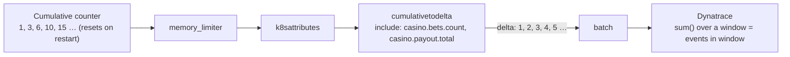

# Catalog B6 — Metric temporality (`cumulativetodelta`)

!!! abstract "At a glance"
    **Theme:** metrics / collector · **Time:** 20 min · **Difficulty:** med ·
    **Skill:** `otel-collector` ·
    **Reference:** `labs/advanced/catalog-b6-cumulativetodelta/`

**Goal:** the gateway already carries `cumulativetodelta: {}` — but empty, it
converts everything blindly and keeps state forever. You will use `opencode` with
the `otel-collector` skill to make it **explicit and targeted**, understand *why*
delta temporality is the right shape for Dynatrace, and verify the casino counters
read as a clean per-minute rate. You run the **Problem → Opencode → Verify** loop,
driving the agent with a numbered prompt **ladder** rather than one mega-prompt.

## The concept



**Temporality** is what a counter point *means*:

| | Cumulative | Delta |
|---|---|---|
| A point means | running total since process start | count **in that interval** |
| Series | `1, 3, 6, 10, 15 …` | `1, 2, 3, 4, 5 …` |
| On restart | resets to 0 → **false drop** | unaffected |
| `sum()` over a window | double-counts (meaningless) | **events in that window** |

Dynatrace does rate math natively on **delta** counters, so bets/min, payout/min,
and SLO burn come straight from `sum()` — no restart artefacts, no `rate()`
gymnastics.

## ① Problem — cumulative counters don't answer "per minute"

Most SDKs export counters as **cumulative** — an ever-climbing total. Ask "how
many bets in the last minute?" and a cumulative series can't tell you cheaply:
you'd have to subtract adjacent points, and a pod restart drops the line to 0,
producing a false negative rate. And the current `cumulativetodelta: {}` is
**empty** — it converts every sum blindly (including ones that shouldn't be) and
never bounds its state. Confirm it: run the [checkpoint DQL](#verify) now on the
raw counter — it's a staircase, and a restart shows a cliff.

## ② Understand the change

Replace the empty processor in `observability/collectors/gateway.yaml`
(reference: `labs/advanced/catalog-b6-cumulativetodelta/cumulativetodelta-processor.yaml`)
with an **explicit, targeted** config. The pipeline **position does not change** —
only the processor body:

```yaml
processors:
  cumulativetodelta:
    include:
      metrics: [casino.bets.count, casino.payout.total]
      match_type: strict        # exact names; `regexp` for a family prefix
    max_staleness: 10m          # forget a series that stops reporting
    initial_value: auto         # first point = baseline, emits nothing
service:
  pipelines:
    metrics:
      processors: [memory_limiter, k8sattributes, cumulativetodelta, batch]
```

!!! danger "Invariants still hold"
    `memory_limiter` stays **first** and `batch` stays **last**. The position of
    `cumulativetodelta` is unchanged — only its body goes from `{}` to the targeted
    config. The processor supports the **metrics** signal only; it must not be
    added to the traces or logs pipeline (that fails validation).

!!! note "Why `include` instead of converting everything"
    An empty config converts **every** cumulative sum. That's wrong for two
    reasons: converting a **gauge** is nonsensical, and converting a
    **non-monotonic** sum can emit **negative** deltas. Naming the two monotonic
    casino counters with `match_type: strict` keeps the conversion correct and
    intentional. `max_staleness` stops a long-gone series from producing a huge
    false delta when it comes back.

## ③ Drive opencode — the prompt ladder

Climb the ladder one rung at a time. After each rung, read what the agent did
before you let it continue.

=== "P1 · Orient (read-only)"

    ```text
    Using the otel-collector skill, read observability/collectors/gateway.yaml —
    do not edit. Show me the current cumulativetodelta config and its position in
    the metrics pipeline, and explain what an empty `cumulativetodelta: {}`
    converts.
    ```
    **What you should see:** the agent reports the empty `{}` between
    `k8sattributes` and `batch` and explains it converts all cumulative sums.
    **Review check:** it confirms the processor is metrics-only.

=== "P2 · Core — target the casino counters"

    ```text
    Make it explicit: convert only casino.bets.count and casino.payout.total, using
    include.metrics with match_type: strict. Keep the processor in the same
    position on the metrics pipeline. Do not add it to traces or logs.
    ```
    **What you should see:** an `include.metrics` list with the two counters and
    `match_type: strict`; position unchanged.
    **Review check:** `memory_limiter` first, `batch` last; metrics pipeline only.

=== "P3 · Deepen — bound the state"

    ```text
    Add max_staleness: 10m so a series that stops reporting is forgotten instead of
    held forever, and initial_value: auto so the first point sets the baseline and
    emits nothing. Explain in a comment why converting a gauge or a non-monotonic
    sum would be wrong.
    ```
    **What you should see:** `max_staleness` and `initial_value` set, with a comment
    on why `include` is scoped to monotonic counters.
    **Review check:** the agent can articulate cumulative vs delta and the restart
    behaviour.

=== "P4 · Steer — confirm metrics-only + temporality"

    ```text
    Confirm cumulativetodelta is on the metrics pipeline ONLY and that traces/logs
    are unchanged. In one sentence, state why Dynatrace prefers delta counters for
    rate and SLO math.
    ```
    **What you should see:** the agent confirms the signal scope and states the
    delta rationale (sum over a window = events in that window; restart-safe).
    **Review check:** nothing was added to traces/logs; the invariant order holds.

## ④ Review & apply

Diff against the reference, then apply the collector:

```bash
kubectl apply -f observability/collectors/gateway.yaml
kubectl -n observability rollout status deploy/otel-gateway-collector
```

The k6 loadgen keeps placing bets, so the delta counters populate within a minute.

## Verify

Run in a Grail **Notebook**, filtered to your cluster.

**Bets per minute — each bucket is the delta for that minute:**

```dql
timeseries bets = sum(casino.bets.count), from: now() - 1h, interval: 1m
```

**Payout per minute — same, on the money counter:**

```dql
timeseries payout = sum(casino.payout.total), from: now() - 1h, interval: 1m
```

- **Cumulative (before):** the raw series is an ever-climbing staircase; a pod
  restart drops it to 0 — a false rate dip.
- **Delta (after):** each 1-minute bucket is the bets/payout **in that minute** —
  a stable rate you can chart, alert, and feed an SLO, with no restart cliff.

!!! warning "If the agent gets it wrong — steer it back"
    - **Leaves it empty / converts everything:** *"scope it with include.metrics to
      casino.bets.count and casino.payout.total — converting gauges or
      non-monotonic sums is wrong."*
    - **Adds it to traces or logs:** *"cumulativetodelta is metrics-only; it must
      not appear on the traces or logs pipeline."*
    - **Breaks the invariant** (moves it after batch, or memory_limiter not first):
      *"memory_limiter first, batch last; cumulativetodelta stays between
      k8sattributes and batch."*
    - **Drops `max_staleness`** (stale series holds forever): *"add max_staleness:
      10m so a series that stops reporting is forgotten, not replayed as a huge
      delta."*

## Definition of done

- [ ] `cumulativetodelta` is explicit — `include.metrics` names the two counters
- [ ] `max_staleness` + `initial_value` set; `match_type: strict`
- [ ] On the **metrics** pipeline only, between `k8sattributes` and `batch`
- [ ] Invariants hold (memory_limiter first, batch last); traces/logs untouched
- [ ] Per-minute `sum()` DQL reads as a clean rate (not a cumulative staircase)

Back to the [catalog menu](catalog.md).
