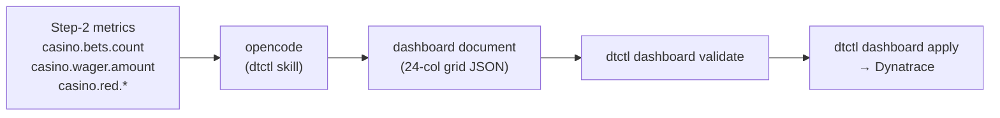

# Catalog C1 — Build a Dynatrace dashboard via dtctl

!!! abstract "At a glance"
    **Theme:** Dynatrace automation · **Time:** 20 min · **Difficulty:** medium ·
    **Skill:** `dtctl` ·
    **Reference:** `labs/advanced/catalog-c1-dtctl-dashboard/`

**Goal:** turn the business metrics you built in
[Step 2](step-2-business-metrics.md) (and the [Catalog B1](catalog-b1-spanmetrics.md)
RED metrics) into a **live Dynatrace dashboard — as code**. You drive `opencode`
with the `dtctl` skill through a prompt **ladder**; no clicking in the UI.

## The concept



## ① Problem — the metrics exist, but no one is watching them

After Step 2 and B1 the casino emits first-class business and RED metrics, but
there is **no dashboard** — nobody can see bets-per-minute, wager p90, or error
rate at a glance. A dashboard clicked together in the UI is invisible to review
and impossible to reproduce per attendee. You want it as a **document applied
with `dtctl`**: version controlled, diffable, deployed from the same codespace.

## ② Understand the change

You produce a dashboard **document** (reference:
`labs/advanced/catalog-c1-dtctl-dashboard/casino-business-dashboard.json`) on a
**24-column grid**, with tiles built on DQL over your metrics, and deploy it with
`dtctl` — which **validates schema and DQL before anything ships** (fail-closed).
This mirrors the mandatory **dt-app-dashboards** discipline: define purpose →
explore the data → validate DQL → construct the JSON → deploy.

| Tile | DQL | Reads |
|---|---|---|
| Bets per minute by outcome | `timeseries sum(casino.bets.count), by:{casino.outcome}` | Step 2 counter |
| Wager p90 by game | `timeseries percentile(casino.wager.amount, 90), by:{casino.game.name}` | Step 2 histogram |
| RED — call rate | `timeseries sum(casino.red.calls), by:{span.name, status.code}` | B1 spanmetrics |
| RED — p90 duration | `timeseries percentile(casino.red.duration, 90), by:{span.name}` | B1 spanmetrics |

`dtctl` authenticates with the platform token already in your codespace
(ISI-7175) — no extra secret.

## ③ Drive opencode — the prompt ladder

=== "P1 · Orient (read-only)"

    ```text
    Using the dtctl skill, list the metrics available to me that match
    casino.bets.*, casino.wager.* and casino.red.* — and show the DQL you would
    use to chart each. Do not create a dashboard yet.
    ```
    **What you should see:** the agent runs `dtctl` to confirm the metrics exist and
    drafts one `timeseries` query per tile.
    **Review check:** every query references a metric that actually returns data.

=== "P2 · Core — build the document"

    ```text
    Create a dashboard document on a 24-column grid with four tiles: bets per
    minute by casino.outcome, wager p90 by casino.game.name, RED call rate by
    span.name and status.code, and RED p90 duration by span.name. Use the DQL
    from P1.
    ```
    **What you should see:** a JSON document with `tiles` + `layouts` on a 24-wide
    grid.
    **Review check:** tiles do not overlap and fit within 24 columns.

=== "P3 · Deepen — header + single value"

    ```text
    Add a markdown header tile across the top and a single-value tile for total
    wagered in the last hour. Name the dashboard after my PARTICIPANT_ID.
    ```
    **What you should see:** a markdown tile at row 0 and a `singleValue` tile.
    **Review check:** the dashboard name includes the participant id.

=== "P4 · Steer — validate then deploy"

    ```text
    Validate the document with dtctl before deploying, and only apply it if
    validation passes. Show me the validation output.
    ```
    **What you should see:** `dtctl dashboard validate` runs clean, then
    `dtctl dashboard apply` deploys.
    **Review check:** the agent refuses to apply if validation fails.

## ④ Review & apply

Diff against the reference document, then deploy (the manual equivalent of what
opencode runs):

```bash
bash labs/advanced/catalog-c1-dtctl-dashboard/dtctl-apply.sh
```

## Verify

- Open **Dynatrace → Dashboards** and find `${PARTICIPANT_ID}-business-overview`.
- Each tile renders data: bets-by-outcome trends, a wager-p90 bar per game, the
  RED call-rate and duration charts.
- Re-run `dtctl dashboard validate --file …` — it exits 0 (schema + DQL valid).

Confirm the queries resolve directly in a Notebook:

```dql
timeseries bets = sum(casino.bets.count), by: { casino.outcome }, from: now() - 1h
```

- **Before:** no dashboard — the operator view does not exist.
- **After:** a versioned, reproducible dashboard renders the casino's business and
  RED health, deployed entirely from code.

!!! warning "If the agent gets it wrong — steer it back"
    - **Applies without validating:** *"always run dtctl dashboard validate first
      and only apply if it passes."*
    - **Invents metric or field names:** *"only use metrics that P1 confirmed
      return data — do not guess field names."*
    - **Tiles overflow the grid:** *"the grid is 24 columns wide; keep tile x + w ≤
      24 and avoid overlaps."*
    - **Hardcodes a tenant or token:** *"dtctl uses the platform token in the
      environment — do not embed credentials in the document."*

## Definition of done

- [ ] Dashboard document built on the 24-column grid from Step-2 + B1 metrics
- [ ] All DQL validated (`dtctl dashboard validate` exits 0)
- [ ] Deployed with `dtctl dashboard apply`, named after `PARTICIPANT_ID`
- [ ] Every tile renders data in Dynatrace
- [ ] No credentials embedded in the document

Back to the [catalog menu](catalog.md).
