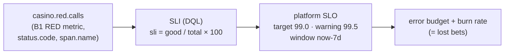

# Catalog C2 — Define a reliability SLO via dtctl

!!! abstract "At a glance"
    **Theme:** Dynatrace automation · **Time:** 20 min · **Difficulty:** medium ·
    **Skill:** `dtctl` ·
    **Reference:** `labs/advanced/catalog-c2-slo/`

**Goal:** turn one of the money-path metrics into a **commitment with a budget**.
The [C1 dashboard](catalog-c1-dtctl-dashboard.md) shows you *what the numbers
are*; an **SLO** picks one number — availability — and says "99% of
bet-processing requests succeed over 7 days", then gives you an **error budget**
and a **burn rate**. You build it as a `dtctl` document from the
[Step 2](step-2-business-metrics.md) / [B1](catalog-b1-spanmetrics.md) metrics —
no clicking in the SLO app.

## The concept



## ① Problem — the dashboard shows health, but nothing commits to it

After [C1](catalog-c1-dtctl-dashboard.md) you can *see* the money-path's call
rate and error rate on a dashboard, but nothing says **how good is good
enough**. There is no target, no error budget, and no way to answer "are we
burning reliability faster than we can afford?". A number without a budget is a
vanity metric — you need an **SLO**.

## ② Understand the change

You produce an **SLO document** (reference:
`labs/advanced/catalog-c2-slo/casino-availability-slo.yaml`) — a Grail-native
platform SLO that `dtctl` manages as the `slo` resource. Its **SLI** is a DQL
`customSli.indicator` that MUST return a field named **`sli`** (an array of
doubles): the availability percentage per bucket. The **criteria** set the
window (`now-7d`), the **target** (99.0, the line you commit to) and the
**warning** (99.5, which sits *above* target for availability — the "burning
fast" line).

The SLI is **keyed on the money-path metrics you already emit** — the B1
`casino.red.calls` RED metric, which carries the same `span.name ==
"casino.slots.spin"` and `casino.*` vocabulary as the Step-2 business metrics:

| Part | DQL | Means |
|---|---|---|
| total | `sum(casino.red.calls)` | every bet-processing request on the money-path |
| good | `sum(casino.red.calls, filter: { status.code != "ERROR" })` | the ones that did not error |
| sli | `(good[] / total[]) * 100` | availability % — the reliability face of `casino.bets.count` |

Every errored call is a **bet that never settled**, so this error budget is
denominated in *lost bets* — the SLO speaks the business's language. A platform
SLO accepts **exactly one** of `customSli` or `sliReference`; this uses
`customSli`. `dtctl` authenticates with the platform token already in your
codespace (ISI-7175) — no extra secret.

## ③ Drive opencode — the prompt ladder

=== "P1 · Orient (read-only)"

    ```text
    Using the dtctl skill, show me the DQL you would use to compute a
    money-path availability SLI from casino.red.calls: good (status.code not
    ERROR) over total, filtered to span.name casino.slots.spin, as a field
    named sli. Confirm the metric returns data. Do not create an SLO yet.
    ```
    **What you should see:** the agent runs `dtctl query` to confirm
    `casino.red.calls` returns data and drafts an indicator that ends in
    `fieldsAdd sli = …`.
    **Review check:** the indicator produces a field literally named `sli`.

=== "P2 · Core — build the SLO document"

    ```text
    Create a platform SLO document with a customSli whose indicator is the DQL
    from P1, and a 7-day criteria: target 99.0, warning 99.5. Name it after my
    PARTICIPANT_ID. Tag it casino, money-path, training.
    ```
    **What you should see:** a YAML/JSON SLO with `customSli.indicator`,
    `criteria`, `name`, and `tags`.
    **Review check:** exactly one of `customSli` / `sliReference` is present (not
    both, not neither).

=== "P3 · Deepen — validate the budget math"

    ```text
    Before applying, run the SLI DQL for the last 7 days and compute the
    achieved availability and how much of the 1% error budget is already spent.
    Show me the numbers.
    ```
    **What you should see:** an achieved availability (e.g. 99.4%) and an
    error-budget-spent figure derived from the same query.
    **Review check:** the budget is `(1 - target/100)` of total — the agent does
    not invent a different denominator.

=== "P4 · Steer — validate then create"

    ```text
    Validate with `dtctl create slo -f <file> --dry-run` first, and only create
    with `dtctl create slo -f <file>` if the dry-run passes. Show me the dry-run
    output.
    ```
    **What you should see:** `dtctl create slo … --dry-run` runs clean
    (fail-closed on a bad schema or indicator DQL), then the real create.
    **Review check:** the agent uses `dtctl create slo -f` / `dtctl apply -f`
    (kubectl-style) — not a non-existent `dtctl slo create` verb — and refuses to
    create if the dry-run fails.

## ④ Review & apply

Diff against the reference document, then create (the manual equivalent of what
opencode runs):

```bash
bash labs/advanced/catalog-c2-slo/dtctl-apply.sh
```

## Verify

Confirm the SLI resolves directly in a Notebook, and read the achieved
availability + remaining error budget:

```dql
timeseries {
  total = sum(casino.red.calls),
  good  = sum(casino.red.calls, filter: { status.code != "ERROR" })
},
filter: { span.name == "casino.slots.spin" }, from: now() - 7d
| fieldsAdd sli = (good[] / total[]) * 100
| summarize availability = avg(arrayAvg(sli))
| fieldsAdd budget_spent_pct = (100 - availability) / (100 - 99.0) * 100
```

- Open **Dynatrace → SLOs** and find `${PARTICIPANT_ID}-money-path-availability`;
  the 7-day status, error budget, and burn render.
- `dtctl get slos --filter "name~'${PARTICIPANT_ID}'"` lists it.
- **Before:** a dashboard number with no target or budget.
- **After:** a versioned SLO with a 99% target, a 1% error budget, and a burn
  rate — the money-path now has a reliability contract.

!!! warning "If the agent gets it wrong — steer it back"
    - **Indicator has no `sli` field:** *"the customSli indicator must end in a
      field named `sli` (array of doubles) — that is what the SLO evaluates."*
    - **Supplies both customSli and sliReference:** *"a platform SLO takes exactly
      one of customSli or sliReference — use customSli only."*
    - **Reaches for a `dtctl slo create` verb:** *"dtctl is kubectl-style — use
      `dtctl create slo -f <file>` or `dtctl apply -f <file>`."*
    - **Warning below target:** *"for availability the warning line sits ABOVE the
      target (99.5 > 99.0) — it warns before you breach."*
    - **Applies without validating:** *"always run `--dry-run` first and only
      create if it passes."*

## Definition of done

- [ ] SLO document built with a `customSli` DQL indicator that yields `sli`
- [ ] `criteria`: 7-day window, target 99.0, warning 99.5
- [ ] Validated (`dtctl create slo -f … --dry-run` exits 0), then created
- [ ] SLO `name` includes `PARTICIPANT_ID`; tags applied
- [ ] Achieved availability + error budget read back via DQL

Back to the [catalog menu](catalog.md).
