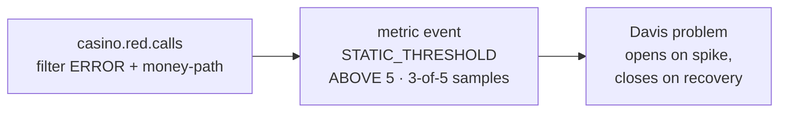

# Catalog C3 — Metric event / Davis alert via dtctl

!!! abstract "At a glance"
    **Theme:** Dynatrace automation · **Time:** 20 min · **Difficulty:** medium ·
    **Skill:** `dtctl` ·
    **Reference:** `labs/advanced/catalog-c3-metric-davis-alert/`

**Goal:** put a **Davis alert** on the casino money-path — a metric event that
samples the error count every minute and raises a **Davis problem** the moment
it spikes — then **prove it fires** by breaking the money-path in a controlled
scenario. The [C2 SLO](catalog-c2-slo.md) tracks the slow reliability budget;
this is the fast page-me-now signal, built as a `dtctl` document.

## The concept



## ① Problem — the SLO burns slowly; a spike needs a page now

The [C2 SLO](catalog-c2-slo.md) tells you *over 7 days* whether you are meeting
99% — but if the money-path starts erroring **right now**, the SLO budget drains
quietly and no one is paged until it is nearly gone. You need a signal that
fires **within minutes** of an error spike and opens a Davis problem. That is a
**metric event**.

## ② Understand the change

You produce a **Settings 2.0 object** (reference:
`labs/advanced/catalog-c3-metric-davis-alert/casino-error-rate-metric-event.yaml`)
on schema `builtin:anomaly-detection.metric-events`, scope `environment`, which
`dtctl` manages as a `settings` resource. A metric event watches **one metric
selector**, so you alert on the money-path **error count per minute** (a rate) —
the good/total *ratio* is what the C2 error budget already tracks.

| Field | Value | Means |
|---|---|---|
| `queryDefinition.metricSelector` | `casino.red.calls:filter(and(eq("span.name","casino.slots.spin"),eq("status.code","ERROR"))):splitBy():sum:rollup(avg)` | error count on the money-path |
| `modelProperties.type` | `STATIC_THRESHOLD` | fixed line (vs. an auto-adaptive baseline) |
| `alertCondition` / `threshold` | `ABOVE` / `5` | fire above 5 errors/min |
| `samples` / `violatingSamples` | `5` / `3` | 3 bad minutes in a 5-minute window |
| `eventTemplate.eventType` | `ERROR` | raises an error-class Davis problem |

`dtctl` authenticates with the platform token already in your codespace
(ISI-7175) — no extra secret.

!!! note "Validate the selector before you apply (C1 discipline)"
    Confirm the selector returns data (`dtctl query` / Data Explorer) and the
    exact field set for your tenant's schema version with
    `dtctl get settings-schema builtin:anomaly-detection.metric-events`. The
    `status.code` error value may be `ERROR` or `STATUS_CODE_ERROR`, and the
    selector's transformation suffix may differ by how the OTLP spanmetrics
    counter is ingested — do not guess, check.

## ③ Drive opencode — the prompt ladder

=== "P1 · Orient (read-only)"

    ```text
    Using the dtctl skill, show me the metric selector for the money-path error
    count: casino.red.calls filtered to span.name casino.slots.spin and
    status.code ERROR, summed. Confirm it returns data with dtctl query. Also
    show me the fields of the builtin:anomaly-detection.metric-events schema. Do
    not create anything yet.
    ```
    **What you should see:** the agent runs `dtctl query` and
    `dtctl get settings-schema …` to ground both the selector and the field set.
    **Review check:** the selector resolves to real data; the schema is fetched,
    not guessed.

=== "P2 · Core — build the metric event"

    ```text
    Create a builtin:anomaly-detection.metric-events value: a STATIC_THRESHOLD
    on that selector, alertCondition ABOVE, threshold 5, 3 violating samples of
    5, alertingOnMissingData false, eventType ERROR, davisMerge true, with a
    clear title and summary.
    ```
    **What you should see:** a settings `value` body with `queryDefinition`,
    `modelProperties`, and `eventTemplate`.
    **Review check:** `alertCondition: ABOVE` and the threshold/sample fields
    match the schema fetched in P1.

=== "P3 · Deepen — tune the window"

    ```text
    Explain the trade-off between samples/violatingSamples and alert latency vs.
    false positives, and set a window that fires within ~3 minutes of a real
    spike but ignores a single blip.
    ```
    **What you should see:** reasoning about the sliding window; `violatingSamples`
    < `samples` and both small.
    **Review check:** the agent does not set `violatingSamples > samples` (which
    can never fire).

=== "P4 · Steer — validate, create, then prove it fires"

    ```text
    Validate with `dtctl create settings … --dry-run`, then create with
    --schema builtin:anomaly-detection.metric-events --scope environment. Then
    induce money-path errors by scaling vegas-casino-scoring to 0, watch for the
    Davis problem, and scale it back to 1.
    ```
    **What you should see:** the dry-run passes, the object is created, a Davis
    problem opens during the outage and closes after recovery.
    **Review check:** the agent uses `dtctl create settings … --schema … --scope
    …` (kubectl-style) and reverts the controlled scenario.

## ④ Review & apply

Diff against the reference, then create and print the controlled-scenario
commands:

```bash
bash labs/advanced/catalog-c3-metric-davis-alert/dtctl-apply.sh
```

## Verify

Prove the alert fires, then auto-closes:

```bash
kubectl -n casino scale deploy/vegas-casino-scoring --replicas=0   # induce errors
# ...wait violatingSamples minutes; Dynatrace > Problems shows the Davis problem...
kubectl -n casino scale deploy/vegas-casino-scoring --replicas=1   # recover
```

Confirm the error count the alert watches with DQL:

```dql
timeseries errors = sum(casino.red.calls, filter: { status.code == "ERROR" }),
  filter: { span.name == "casino.slots.spin" }, from: now() - 30m, interval: 1m
```

The errors surface as **ERROR spans** on the money-path (strongest once the
[A4 exercise](catalog-a4-exceptions-span-events.md)'s exception/ERROR-status
recording is in place — the exercise that stops a failing money-path from
looking green).

- `dtctl get settings --schema builtin:anomaly-detection.metric-events` lists the
  alert.
- **Before:** errors drain the SLO budget silently; no page.
- **After:** a Davis problem opens within the violating window and auto-closes
  after recovery — a real alert, proven to fire.

!!! warning "If the agent gets it wrong — steer it back"
    - **Invents the schema fields:** *"fetch
      `dtctl get settings-schema builtin:anomaly-detection.metric-events` and use
      its field names — do not guess."*
    - **Uses an unresolved selector:** *"confirm the metric selector returns data
      with `dtctl query` before building the event."*
    - **`violatingSamples` > `samples`:** *"violatingSamples must be ≤ samples or
      the event can never fire."*
    - **Forgets the controlled scenario:** *"prove it fires — scale
      vegas-casino-scoring to 0, watch Problems, then scale back to 1."*
    - **Alerts on missing data by accident:** *"set alertingOnMissingData false —
      a series that stops reporting is the SLO's concern, not this spike alert."*

## Definition of done

- [ ] Metric event on `builtin:anomaly-detection.metric-events`, scope environment
- [ ] `STATIC_THRESHOLD`, `ABOVE`, threshold 5, 3-of-5 violating samples
- [ ] Selector grounded (`dtctl query` returns data; schema fetched, not guessed)
- [ ] Validated (`--dry-run` exits 0), then created
- [ ] Proven to fire: Davis problem opens on the induced outage and auto-closes

Back to the [catalog menu](catalog.md).
