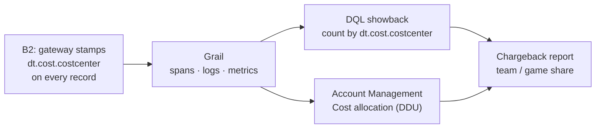

# Catalog C4 — Attribute ingest to cost centers in Dynatrace

!!! abstract "At a glance"
    **Theme:** Dynatrace automation · **Time:** 20 min · **Difficulty:** med ·
    **Skill:** `dtctl` + `dt-app-dashboards` ·
    **Reference:** `labs/advanced/catalog-c4-dynatrace-cost-center/`

**Goal:** turn the cost-center tag [Catalog B2](catalog-b2-cost-center.md) stamped at
the gateway into **showback / chargeback** — allocate observability ingest back to
the team or game that drove it. You will drive `opencode` (`dtctl`, and the
`dt-app-dashboards` skill for the optional dashboard) to build DQL that groups ingest
by `dt.cost.costcenter` and, optionally, a cost dashboard. This is the **C4** half of
the cost-allocation pair — B2 tags ingest once at the collector; **C4 reports on it**
in Dynatrace. *Instrument once, allocate everywhere.*

!!! warning "Prerequisite — B2 first"
    C4 reads the `dt.cost.costcenter` / `dt.cost.product` resource attributes that
    [Catalog B2](catalog-b2-cost-center.md) derives at the gateway. Do B2 first, or
    every query here returns a single `shared-unallocated` bucket.

## The concept



Two readouts over the **same** attribute: **DQL** gives you an in-tenant, relative
showback (record volume per cost center — a faithful proxy for ingest); **Account
Management → Cost allocation** gives the invoice-grade **billed DDU** split. Both
read `dt.cost.costcenter`.

!!! note "Ingest proxy vs. billed DDU"
    Grail bills on ingest/retention (DDU). DQL `count()` over `spans`/`logs`/`metrics`
    is a faithful **relative** proxy — which cost center drives what share of volume.
    The authoritative **currency/DDU** number is in **Account Management → Cost
    allocation**, which groups by the same attribute. Use DQL to drill down; use
    Account Management for the number finance bills on.

## ① Problem — ingest has no owner

After B2, every record carries a cost center — but nobody has turned that into a
**report**. Finance wants showback: "the casino team drove 60 % of ingest this week,
the platform 30 %, scoring 10 % — here is the chargeback." Without the report the tag
is just a dimension nobody looks at. Confirm the raw material exists: run the
[headline DQL](#verify) — you should already see several `dt.cost.costcenter` buckets
(if you only see `shared-unallocated`, go back and apply B2).

## ② Understand the change — and the surface caveat

You will build **DQL showback** (reference:
`labs/advanced/catalog-c4-dynatrace-cost-center/cost-center-dql.md`) grouping ingest
records by `dt.cost.costcenter` and `dt.cost.product`, plus a governance guard that
the `shared-unallocated` remainder trends to zero. Optionally you render the queries
as a **cost dashboard** with the `dt-app-dashboards` skill (24-column grid), deployed
via `dtctl`.

!!! danger "Confirm the definition surface on your tenant"
    *Defining* cost centers in Dynatrace is **tenant-version dependent** — confirm
    before teaching a click-path:

    - **Account Management → Cost allocation / Cost & carbon** — groups **billed
      DDU** by `dt.cost.costcenter` / `dt.cost.product`. The invoice-grade home when
      the tenant has the app.
    - **Management zones** — tenant-agnostic fallback: a zone rule matching
      `dt.cost.costcenter = <value>` scopes dashboards/SLOs/access per cost center.
    - **Cost dashboard** — optional live dashboard via `dt-app-dashboards`.

    This lab **verifies the DQL** (works on any Grail tenant) and treats the Account
    Management readout as invoice-grade confirmation. Do not hardcode a UI path that
    may not exist on a given tenant.

| Readout | DQL | Answers |
|---|---|---|
| Volume per cost center | `fetch spans … summarize count(), by:{dt.cost.costcenter}` | Who drives ingest? |
| Blended volume (spans+logs) | `append` spans+logs, `summarize sum()` | Total volume per team? |
| Chargeback by product | `… by:{dt.cost.product, dt.cost.costcenter}` | Which game/platform? |
| Governance guard | `countIf(dt.cost.costcenter == "shared-unallocated")` | Is anything unattributed? |

## ③ Drive opencode — the prompt ladder

=== "P1 · Orient (read-only)"

    ```text
    Using the dtctl skill, confirm dt.cost.costcenter and dt.cost.product are present
    on spans, logs and metrics in my tenant and list the distinct cost-center values.
    Do not build anything yet. If the only value is shared-unallocated, tell me to
    apply Catalog B2 first.
    ```
    **What you should see:** the agent lists several cost-center values and confirms
    the attribute is on all three signals.
    **Review check:** it reads real values — it does not invent cost-center names.

=== "P2 · Core — the showback query"

    ```text
    Write DQL that returns ingest record volume per dt.cost.costcenter over the last
    24h on spans, sorted descending. Then extend it to a blended volume across spans
    and logs using append, totalling records per cost center.
    ```
    **What you should see:** a `summarize count(), by:{dt.cost.costcenter}` query,
    then an `append`-based blend summed per cost center.
    **Review check:** it groups by the real `dt.cost.costcenter` attribute, uses
    `append` to combine signals, and does not guess a billing-table field name.

=== "P3 · Deepen — chargeback + governance guard"

    ```text
    Add a chargeback query grouping by dt.cost.product and dt.cost.costcenter, and a
    governance guard that reports the percentage of records still tagged
    shared-unallocated. Explain what a non-trivial unallocated percentage means.
    ```
    **What you should see:** a product/cost-center breakdown and an
    `unallocated_pct` guard with an interpretation (B2's map has a gap).
    **Review check:** the guard uses `countIf(... == "shared-unallocated")`, not a
    hardcoded number.

=== "P4 · Steer — optional cost dashboard (dt-app-dashboards)"

    ```text
    Using the dt-app-dashboards skill, build a 24-column cost dashboard with the
    showback and chargeback queries as tiles, validate every DQL, and deploy it with
    dtctl apply -f … --dry-run first, then the real apply. Put my PARTICIPANT_ID in
    the dashboard name in the document body.
    ```
    **What you should see:** the skill's 7-step flow — validate DQL, construct the
    24-col JSON, dry-run, deploy.
    **Review check:** `dtctl apply -f … --dry-run` runs before the real apply; the
    dashboard `name` is in the document body, not a `--name` flag.

## ④ Review & apply

Diff your queries against the reference
(`labs/advanced/catalog-c4-dynatrace-cost-center/cost-center-dql.md`). For the
optional dashboard, the `dt-app-dashboards` skill deploys via its own
`scripts/deploy_dashboard.sh` after a dry-run.

## Verify

Run in a Grail **Notebook**, filtered to your cluster.

**Headline — chargeback by cost center and product:**

```dql
fetch spans, from: now() - 24h
| summarize records = count(), by: { dt.cost.costcenter, dt.cost.product }
| sort records desc
```

**Governance guard — unattributed ingest should be a thin remainder:**

```dql
fetch spans, from: now() - 24h
| summarize total = count(), unallocated = countIf(dt.cost.costcenter == "shared-unallocated")
| fieldsAdd unallocated_pct = toDouble(unallocated) / total * 100
```

- **Before:** the cost-center tag exists (from B2) but there is no report — ingest
  has no owner.
- **After:** one row per cost center / product shows each team's ingest share, the
  `unallocated_pct` is small, and (optionally) a live cost dashboard renders the
  split. **Account Management → Cost allocation** shows the matching **DDU** split —
  the invoice-grade confirmation.

!!! warning "If the agent gets it wrong — steer it back"
    - **Invents a billing table / field:** *"query `spans`/`logs`/`metrics` and group
      by `dt.cost.costcenter`; the currency number is in Account Management, not a DQL
      table — don't guess field names."*
    - **Treats record count as billed DDU:** *"count() is a relative proxy for ingest
      volume; the DDU/$ split is Account Management → Cost allocation."*
    - **Reaches for a `dtctl dashboard` command:** *"dtctl is kubectl-style — use
      `dtctl apply -f <file>`; build the tile JSON with the dt-app-dashboards skill."*
    - **Reports only spans:** *"allocation should reflect all ingest — blend spans and
      logs (and metrics) in the share."*
    - **Only sees `shared-unallocated`:** *"apply Catalog B2 first so the gateway
      stamps real cost centers."*

## Definition of done

- [ ] Showback DQL groups ingest records by `dt.cost.costcenter` (spans + logs)
- [ ] Chargeback DQL breaks down by `dt.cost.product` / `dt.cost.costcenter`
- [ ] Governance guard reports `unallocated_pct`, and it is a thin remainder
- [ ] *(optional)* 24-column cost dashboard deployed via `dtctl` after a dry-run
- [ ] The definition surface was confirmed on the actual tenant (Cost allocation app vs management zone)

Back to the [catalog menu](catalog.md) · pair with [B2 — cost-center tagging](catalog-b2-cost-center.md).
