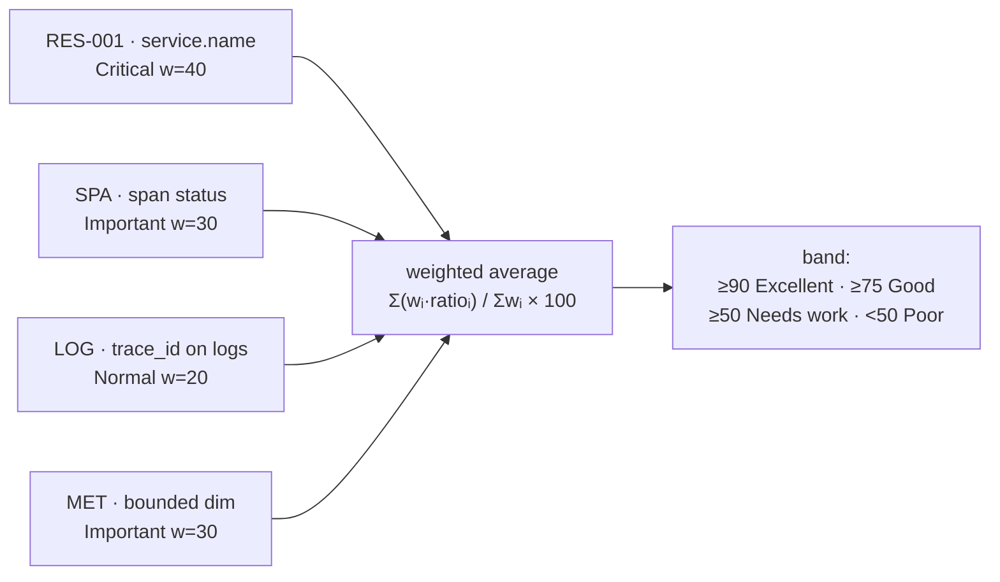

# Catalog D1 — Instrumentation Score (per-service, as code)

!!! abstract "At a glance"
    **Theme:** D — observability-of-observability (**capstone**) · **Time:** 40 min ·
    **Difficulty:** hard · **Skill:** `dtctl` + DQL ·
    **Reference:** `labs/advanced/catalog-d1-instrumentation-score/` ·
    **Read first:** [Instrumentation Score — the concept](instrumentation-score-concept.md)

**Goal:** grade the casino's telemetry with a single **instrumentation score** —
a weighted average of runtime-observable rules, computed in DQL and deployed as a
version-controlled Dynatrace dashboard. This is the **capstone**: it reuses the
muscle from [Step 1](step-1-instrument-with-agents.md) (resource attrs),
[A4](catalog-a4-exceptions-span-events.md) (span status),
[A2](catalog-a2-log-trace-correlation.md) (log↔trace) and
[B4](catalog-b4-ottl-enrichment.md) (bounded dims), and turns "did we instrument
well?" from a vibe into a **number with a band**.

## The concept (one paragraph)

The [instrumentation score](instrumentation-score-concept.md) is the **runtime
guard** that complements [Step 3 — Weaver](step-3-weaver-pipeline.md)'s
**build-time guard**: Weaver proves the `casino.*` contract is *defined*
correctly before a PR merges; the score proves the live fleet actually *honors*
it. Four anchor rules — one each from the Resource, Span, Log and Metric families
— are weighted by impact (Critical 40 / Important 30 / Normal 20) and combined:

```text
score = Σ(weightᵢ × pass_ratioᵢ) / Σ(weightᵢ) × 100
```



Read the [concept page](instrumentation-score-concept.md) for the full rule
families, weights, bands, and the Weaver-vs-runtime framing before you start.

## ① Problem — "we instrumented it" is not a measurement

After the A- and B-theme exercises the casino *looks* well instrumented. But
nothing **quantifies** it, and nothing catches **drift**: a new service ships
without `service.name`, a refactor starts swallowing exceptions again, a logger
loses `trace_id`, a dimension blows past its bound. Each regression passes
Weaver (the *definitions* are still fine) and silently rots the data you rely on
in every other lab. You need a single **per-service score** — graded on live
telemetry, watchable over time, deployed as code so it is reproducible and
diffable.

## ② Understand the change — hand-build the 4 anchor DQLs

Each anchor rule is a DQL pipeline that returns a **`pass_ratio`** ∈ [0, 1]: the
fraction of inspected telemetry that obeys the rule. All four use only fields
already exercised by earlier labs — nothing invented. Grail field-name notes:
logs use `trace_id` / `span_id` (**underscore**, not dotted); spans use
`span.status_code` (values `ERROR` / `OK` / `UNSET`), `span.kind`
(`server` / `client` / …), `span.name`.

### RES-001 — `service.name` present · Critical (w=40)

*Builds on [Step 1](step-1-instrument-with-agents.md).* Every span must carry a
resource `service.name`; without it the span is unattributable — the single most
damaging gap, hence Critical.

- **Before:** a service emits spans with `service.name` null (bad SDK resource
  config) — they land in Grail but belong to no service.
- **DQL:**
  ```dql
  fetch spans, from: now() - 30m
  | summarize total = count(), missing = countIf(isNull(service.name))
  | fieldsAdd pass_ratio = (total - missing) / total
  ```
- **Expected:** after Step 1, `missing` ≈ 0 and `pass_ratio` ≈ 1.0.

### SPA — span status / errors recorded · Important (w=30)

*Builds on [A4](catalog-a4-exceptions-span-events.md).* Entry (`server`) spans
should carry an explicit status (`OK` / `ERROR`), never `UNSET` — an unset status
means a failing money-path still looks green.

- **Before:** scoring swallows exceptions; `server` spans stay `UNSET` so errors
  are invisible.
- **DQL:**
  ```dql
  fetch spans, from: now() - 30m
  | filter span.kind == "server"
  | summarize total = count(), recorded = countIf(span.status_code != "UNSET")
  | fieldsAdd pass_ratio = recorded / total
  ```
- **Expected:** after A4, `recorded` ≈ `total` and `pass_ratio` ≈ 1.0.

### LOG — log ↔ trace correlation · Normal (w=20)

*Builds on [A2](catalog-a2-log-trace-correlation.md).* Logs should carry a
`trace_id` so Dynatrace can pivot each line to its span.

- **Before:** slots logs are plain text with no trace context — no pivot.
- **DQL:**
  ```dql
  fetch logs, from: now() - 30m
  | summarize total = count(), correlated = countIf(isNotNull(trace_id))
  | fieldsAdd pass_ratio = correlated / total
  ```
- **Expected:** after A2, `correlated` rises toward `total`; `pass_ratio` → 1.0.

### MET — required dimension present + bounded · Important (w=30)

*Builds on [B4](catalog-b4-ottl-enrichment.md).* A required dimension
(`casino.bet.tier`) must be present **and** bounded — cardinality is the enemy, so
a present-but-unbounded dim still fails the spirit of the rule.

- **Before:** the raw bet amount is used as a dimension directly — unbounded
  cardinality — or the bucketed `casino.bet.tier` is missing entirely.
- **DQL:**
  ```dql
  fetch spans, from: now() - 30m
  | summarize present = countIf(isNotNull(casino.bet.tier)), total = count(), distinct_tier = countDistinct(casino.bet.tier)
  | fieldsAdd pass_ratio = present / total, bounded = (distinct_tier <= 8)
  ```
- **Expected:** after B4, `pass_ratio` ≈ 1.0 **and** `bounded == true`
  (`distinct_tier` ≤ 8). If `bounded` is false the dimension is present but
  exploding — count it as a fail for the MET anchor.

!!! info "Why a dashboard, not one DQL expression"
    A DQL pipeline is **single-source** — one `fetch` per query. You cannot
    `fetch spans` *and* `fetch logs` in one pipeline, so the weighted composite is
    **not expressible as a single DQL expression** across signals. The reference
    artifact is therefore a dashboard with **one tile per anchor rule** (each its
    own `pass_ratio`) **plus a markdown note tile** carrying the weighted-score
    formula and bands — deployed with `dtctl apply -f`, exactly like
    [C1](catalog-c1-dtctl-dashboard.md). (The SDK-settings-based **Site Reliability
    Guardian** that would weight these natively is **UI-only** today — see the
    stretch note at the end.)

## ③ Drive opencode — the prompt ladder

You drive `opencode` with the `dtctl` skill through a **ladder**: orient, then
translate the bounded rule set into DQL objectives, then assemble and deploy the
per-service score. No clicking in the UI.

=== "P1 · Orient + scope the rules (read-only)"

    ```text
    Using the dtctl skill, read the instrumentation-score spec rule families
    (RES/SPA/LOG/MET/SDK). List a BOUNDED set of ~8–12 rules that are actually
    runtime-observable in Grail for my casino telemetry, and for EACH rule note
    the signal it reads and the field it checks. Then list the rules you are
    EXCLUDING as design-time / not runtime-observable (e.g. schema_url,
    SDK sampler/exporter config, metric unit metadata) and say why. Do NOT build
    anything yet.
    ```
    **What you should see:** a table of ~8–12 observable rules + an explicit
    *excluded* list naming SDK/config and `schema_url`-class rules.
    **Review check:** SDK-config rules are in the EXCLUDED list, not the scored
    set — the agent does not claim to score something invisible in telemetry.

=== "P2 · Core — translate the 4 anchors to DQL objectives"

    ```text
    For the four anchor rules — RES-001 service.name (Critical), span status
    recorded on server spans (Important), log trace_id correlation (Normal), and
    casino.bet.tier present + bounded ≤ 8 (Important) — write a DQL objective each
    that returns a field named pass_ratio in [0,1]. Confirm each query returns data
    with dtctl query -o json before moving on. Do not deploy yet.
    ```
    **What you should see:** four DQL pipelines, each ending in
    `fieldsAdd pass_ratio = …`, each confirmed to return data.
    **Review check:** logs use `trace_id` (underscore); spans use
    `span.status_code != "UNSET"` and `span.kind == "server"` — not dotted or
    invented field names.

=== "P3 · Assemble — the weighted per-service score"

    ```text
    Assemble a per-service score: for the anchors, weight them 40/30/20/30
    (Critical/Important/Normal/Important) and compute
    score = Σ(weightᵢ × pass_ratioᵢ) / Σweightᵢ × 100, grouped by service.name so
    I get one score per casino service. Map the score to the bands
    90 / 75 / 50 (Excellent/Good/Needs work/Poor). Show me the per-service numbers.
    ```
    **What you should see:** a per-`service.name` score and band, with the casino
    scoring service landing Good→Excellent.
    **Review check:** the denominator is `Σ weight` (120 for the four anchors) —
    the agent does not divide by rule *count* or invent a different denominator;
    and it groups `by: service.name` rather than scoring the fleet as one blob.

=== "P4 · Deploy as code — validate then apply"

    ```text
    Build a Dynatrace dashboard document with one data tile per anchor (each
    charting its pass_ratio) plus a markdown tile stating the weighted-score
    formula and the four bands. Name it after my PARTICIPANT_ID, tag it
    instrumentation-score / casino / training. Validate with
    dtctl apply -f <file> --dry-run first, and only apply for real if the dry-run
    passes. Show me the dry-run output.
    ```
    **What you should see:** `dtctl apply -f … --dry-run` runs clean (fail-closed
    on a bad DQL or schema), then the real apply.
    **Review check:** the agent uses `dtctl apply -f` (kubectl-style) — not a
    non-existent `dtctl dashboard`/`dtctl guardian` verb — and refuses to apply if
    the dry-run fails. There is **no** `dtctl` guardian resource; if the agent
    reaches for one, steer it to the dashboard (see the warning box).

## ④ Review & apply

Diff against the reference dashboard, then validate + deploy (the manual
equivalent of what opencode generates):

```bash
bash labs/advanced/catalog-d1-instrumentation-score/dtctl-apply.sh
```

## Verify

Re-run the anchor DQLs and compute the score — the `verify.sh` does this for you
(deferred-verify pattern: it uses `dtctl query`, and when the tenant is not
configured it prints the DQLs so a facilitator can run them live):

```bash
bash labs/advanced/catalog-d1-instrumentation-score/verify.sh
```

Or confirm the composite directly in a Notebook — the four `pass_ratio`s folded
into one weighted score per service:

```dql
fetch spans, from: now() - 30m
| summarize
    res = (count() - countIf(isNull(service.name))) / count(),
    spa = countIf(span.status_code != "UNSET" and span.kind == "server") / countIf(span.kind == "server"),
    met = countIf(isNotNull(casino.bet.tier)) / count(),
  by: { service.name }
| fieldsAdd score = (40 * res + 30 * spa + 30 * met) / 90 * 100
| fieldsAdd band = if(score >= 90, "Excellent", else:
                   if(score >= 75, "Good", else:
                   if(score >= 50, "Needs work", else: "Poor")))
| fields service.name, score, band
```

!!! note "The Notebook composite is span-only"
    The composite above folds the three **span-sourced** anchors (RES/SPA/MET,
    weights 40/30/30 = 100) because a DQL pipeline is single-source. The LOG
    anchor (`fetch logs`, w=20) is its own tile/query — fold it in by hand, or
    read the full four-anchor score from the dashboard + `verify.sh`, which run
    each `fetch` separately.

- **Before:** telemetry quality is a vibe; regressions (a dropped
  `service.name`, a swallowed exception, a lost `trace_id`, an exploding dim) rot
  the data silently and pass Weaver.
- **After:** a per-service **instrumentation score** on a version-controlled
  dashboard, graded on live telemetry, that lands the casino scoring service in
  **Good → Excellent** and surfaces any untouched service in **Needs work** — the
  runtime half of the two-guard contract.

!!! warning "If the agent gets it wrong — steer it back"
    - **Reaches for a `dtctl guardian` / `dtctl srg` resource:** *"dtctl has no
      guardian resource — a Site Reliability Guardian is a UI-only app setting.
      Deploy the score as a dashboard with `dtctl apply -f` instead."*
    - **Tries to `fetch spans` and `fetch logs` in one pipeline:** *"DQL is
      single-source — one `fetch` per query. Use one tile/query per signal and
      combine the weighted score in a note tile."*
    - **Dotted log fields (`trace.id`):** *"Grail logs use `trace_id` /
      `span_id` with an underscore — dotted names return null."*
    - **Divides by rule count, not Σweight:** *"the denominator is the sum of the
      weights (120 for four anchors), not the number of rules."*
    - **Scores the whole fleet as one number:** *"group `by: service.name` — the
      score is per-service so one bad service is visible, not averaged away."*
    - **Scores an SDK/config rule:** *"sampler, exporter and batch settings are not
      in the emitted telemetry — keep them in the design-time/excluded list."*
    - **Applies without validating:** *"always `dtctl apply -f … --dry-run` first
      and only apply if it passes."*

## Optional stretch — the Site Reliability Guardian (UI)

A Dynatrace **Site Reliability Guardian** *does* weight DQL objectives natively —
paste the four anchor DQLs as objectives with weights 40/30/20/30 and the
guardian engine computes the score for you, with validation history. But the SRG
is an **app setting** (`app:dynatrace.site.reliability.guardian:guardians`), **not
a `dtctl`-authorable resource** today, so this track keeps the score as a
`dtctl`-deployed dashboard (verifiable, diffable, reproducible per attendee). If
you want the native weighting, build the guardian in **Dynatrace → Workflows →
Site Reliability Guardian** by hand — see
`labs/advanced/catalog-d1-instrumentation-score/guardian-ui-stretch.md`.

## Definition of done

- [ ] The four anchor DQLs return a `pass_ratio` ∈ [0, 1] and confirm data
- [ ] A per-service weighted score (`Σwᵢ·ratioᵢ / Σwᵢ × 100`) + band mapping
- [ ] Excluded (design-time / SDK-config) rules logged, not scored
- [ ] Dashboard built, validated (`dtctl apply -f … --dry-run` exits 0), deployed
- [ ] Dashboard `name` includes `PARTICIPANT_ID`; tags applied
- [ ] `verify.sh` re-runs the anchors / prints them for live verification

Back to the [catalog menu](catalog.md).
