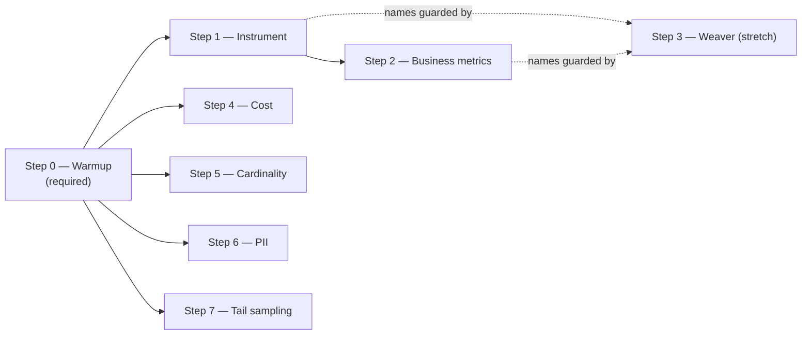

# Choose your path — facilitator menu

**For facilitators and self-paced attendees.** The advanced track is eight
exercises (a Step 0 warmup plus Steps 1–7) that share one shape — the
**Problem → Understand → Drive → Review → Verify** loop. You rarely run all of
them in one sitting. This page is the menu: pick a path that fits your time box
and the skills your cohort needs, then send attendees to those pages in order.

Every step page carries the same badge at the top — **skill · time · difficulty**
— so the tags below match what attendees see when they land.

!!! note "How to read the tags"
    - **⏱ time** — a realistic budget for one attendee driving `opencode`, including
      reading the diff and waiting for Argo CD / the collector to apply.
    - **difficulty** — ●○○ warmup/orientation · ●●○ core exercise · ●●● deeper
      (OTTL, Weaver, or multi-step steering).
    - **Core** steps build the money-path story end to end. **Stretch** steps are
      valuable but skippable when time is tight.

## Every exercise at a glance

| # | Exercise | ⏱ | Difficulty | Role | Skill driven |
|---|---|---|---|---|---|
| — | [Getting started](getting-started.md) | 15 min | setup | **Prerequisite** — tokens, fork, Codespace | — |
| — | [The environment](environment.md) | 15 min | ●○○ | **Prerequisite** — the five moving parts + the loop | `otel-collector` (read) |
| 0 | [Warmup](step-0-warmup.md) | 15 min | ●○○ | **Required** — prove opencode reads + edits; load skills | all skills |
| 1 | [Instrument with AI agents](step-1-instrument-with-agents.md) | 30 min | ●●○ | **Core** — add the money-path span | `otel-instrumentation` |
| 2 | [Business metrics](step-2-business-metrics.md) | 25 min | ●●○ | **Core** — counter + histogram on the money-path | `otel-instrumentation` |
| 3 | [Weaver pipeline](step-3-weaver-pipeline.md) | 25 min | ●●● | **Stretch** — guard the conventions in CI | `otel-semantic-conventions` |
| 4 | [Cost of observability](step-4-cost-of-observability.md) | 20 min | ●●○ | **Core** — attribute spend at the gateway | `otel-collector` |
| 5 | [High-cardinality metrics](step-5-high-cardinality.md) | 25 min | ●●● | **Core** — strip unbounded labels (OTTL) | `otel-ottl` |
| 6 | [PII in logs](step-6-pii-logs.md) | 30 min | ●●● | **Core** — redact email/PAN/SSN (OTTL) | `otel-ottl` |
| 7 | [Tail sampling](step-7-tail-sampling.md) | 25 min | ●●○ | **Core** — keep what matters, sample the rest | `otel-collector` |

Prerequisites (Getting started + The environment + Step 0 ≈ 45 min) come before
**every** path below — they are the shared on-ramp, not part of the time estimate
for each path.

## Curated paths

Pick one. Times exclude the ~45 min on-ramp (Getting started → environment →
Step 0).

=== "Money-path story (≈80 min)"

    The tightest end-to-end narrative: make the business logic observable, then
    turn it into metrics, then control the trace cost. Best for an app-developer
    audience.

    1. [Step 1 — Instrument](step-1-instrument-with-agents.md) · 30 min · ●●○
    2. [Step 2 — Business metrics](step-2-business-metrics.md) · 25 min · ●●○
    3. [Step 7 — Tail sampling](step-7-tail-sampling.md) · 25 min · ●●○

=== "Collector control plane (≈95 min)"

    Everything happens at the gateway — no app redeploys. Best for a
    platform/SRE audience who owns the collectors.

    1. [Step 4 — Cost of observability](step-4-cost-of-observability.md) · 20 min · ●●○
    2. [Step 5 — High-cardinality](step-5-high-cardinality.md) · 25 min · ●●●
    3. [Step 6 — PII in logs](step-6-pii-logs.md) · 30 min · ●●●
    4. [Step 7 — Tail sampling](step-7-tail-sampling.md) · 25 min · ●●○

=== "Governance & compliance (≈55 min)"

    Stop telemetry from rotting and stop PII from leaking. Best for a
    data-governance or security-minded cohort.

    1. [Step 3 — Weaver pipeline](step-3-weaver-pipeline.md) · 25 min · ●●●
    2. [Step 6 — PII in logs](step-6-pii-logs.md) · 30 min · ●●●

=== "Full track (≈3h20m)"

    All eight exercises in order — the complete arc from a blind money-path to a
    governed, cost-attributed, sampled pipeline. Best for a full-day workshop.

    [Step 1](step-1-instrument-with-agents.md) → [2](step-2-business-metrics.md)
    → [3](step-3-weaver-pipeline.md) → [4](step-4-cost-of-observability.md)
    → [5](step-5-high-cardinality.md) → [6](step-6-pii-logs.md)
    → [7](step-7-tail-sampling.md)

## How the exercises depend on each other

Steps 1 and 2 create the `casino.*` attributes and metrics that Steps 3, 5, and 7
later reference. The collector steps (4–7) are independent of each other — you can
run them in any order or à la carte — but each assumes Step 0's warmed-up agent.

!!! tip "Facilitator timing rule of thumb"
    Budget the ~45 min on-ramp once at the start, then **count two core steps per
    hour** of hands-on time. A 2-hour slot comfortably fits the on-ramp plus three
    core steps; a half day fits the full track with room for questions and the
    optional BindPlane/OpAMP escalation in [Step 6](step-6-pii-logs.md).

Start here: [Getting started](getting-started.md) → [The environment](environment.md)
→ [Step 0 — Warmup](step-0-warmup.md), then your chosen path above.
