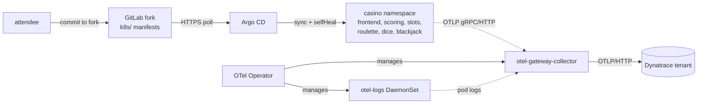
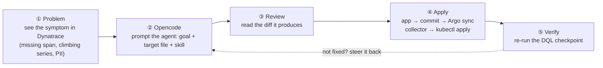
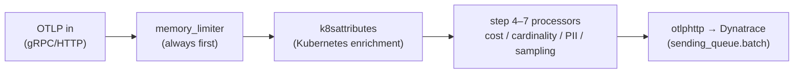

# The environment

**Goal:** understand the five moving parts of your lab — the casino app, GitLab,
Argo CD, and the OTel Operator + collectors — then open Dynatrace and see the
planted issues you will fix across steps 1–7. This page also introduces the one
pattern you reuse on every step: the **Problem → Opencode → Verify** loop. Budget
15 minutes.

## The shape of the lab

Everything runs in one kind cluster inside your Codespace. Your GitLab fork is
the single source of truth; Argo CD deploys whatever is committed there; the OTel
Operator manages the collectors that enrich your telemetry and forward it to
Dynatrace.



### Who does what

| Component | Namespace | Role in the lab |
|---|---|---|
| Casino services | `casino` | Frontend + per-game services (slots, roulette, dice, blackjack) + scoring, Redis, PostgreSQL, k6 load-gen. The thing you are observing. |
| GitLab fork | external | Holds the Kubernetes manifests under `k8s/`. You edit here. |
| Argo CD | `argocd` | Polls your fork and applies it. `selfHeal` reverts hand-drift. |
| OTel Operator | `observability` | Manages the gateway collector and the logs DaemonSet as CRDs. |
| Gateway collector | `observability` | The single control point. All collector fixes in steps 4–7 land here. |
| Dynatrace Operator | `dynatrace` | Kubernetes monitoring + ActiveGate. |

## The lab mechanic: edit → commit → sync

Your loop for the whole track:

1. Edit a manifest under `k8s/` in your fork — the GitLab **Web IDE** or a local clone.
2. Commit and push to `main` on your fork.
3. Argo CD auto-syncs within the reconcile interval; the **Refresh** button in the
   Argo CD UI (`http://localhost:30002`) forces it instantly.

!!! warning "Do not `kubectl apply` into the casino namespace"
    Argo CD `selfHeal` reverts any hand-drift. Your GitLab fork is the single
    source of truth — if a change is not committed there, it does not persist.

## The agent loop: Problem → Opencode → Verify

Every step from here on follows **one** canonical pattern. You never hand-author
the fix from a blank file — you observe the symptom in Dynatrace, then drive the
`opencode` coding agent (warmed up in [Step 0](step-0-warmup.md)) to produce it,
review the diff, apply it, and verify with a DQL checkpoint. Learn the loop once
here; every step is a variation on it.



Each step gives you a **copy-pasteable prompt** with three things the agent needs:

1. **The goal** — what telemetry should exist afterwards, in plain terms.
2. **The target file** — e.g. `observability/collectors/gateway.yaml` for a
   collector fix, or the slots service source for an instrumentation fix.
3. **The skill** — which installed Agent Skill to lean on: `otel-instrumentation`
   for SDK code, `otel-collector` / `otel-ottl` for pipeline and transform logic,
   `otel-semantic-conventions` for the Weaver registry, `dt-*` for Dynatrace/DQL.

!!! tip "When the agent gets it wrong — steer it back, don't hand-fix"
    `opencode` is not deterministic. If the diff misses an attribute, puts a
    processor in the wrong pipeline order, or invents a field name, **reply with
    the specific correction** rather than editing by hand — e.g. *"memory_limiter
    must stay the first processor and there must be no batch processor; move your new processor
    after k8sattributes."* Steering the agent is the skill this track
    teaches; the verify checkpoint tells you when you are done.

**Apply differs by target.** App-code fixes (Steps 1–2) go through Git —
`commit → push → Argo CD sync` — because the casino namespace is GitOps-owned
(`selfHeal` reverts hand-drift). Collector fixes (Steps 4–7) are applied with
`kubectl apply` against the `observability` namespace, which Argo does not manage.

## The collector is the control point

Steps 4–7 all change **one** collector — the gateway — never the apps. That is
deliberate: a gateway change covers traces, metrics, and logs for the whole
cluster at once. The pipelines obey three invariants that never change, no matter
which processor you add:



!!! note "The three invariants"
    - `memory_limiter` is **always the first** processor.
    - There is **no `batch` processor** (deprecated) — batching is `sending_queue.batch` on the exporter.
    - `k8sattributes` does the Kubernetes enrichment (we run in Kubernetes — we
      never use `resourcedetection` here).

    The known-good baseline is
    [`observability/collectors/gateway.yaml`](https://github.com/)
    in the repo. The fully composed end-state — steps 4+5+6+7 wired in the
    correct order — is `labs/advanced/gateway-advanced.yaml`.

## Dynatrace validation checkpoint

Confirm the environment is live and see the planted issues you will fix:

1. **Ctrl/Cmd+K → "Kubernetes" → Clusters** — your cluster (by `PARTICIPANT_ID`) is present.
2. **Ctrl/Cmd+K → "Distributed Tracing"** — a trickle of casino traces is already flowing (k6 is
   playing for you). The casino's money-path (the actual spin/payout) is **not**
   visible yet — that is Step 1's job.
3. **Logs** — casino log lines are arriving with player PII intact (Step 6).
4. **Metrics / Account Management → Cost allocation** — telemetry sits in one
   undifferentiated cost bucket, and at least one metric's series count is
   climbing (Steps 4 and 5). The money-path has traces but **no business
   metrics** yet — no bet count, no wager histogram (Step 2).

Argo CD should show the `casino` Application `Synced` / `Healthy`:

```bash
kubectl -n argocd get application casino
kubectl -n argocd get secret casino-repo -o jsonpath='{.data.url}' | base64 -d; echo
# -> https://<gitlab-host>/<attendee>/casino.git
```

## Definition of done

- [ ] You can name each component and its namespace
- [ ] `casino` Application shows `Synced` / `Healthy` in Argo CD
- [ ] The casino-repo secret points at **your** GitLab fork
- [ ] You can state the three collector-pipeline invariants
- [ ] You have seen the planted issues in Dynatrace (missing money-path, PII in
      logs, single cost bucket, climbing cardinality)

Next: [Step 0 — Warmup](step-0-warmup.md).
