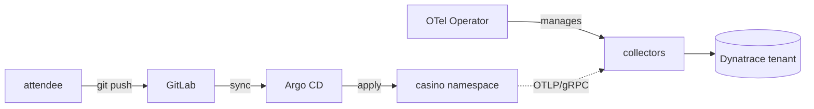

# The environment

!!! note "Stub — content pending ISI-6930 (ISI-6913 §2)"
    This page is part of the Option A **advanced self-paced track**. The nav,
    mermaid2 rendering, and build/CI are wired (ISI-6929); the step-by-step
    content will be authored once the lab assets land.

**This page will cover**

- The application plus GitLab + Argo CD (deploy) and the OTel Operator (collectors).
- Opening Dynatrace and observing the planted issues.

