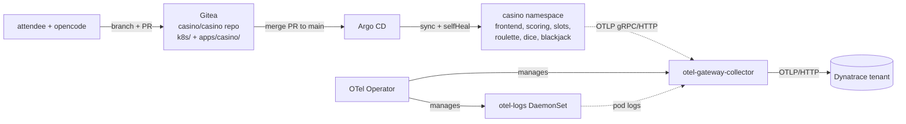
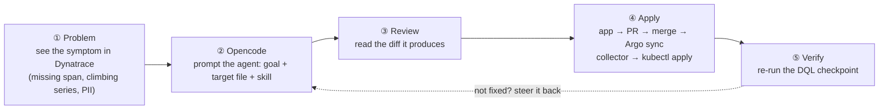
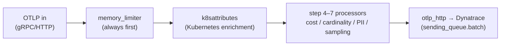

# The environment

**Goal:** understand the five moving parts of your lab — the casino app, Gitea,
Argo CD, and the OTel Operator + collectors — then open Dynatrace and see the
planted issues you will fix across steps 1–7. This page also introduces the one
pattern you reuse on every step: the **Problem → Opencode → Verify** loop. Budget
15 minutes.

## The shape of the lab

Everything runs in one kind cluster inside your Codespace. Your git host is the
in-cluster **Gitea** (`http://localhost:30001`), and you drive it with **opencode**:
the agent edits the casino source, opens a pull request, and once you merge it,
Argo CD deploys whatever is on `main`. The OTel Operator manages the collectors
that enrich your telemetry and forward it to Dynatrace.



!!! note "GitLab path (alternative)"
    If your room runs the Dynatrace-solution **GitLab** instead of Gitea
    (`GITLAB_TOKEN` / `GITLAB_REPO_URL` set — see [Getting started](getting-started.md)),
    the shape is identical: swap **Gitea** for your GitLab fork and "merge the PR"
    for "merge the MR". Everything else on this page is unchanged.

### Who does what

| Component | Namespace | Role in the lab |
|---|---|---|
| Casino services | `casino` | Frontend + per-game services (slots, roulette, dice, blackjack) + scoring, Redis, PostgreSQL, k6 load-gen. The thing you are observing. |
| Gitea | `gitea` | In-cluster git host (`http://localhost:30001`). Holds the `casino/casino` repo — manifests under `k8s/`, service source under `apps/casino/`. You open PRs here. *(GitLab fork if your room runs the GitLab path.)* |
| Argo CD | `argocd` | Polls your fork and applies it. `selfHeal` reverts hand-drift. |
| OTel Operator | `observability` | Manages the gateway collector and the logs DaemonSet as CRDs. |
| Gateway collector | `observability` | The single control point. All collector fixes in steps 4–7 land here. |
| Dynatrace Operator | `dynatrace` | Kubernetes monitoring + ActiveGate. |

!!! note "Lite profile — a smaller casino"
    On a tight Codespace you can bring the casino up in its **`lite`** profile:
    `CASINO_PROFILE=lite bash .devcontainer/bootstrap/deploy-environment.sh`.
    Lite drops the **roulette** and **dice** services (the only two no lab
    uniquely needs), narrows the k6 load-gen to the surviving
    games, and makes the Dynatrace **ActiveGate** optional (app telemetry still
    flows through the OTel collector). Pair with `DEPLOY_MODE=direct` for a
    Gitea-free `kubectl apply` bring-up. Default is **`full`** (the diagram
    above). Details: [`deploy/casino/README.md`](https://github.com/henrikrexed/Otel-Training/blob/main/deploy/casino/README.md).

## The lab mechanic: opencode → PR → merge → sync

App-code changes reach the cluster through Git, driven by **opencode** against the
in-cluster **Gitea**. Set the loop up **once**, then repeat the last part on every
app-code step.

**One-time setup** (from the training repo root — the helper scripts are already
on your `PATH`):

```bash
gitea-token.sh      # mint a scoped Gitea token -> ~/.workshop-gitea.env
clone-casino.sh     # clone casino/casino -> ~/casino, wire creds + the DCO hook
cd ~/casino && opencode
```

**Every app-code step** — from inside `~/casino`, after opencode has edited the
source:

```bash
# opencode can run the whole loop itself; or ship it by hand:
gitea-pr.sh "fix(slots): propagate trace context across the scoring hop"
```

`gitea-pr.sh` branches `opencode/<slug>`, commits with a DCO sign-off, pushes, and
opens a pull request against `main` — printing the PR URL. **Review and merge the
PR in the Gitea UI** (`http://localhost:30001/casino/casino/pulls`). Merging `main`
is what triggers the rollout:

- a change under `k8s/**` → Argo CD syncs it into the `casino` namespace;
- a change under `apps/casino/**` → `.gitea/workflows/casino-images.yml` rebuilds
  the service image, which the next sync rolls out.

Hit **Refresh** in the Argo CD UI (`http://localhost:30002`) to force a sync
instantly rather than waiting for the reconcile interval.

!!! warning "Do not `kubectl apply` into the casino namespace"
    Argo CD `selfHeal` reverts any hand-drift. The merged state on Gitea `main` is
    the single source of truth — if a change is not merged there, it does not
    persist. (Never push straight to `main` either — always go through a PR.)

## The agent loop: Problem → Opencode → Verify

Every step from here on follows **one** canonical pattern. You never hand-author
the fix from a blank file — you observe the symptom in Dynatrace, then drive the
`opencode` coding agent (warmed up in [Step 0](step-0-warmup.md)) to produce it,
review the diff, apply it, and verify with a DQL checkpoint. Learn the loop once
here; every step is a variation on it.



Each step gives you a **copy-pasteable prompt** with three things the agent needs:

1. **The goal** — what telemetry should exist afterwards, in plain terms.
2. **The target file** — e.g. `observability/collectors/gateway.yaml` for a
   collector fix, or the slots service source for an instrumentation fix.
3. **The skill** — which installed Agent Skill to lean on: `otel-instrumentation`
   for SDK code, `otel-collector` / `otel-ottl` for pipeline and transform logic,
   `otel-semantic-conventions` for the Weaver registry, `dt-*` for Dynatrace/DQL.

!!! tip "When the agent gets it wrong — steer it back, don't hand-fix"
    `opencode` is not deterministic. If the diff misses an attribute, puts a
    processor in the wrong pipeline order, or invents a field name, **reply with
    the specific correction** rather than editing by hand — e.g. *"memory_limiter
    must stay the first processor and there must be no batch processor; move your new processor
    after k8sattributes."* Steering the agent is the skill this track
    teaches; the verify checkpoint tells you when you are done.

**Apply differs by target.** App-code fixes (Steps 1–2 and the catalog **A**
exercises) ship through **Gitea + opencode** — opencode edits in `~/casino`,
`gitea-pr.sh` opens a PR, you merge it, Argo CD syncs — because the casino
namespace is GitOps-owned (`selfHeal` reverts hand-drift). Collector fixes
(Steps 4–7 and the catalog **B** exercises) are applied with `kubectl apply`
against the `observability` namespace, which Argo does not manage (opencode can
run that `kubectl apply` for you too).

## The collector is the control point

Steps 4–7 all change **one** collector — the gateway — never the apps. That is
deliberate: a gateway change covers traces, metrics, and logs for the whole
cluster at once. The pipelines obey three invariants that never change, no matter
which processor you add:



!!! note "The three invariants"
    - `memory_limiter` is **always the first** processor.
    - There is **no `batch` processor** (deprecated) — batching is `sending_queue.batch` on the exporter.
    - `k8sattributes` does the Kubernetes enrichment (we run in Kubernetes — we
      never use `resourcedetection` here).

    The known-good baseline is
    [`observability/collectors/gateway.yaml`](https://github.com/)
    in the repo. The fully composed end-state — steps 4+5+6+7 wired in the
    correct order — is `labs/advanced/gateway-advanced.yaml`.

## Dynatrace validation checkpoint

Confirm the environment is live and see the planted issues you will fix:

1. **Ctrl/Cmd+K → "Kubernetes" → Clusters** — your cluster (by `PARTICIPANT_ID`) is present.
2. **Ctrl/Cmd+K → "Distributed Tracing"** — a trickle of casino traces is already flowing (k6 is
   playing for you). The casino's money-path (the actual spin/payout) is **not**
   visible yet — that is Step 1's job.
3. **Logs** — casino log lines are arriving with player PII intact (Step 6).
4. **Metrics / Account Management → Cost allocation** — telemetry sits in one
   undifferentiated cost bucket, and at least one metric's series count is
   climbing (Steps 4 and 5). The money-path has traces but **no business
   metrics** yet — no bet count, no wager histogram (Step 2).

Argo CD should show the `casino` Application `Synced` / `Healthy`:

```bash
kubectl -n argocd get application casino
kubectl -n argocd get application casino -o jsonpath='{.spec.source.repoURL}'; echo
# -> http://gitea-http.gitea.svc:3000/casino/casino.git   (or your GitLab fork URL)
```

## Definition of done

- [ ] You can name each component and its namespace
- [ ] `casino` Application shows `Synced` / `Healthy` in Argo CD
- [ ] The casino Application `repoURL` points at your git host (in-cluster Gitea,
      or your GitLab fork on the GitLab path)
- [ ] You ran the one-time setup (`gitea-token.sh` → `clone-casino.sh` → `cd ~/casino`)
- [ ] You can state the three collector-pipeline invariants
- [ ] You have seen the planted issues in Dynatrace (missing money-path, PII in
      logs, single cost bucket, climbing cardinality)

Next: [Step 0 — Warmup](step-0-warmup.md).
