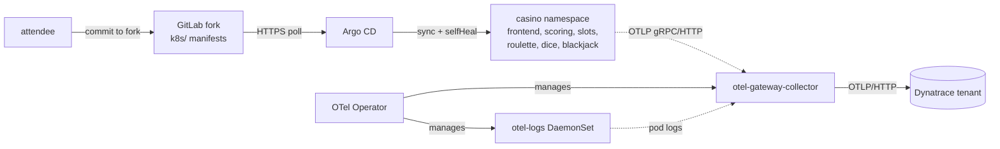
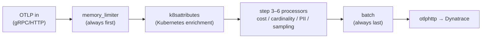

# The environment

**Goal:** understand the five moving parts of your lab — the casino app, GitLab,
Argo CD, and the OTel Operator + collectors — then open Dynatrace and see the
planted issues you will fix across steps 1–6. Budget 15 minutes.

## The shape of the lab

Everything runs in one kind cluster inside your Codespace. Your GitLab fork is
the single source of truth; Argo CD deploys whatever is committed there; the OTel
Operator manages the collectors that enrich your telemetry and forward it to
Dynatrace.



### Who does what

| Component | Namespace | Role in the lab |
|---|---|---|
| Casino services | `casino` | Frontend + per-game services (slots, roulette, dice, blackjack) + scoring, Redis, PostgreSQL, k6 load-gen. The thing you are observing. |
| GitLab fork | external | Holds the Kubernetes manifests under `k8s/`. You edit here. |
| Argo CD | `argocd` | Polls your fork and applies it. `selfHeal` reverts hand-drift. |
| OTel Operator | `observability` | Manages the gateway collector and the logs DaemonSet as CRDs. |
| Gateway collector | `observability` | The single control point. All collector fixes in steps 3–6 land here. |
| Dynatrace Operator | `dynatrace` | Kubernetes monitoring + ActiveGate. |

## The lab mechanic: edit → commit → sync

Your loop for the whole track:

1. Edit a manifest under `k8s/` in your fork — the GitLab **Web IDE** or a local clone.
2. Commit and push to `main` on your fork.
3. Argo CD auto-syncs within the reconcile interval; the **Refresh** button in the
   Argo CD UI (`http://localhost:30002`) forces it instantly.

!!! warning "Do not `kubectl apply` into the casino namespace"
    Argo CD `selfHeal` reverts any hand-drift. Your GitLab fork is the single
    source of truth — if a change is not committed there, it does not persist.

## The collector is the control point

Steps 3–6 all change **one** collector — the gateway — never the apps. That is
deliberate: a gateway change covers traces, metrics, and logs for the whole
cluster at once. The pipelines obey three invariants that never change, no matter
which processor you add:



!!! note "The three invariants"
    - `memory_limiter` is **always the first** processor.
    - `batch` is **always the last** processor.
    - `k8sattributes` does the Kubernetes enrichment (we run in Kubernetes — we
      never use `resourcedetection` here).

    The known-good baseline is
    [`observability/collectors/gateway.yaml`](https://github.com/)
    in the repo. The fully composed end-state — steps 3+4+5+6 wired in the
    correct order — is `labs/advanced/gateway-advanced.yaml`.

## Dynatrace validation checkpoint

Confirm the environment is live and see the planted issues you will fix:

1. **Infrastructure → Kubernetes** — your cluster (by `KIND_CLUSTER_NAME`) is present.
2. **Distributed traces** — a trickle of casino traces is already flowing (k6 is
   playing for you). The casino's money-path (the actual spin/payout) is **not**
   visible yet — that is Step 1's job.
3. **Logs** — casino log lines are arriving with player PII intact (Step 5).
4. **Metrics / Account Management → Cost allocation** — telemetry sits in one
   undifferentiated cost bucket, and at least one metric's series count is
   climbing (Steps 3 and 4).

Argo CD should show the `casino` Application `Synced` / `Healthy`:

```bash
kubectl -n argocd get application casino
kubectl -n argocd get secret casino-repo -o jsonpath='{.data.url}' | base64 -d; echo
# -> https://<gitlab-host>/<attendee>/casino.git
```

## Definition of done

- [ ] You can name each component and its namespace
- [ ] `casino` Application shows `Synced` / `Healthy` in Argo CD
- [ ] The casino-repo secret points at **your** GitLab fork
- [ ] You can state the three collector-pipeline invariants
- [ ] You have seen the planted issues in Dynatrace (missing money-path, PII in
      logs, single cost bucket, climbing cardinality)

Next: [Step 1 — Instrument with AI agents](step-1-instrument-with-agents.md).
