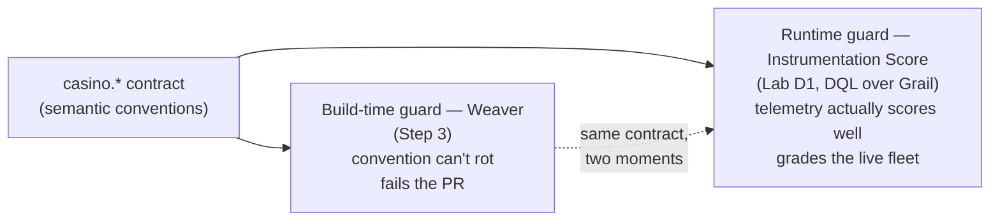
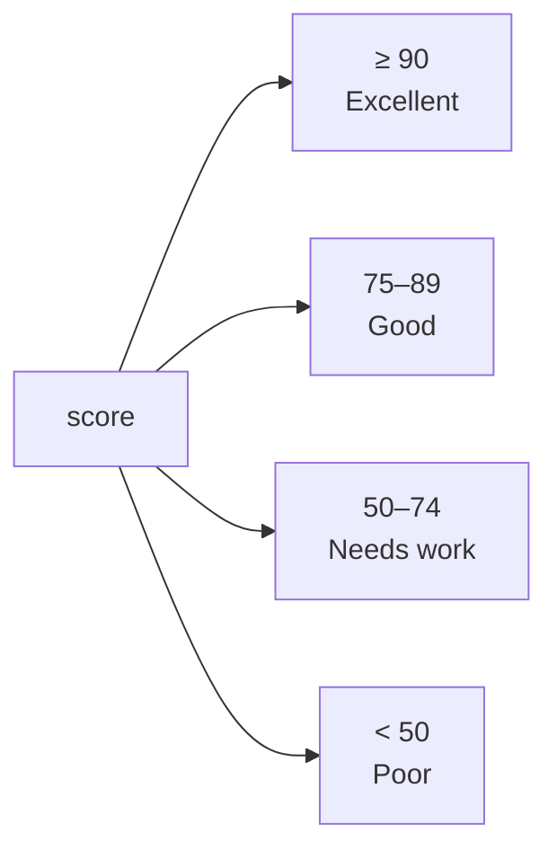

# Instrumentation Score — the concept (Theme D)

!!! abstract "At a glance"
    **Theme:** D — observability-of-observability (capstone) · **Read time:** 10 min ·
    **Pairs with:** [Catalog D1 — Instrumentation Score lab](catalog-d1-instrumentation-score.md)

Every other exercise in this track makes the casino's telemetry **better** — a
span reconnected (A1), a status recorded (A4), a dimension bounded (B4). This
page introduces the capstone question that sits *above* all of them: **how good
is our telemetry, as one number?** That is what an **instrumentation score** is —
a weighted grade for how well the emitted telemetry obeys its own conventions.

The rules come from the open
[instrumentation-score specification](https://github.com/instrumentation-score/spec/tree/main/rules):
a community-maintained rubric that a vendor-neutral score can be computed from.
In Lab D1 you turn four of those rules into DQL and assemble a **per-service
score** you can watch over time.

## The two guards on the same `casino.*` contract

You have already met the *build-time* guard: in
[Step 3 — Weaver](step-3-weaver-pipeline.md) a semantic-convention registry +
policy gate fails a pull request the moment someone renames `casino.bet.amount`
or drops a required attribute. **Convention can't rot** — a schema violation
never reaches `main`.

But a green Weaver gate only proves the *definitions* are sound. It says nothing
about what the running fleet actually emits: a service that forgets to set
`service.name`, swallows an exception instead of recording ERROR status, or ships
logs with no `trace_id` all pass Weaver and still produce telemetry you can't
query or correlate. That is the **runtime** gap — and the instrumentation score
is the guard that closes it.



**Build-time ∧ runtime.** Weaver proves the contract is *defined* correctly before
the code merges; the instrumentation score proves the contract is *honored*
correctly after the code runs. You need both — and Lab D1 builds the second one.

## The four signal families

The spec groups rules by the signal they inspect. Lab D1's four anchor rules
deliberately span four of the five families — one anchor each — so a single score
reflects the whole telemetry surface, not just traces:

| Prefix | Family | What it inspects | D1 anchor |
|---|---|---|---|
| `RES` | **Resource** | resource attributes on every signal | `service.name` present (builds on [Step 1](step-1-instrument-with-agents.md)) |
| `SPA` | **Span** | span structure, status, kind | status/errors recorded (builds on [A4](catalog-a4-exceptions-span-events.md)) |
| `LOG` | **Log** | log records + correlation | log ↔ trace correlation (builds on [A2](catalog-a2-log-trace-correlation.md)) |
| `MET` | **Metric** | metric dimensions + cardinality | required dim present + bounded (builds on [B4](catalog-b4-ottl-enrichment.md)) |
| `SDK` | **SDK / config** | sampler, exporter, batch settings | *out of scope* — see below |

## The weighted-average formula

Not all rules matter equally. The spec assigns each rule an **impact weight** and
combines them into a single 0–100 score:

| Impact | Weight | Meaning |
|---|---|---|
| **Critical** | 40 | breaks a core workflow if missing (e.g. no `service.name` → nothing attributable) |
| **Important** | 30 | significantly degrades analysis |
| **Normal** | 20 | best practice; nice to have |
| **Low** | 10 | minor / cosmetic |

```text
score = Σ(weightᵢ × pass_ratioᵢ) / Σ(weightᵢ) × 100
```

where each rule's `pass_ratio` ∈ [0, 1] is the fraction of inspected telemetry
that passes it (the DQL in D1 computes exactly this). A rule that passes on every
span contributes its full weight; one that passes half the time contributes half.

!!! note "Runtime adaptation of the spec formula"
    The spec's canonical formula is `Σ(passed × weight) / Σ(total × weight) × 100`
    over a **count of rules** that pass or fail. D1 computes a *runtime* variant:
    each rule returns a continuous `pass_ratio` over live telemetry instead of a
    binary pass/fail, so partial compliance (90% of spans carry a status) is
    visible rather than rounded to 0 or 1. Same weights, same band boundaries —
    graded on the data, not a checklist.

## The four bands

The score lands a service in one of four bands — the grade a facilitator reads at
a glance:



The casino's scoring service after A1/A2/A4/B4 should land **Good → Excellent**; a
service that was never touched by this track lands **Needs work** or below —
which is exactly the gap the score is meant to surface.

## What is *not* runtime-observable (and why the score is honest about it)

Four families of spec rules **cannot** be checked from telemetry once it has
landed in Grail. D1 excludes them on purpose and labels them *design-time*, so the
score never over-claims:

- **`schema_url` / instrumentation-scope version** — not surfaced as queryable
  span or metric fields.
- **Metric `unit` / descriptor metadata** — OTLP metric descriptor metadata is not
  a Grail dimension you can filter on.
- **Span-name low-cardinality** — observable in principle (`countDistinct(span.name)`)
  but route-dependent and noisy; treated as advisory, not a hard anchor.
- **SDK / config rules** (sampler choice, exporter config, batch settings) — these
  live in collector/SDK config, invisible in the emitted signal.

The four D1 anchors are all runtime-observable, so the score is **honestly
computable from live telemetry** for the Critical + Important + Normal rules that
matter most. The Low-weight and config-only rules stay in Weaver's build-time
lane — which is the whole point of two guards.

→ **Now build it:** [Catalog D1 — Instrumentation Score lab](catalog-d1-instrumentation-score.md).
