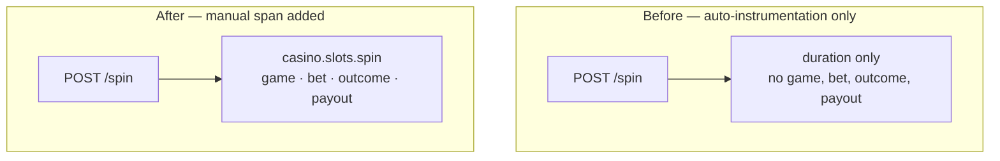

# Step 1 — Instrument with AI agents

**Goal:** make the casino's money-path observable. Auto-instrumentation gives you
the HTTP and DB edges for free, but the *business logic* — the bet, the RNG draw,
the payout decision — is a black box. You will run the **Problem → Opencode →
Verify** loop from [The environment](environment.md#the-agent-loop-problem-opencode-verify)
for the first time: see the missing money-path in Dynatrace, drive `opencode`
(warmed up in [Step 0](step-0-warmup.md)) with the `otel-instrumentation` skill to
add manual spans and domain attributes, review the diff, commit for Argo CD to
redeploy, and confirm the span shows up. Budget 30 minutes.

## The concept



Auto-instrumentation shows a generic `POST /spin` server span with a duration,
but nothing about *which game*, *the bet size*, *the outcome*, or *the payout*.
So you cannot answer "are high-value bets losing more often?" or "which game
drives payout cost?". You add a child span that carries the domain.

## ① Problem — the planted gap

The slots service (`vegas-slots-service`, Node.js) ships **deliberately
under-instrumented**. It wires only the auto-instrumentation SDK, so its `/spin`
handler computes outcome and payout with **no manual span and no domain
attributes**. In Dynatrace the symptom is stark: a spin is a featureless
`POST /spin` server span — flat duration, and because the business logic runs
inside that one handler with no child span, the money-path shows up as an
**orphaned, undifferentiated** operation with nothing you can slice by. Reference
asset (the planted state): `labs/advanced/step1-agent-instrumentation/before.slots-index.js`.

Planted gaps you will see and fix:

- **No child span** around the outcome/payout computation — the variable,
  interesting part of the request is invisible inside the generic server span.
- **No `casino.*` domain attributes** — you cannot answer "are high-value bets
  losing more often?" or "which game drives payout cost?".
- **Losing-edge errors are swallowed** — a settlement failure throws with no span
  event and no error status, so it never surfaces in trace analysis.

Confirm the symptom first — run the checkpoint DQL at the foot of this page now
and watch it return **zero rows**. That is your "before".

## ② Opencode — drive the fix

You already proved `opencode` and its skills work in
[Step 0](step-0-warmup.md). Now use it for real. Clone your casino fork, `cd`
into it, and drive the agent at the slots service source with the
`otel-instrumentation` skill — the prompt names the **goal**, the **target file**,
and the **skill**:

```bash
opencode run "Using the otel-instrumentation skill: in the vegas-slots-service \
/spin handler, wrap the draw and payout in a child span 'casino.slots.spin' with \
@opentelemetry/api. Set attributes casino.game.name, casino.bet.amount, \
casino.outcome, casino.payout.amount; add a 'jackpot' span event on a jackpot; \
set span error status on failures. Keep the existing response shape."
```

## ③ Review — read the diff

In build mode `opencode` writes the change straight into the working tree. **Read
the diff before you commit.** The target shape the agent should converge on (from
`after.slots-index.js`):

```diff
+ const { trace, SpanStatusCode } = require('@opentelemetry/api');
+ const tracer = trace.getTracer('casino-slots', '1.0.0');
  app.post('/spin', async (req, res) => {
-   const bet = Number(req.body.bet);
-   const outcome = draw();
-   const payout = settle(bet, outcome);
-   res.json({ outcome, payout });
+   const bet = Number(req.body.bet);
+   await tracer.startActiveSpan('casino.slots.spin', async (span) => {
+     try {
+       span.setAttribute('casino.game.name', 'slots');
+       span.setAttribute('casino.bet.amount', bet);
+       const outcome = draw();
+       const payout = settle(bet, outcome);
+       span.setAttribute('casino.outcome', outcome.kind);        // win | lose | jackpot
+       span.setAttribute('casino.payout.amount', payout);
+       if (outcome.kind === 'jackpot') span.addEvent('jackpot', { 'casino.payout.amount': payout });
+       res.json({ outcome, payout });
+     } catch (err) {
+       span.setStatus({ code: SpanStatusCode.ERROR, message: err.message });
+       span.recordException(err);
+       throw err;
+     } finally {
+       span.end();
+     }
+   });
  });
```

!!! tip "Why these exact attribute names?"
    `casino.game.name`, `casino.bet.amount`, `casino.outcome`,
    `casino.payout.amount`. Step 1 **creates** these attributes; [Step 3
    (Weaver)](step-3-weaver-pipeline.md) **guards** them, and [Step 2](step-2-business-metrics.md)
    **reuses** `casino.game.name` / `casino.outcome` as the dimensions on the
    business metrics. Keep the names exactly as above or the Step 3 registry
    check will flag drift.

!!! warning "If the agent gets it wrong — steer it back"
    Common misses and the one-line correction to reply with:

    - **Attribute dropped or renamed** (`casino.game` instead of
      `casino.game.name`): *"use exactly these four keys, dotted:
      casino.game.name, casino.bet.amount, casino.outcome, casino.payout.amount."*
    - **No error path**: *"wrap the body in try/catch and set
      SpanStatusCode.ERROR + recordException on failure."*
    - **Response shape changed**: *"keep the existing `res.json({ outcome, payout })`
      response untouched."*

    Re-run `opencode` with the correction rather than hand-editing — the verify
    checkpoint tells you when the agent is done.

The same pattern applies to roulette/dice/blackjack. The Java `scoring` service
runs under the OTel Java agent (zero-code), so there you add
`@WithSpan("casino.scoring.settleRound")` and `@SpanAttribute` annotations
(`opentelemetry-instrumentation-annotations`) rather than hand-building the span:

```java
@WithSpan("casino.scoring.settleRound")
public Payout settleRound(@SpanAttribute("casino.game.name") String game,
                          @SpanAttribute("casino.bet.amount") long bet) {
    // ... scoring logic ...
}
```

## ④ Apply — commit → Argo CD sync

The casino namespace is GitOps-owned, so you apply app-code fixes through Git,
not `kubectl`:

```bash
git add . && git commit -m "feat(slots): add casino.slots.spin money-path span"
git push            # to your fork's main
```

Argo CD syncs within the reconcile interval (hit **Refresh** in the UI at
`http://localhost:30002` to force it), redeploys the slots service, then play a
few rounds of slots to generate traffic.

## ⑤ Verify — Dynatrace validation checkpoint

Run in a Grail **Notebook** against the training tenant (filter to your cluster):

```dql
fetch spans
| filter span.name == "casino.slots.spin"
| summarize spins = count(), avgPayout = avg(toDouble(casino.payout.amount)) by { casino.outcome }
```

- **Before:** the query returns **no rows** — the span does not exist, the
  money-path is invisible.
- **After:** one row per `casino.outcome` (`win` / `lose` / `jackpot`) with payout
  aggregates, and the `casino.slots.spin` span appears as a **child of
  `POST /spin`** in the distributed trace.

## Definition of done

- [ ] `casino.slots.spin` child span wraps the draw+payout
- [ ] It carries `casino.game.name`, `casino.bet.amount`, `casino.outcome`, `casino.payout.amount`
- [ ] The jackpot path records a span event; errors set span status
- [ ] The DQL returns one row per outcome with payout aggregates
- [ ] The span is a child of `POST /spin` in the trace flow

Next: [Step 2 — Business metrics](step-2-business-metrics.md).
