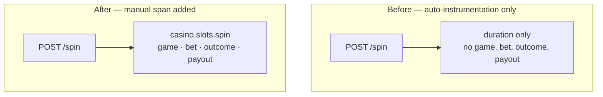

# Step 1 — Instrument with AI agents

**Goal:** make the casino's money-path observable. Auto-instrumentation gives you
the HTTP and DB edges for free, but the *business logic* — the bet, the RNG draw,
the payout decision — is a black box. You will use a coding agent to add manual
spans and domain attributes, then confirm the money-path shows up in Dynatrace.
Budget 30 minutes.

## The concept



Auto-instrumentation shows a generic `POST /spin` server span with a duration,
but nothing about *which game*, *the bet size*, *the outcome*, or *the payout*.
So you cannot answer "are high-value bets losing more often?" or "which game
drives payout cost?". You add a child span that carries the domain.

## Before — the planted gap

The slots service (`vegas-slots-service`, Node.js) wires only the
auto-instrumentation SDK. Its `/spin` handler computes outcome and payout with
**no manual span and no domain attributes**. Reference asset:
`labs/advanced/step1-agent-instrumentation/before.slots-index.js`.

Planted gaps:

- No child span around the outcome/payout computation (the variable part).
- No `casino.*` domain attributes on the server span.
- Losing-edge errors are swallowed — no span event or error status.

## The fix — drive a coding agent

Open the slots service source in your fork and ask your coding agent to add a
manual span around the draw+payout. The target shape (from
`after.slots-index.js`):

```diff
+ const { trace, SpanStatusCode } = require('@opentelemetry/api');
+ const tracer = trace.getTracer('casino-slots', '1.0.0');
  app.post('/spin', async (req, res) => {
-   const bet = Number(req.body.bet);
-   const outcome = draw();
-   const payout = settle(bet, outcome);
-   res.json({ outcome, payout });
+   const bet = Number(req.body.bet);
+   await tracer.startActiveSpan('casino.slots.spin', async (span) => {
+     try {
+       span.setAttribute('casino.game.name', 'slots');
+       span.setAttribute('casino.bet.amount', bet);
+       const outcome = draw();
+       const payout = settle(bet, outcome);
+       span.setAttribute('casino.outcome', outcome.kind);        // win | lose | jackpot
+       span.setAttribute('casino.payout.amount', payout);
+       if (outcome.kind === 'jackpot') span.addEvent('jackpot', { 'casino.payout.amount': payout });
+       res.json({ outcome, payout });
+     } catch (err) {
+       span.setStatus({ code: SpanStatusCode.ERROR, message: err.message });
+       span.recordException(err);
+       throw err;
+     } finally {
+       span.end();
+     }
+   });
  });
```

!!! tip "Why these exact attribute names?"
    `casino.game.name`, `casino.bet.amount`, `casino.outcome`,
    `casino.payout.amount`. Step 1 **creates** these attributes; Step 2
    **guards** them with Weaver. Keep the names exactly as above or the Step 2
    registry check will flag drift.

The same pattern applies to roulette/dice/blackjack. The Java `scoring` service
runs under the OTel Java agent (zero-code), so there you add
`@WithSpan("casino.scoring.settleRound")` and `@SpanAttribute` annotations
(`opentelemetry-instrumentation-annotations`) rather than hand-building the span:

```java
@WithSpan("casino.scoring.settleRound")
public Payout settleRound(@SpanAttribute("casino.game.name") String game,
                          @SpanAttribute("casino.bet.amount") long bet) {
    // ... scoring logic ...
}
```

Commit the change to your fork and let Argo CD redeploy the service, then play a
few rounds of slots to generate traffic.

## Dynatrace validation checkpoint

Run in a Grail **Notebook** against the training tenant (filter to your cluster):

```dql
fetch spans
| filter span.name == "casino.slots.spin"
| summarize spins = count(), avgPayout = avg(toDouble(casino.payout.amount)) by { casino.outcome }
```

- **Before:** the query returns **no rows** — the span does not exist, the
  money-path is invisible.
- **After:** one row per `casino.outcome` (`win` / `lose` / `jackpot`) with payout
  aggregates, and the `casino.slots.spin` span appears as a **child of
  `POST /spin`** in the distributed trace.

## Definition of done

- [ ] `casino.slots.spin` child span wraps the draw+payout
- [ ] It carries `casino.game.name`, `casino.bet.amount`, `casino.outcome`, `casino.payout.amount`
- [ ] The jackpot path records a span event; errors set span status
- [ ] The DQL returns one row per outcome with payout aggregates
- [ ] The span is a child of `POST /spin` in the trace flow

Next: [Step 2 — Weaver pipeline](step-2-weaver-pipeline.md).
