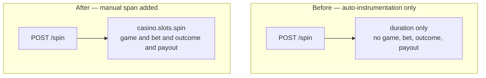

# Step 1 — Instrument with AI agents

!!! abstract "Skill `otel-instrumentation` · ⏱ 30 min · difficulty ●●○ · Core step"
    **Problem → Understand → Drive (ladder) → Review & apply → Verify.** Lean on
    the `otel-instrumentation` skill for this step. Budget ~30 min. Core step, do
    this.

**Goal:** make the casino's money-path observable. Auto-instrumentation gives you
the HTTP and DB edges for free, but the *business logic* — the bet, the RNG draw,
the payout decision — is a black box. After this step a spin carries a
`casino.slots.spin` child span with the game, bet, outcome, and payout on it, so a
casino operator can finally slice spins by outcome and payout instead of staring at
a flat duration. You will run the **Problem → Opencode → Verify** loop from
[The environment](environment.md#the-agent-loop-problem-opencode-verify) for the
first time: see the missing money-path in Dynatrace, drive `opencode` (warmed up in
[Step 0](step-0-warmup.md)) with the `otel-instrumentation` skill to add manual
spans and domain attributes, review the diff, commit for Argo CD to redeploy, and
confirm the span shows up — then extend the same vocabulary to a second game.

## ① Problem — the planted gap

The slots service (`vegas-slots-service`, Node.js) ships **deliberately
under-instrumented**. It wires only the auto-instrumentation SDK, so its `/spin`
handler computes outcome and payout with **no manual span and no domain
attributes**. In Dynatrace the symptom is stark: a spin is a featureless
`POST /spin` server span — flat duration, and because the business logic runs
inside that one handler with no child span, the money-path shows up as an
**orphaned, undifferentiated** operation with nothing you can slice by. Reference
asset (the planted state): `labs/advanced/step1-agent-instrumentation/before.slots-index.js`.



Planted gaps you will see and fix:

- **No child span** around the outcome/payout computation — the variable,
  interesting part of the request is invisible inside the generic server span.
- **No `casino.*` domain attributes** — you cannot answer "are high-value bets
  losing more often?" or "which game drives payout cost?".
- **Losing-edge errors are swallowed** — a settlement failure throws with no span
  event and no error status, so it never surfaces in trace analysis.

Confirm the symptom — run the checkpoint DQL in ⑤ now and watch it return **zero
rows**. That is your "before".

## ② Understand the change

Auto-instrumentation shows a generic `POST /spin` server span with a duration,
but nothing about *which game*, *the bet size*, *the outcome*, or *the payout*.
So you cannot answer "are high-value bets losing more often?" or "which game
drives payout cost?". The fix is a **child span** that wraps exactly the variable
part of the request — the draw and the settlement — and carries the domain on
named attributes. The span name is stable (`casino.slots.spin`) so you can query
it; the attributes are dotted and shared across games so Step 2 and Step 3 can
reuse them. Understand this shape before you let the agent touch anything.

The target shape the agent should converge on (from `after.slots-index.js`):

```diff
+ const { trace, SpanStatusCode } = require('@opentelemetry/api');
+ const tracer = trace.getTracer('casino-slots', '1.0.0');   // one tracer per service
  app.post('/spin', async (req, res) => {
-   const bet = Number(req.body.bet);
-   const outcome = draw();
-   const payout = settle(bet, outcome);
-   res.json({ outcome, payout });
+   const bet = Number(req.body.bet);
+   await tracer.startActiveSpan('casino.slots.spin', async (span) => {   // child of POST /spin
+     try {
+       span.setAttribute('casino.game.name', 'slots');
+       span.setAttribute('casino.bet.amount', bet);
+       const outcome = draw();
+       const payout = settle(bet, outcome);
+       span.setAttribute('casino.outcome', outcome.kind);        // win | lose | jackpot
+       span.setAttribute('casino.payout.amount', payout);
+       if (outcome.kind === 'jackpot') span.addEvent('jackpot', { 'casino.payout.amount': payout });   // span event on jackpot
+       res.json({ outcome, payout });                            // response shape unchanged
+     } catch (err) {
+       span.setStatus({ code: SpanStatusCode.ERROR, message: err.message });   // surface the losing-edge failure
+       span.recordException(err);
+       throw err;
+     } finally {
+       span.end();                                               // always end the span
+     }
+   });
  });
```

The same pattern applies to roulette/dice/blackjack. The Java `scoring` service
runs under the OTel Java agent (zero-code), so there you add
`@WithSpan("casino.scoring.settleRound")` and `@SpanAttribute` annotations
(`opentelemetry-instrumentation-annotations`) rather than hand-building the span:

```java
@WithSpan("casino.scoring.settleRound")
public Payout settleRound(@SpanAttribute("casino.game.name") String game,
                          @SpanAttribute("casino.bet.amount") long bet) {
    // ... scoring logic ...
}
```

!!! tip "Why these exact attribute names?"
    `casino.game.name`, `casino.bet.amount`, `casino.outcome`,
    `casino.payout.amount`. Step 1 **creates** these attributes; [Step 3
    (Weaver)](step-3-weaver-pipeline.md) **guards** them, and [Step 2](step-2-business-metrics.md)
    **reuses** `casino.game.name` / `casino.outcome` as the dimensions on the
    business metrics. Keep the names exactly as above or the Step 3 registry
    check will flag drift.

!!! tip "Keep asking why — read before you drive"
    Before you let the agent change anything, make it explain the target and its
    plan, read-only:

    ```bash
    opencode run "Using the otel-instrumentation skill: read the vegas-slots-service \
    /spin handler and explain what the auto-instrumentation already captures versus \
    what is missing on the money-path. Do NOT edit any file — just report."
    ```

    A good answer names the generic `POST /spin` span and the three gaps — no child
    span, no `casino.*` attributes, swallowed losing-edge errors. Reading first is
    what lets you catch a wrong diff in ④.

## ③ Drive opencode — the prompt ladder

Clone your casino fork, `cd` into it, and climb the ladder one rung at a time. Run
a rung, read what it did, confirm the **review check**, then go to the next rung. Do
not paste all four at once — steering between rungs is the skill. Each prompt names
the **goal**, the **target**, and the **skill**.

**P1 · Orient (read-only)**

```bash
opencode run "Using the otel-instrumentation skill: read the vegas-slots-service \
/spin handler and explain what auto-instrumentation already captures versus what \
is missing on the money-path — no child span, no casino.* attributes, swallowed \
losing-edge errors. Do NOT edit any file."
```

- **What you should see:** the agent names the generic `POST /spin` server span and
  the three gaps, without touching the working tree.
- **Review check:** did it confirm the money-path is invisible inside the server span?

**P2 · Core change**

```bash
opencode run "Using the otel-instrumentation skill: in the vegas-slots-service \
/spin handler, wrap the draw and payout in a child span 'casino.slots.spin' with \
@opentelemetry/api. Set attributes casino.game.name, casino.bet.amount, \
casino.outcome, casino.payout.amount; add a 'jackpot' span event on a jackpot; \
set span error status on failures. Keep the existing response shape."
```

- **What you should see:** a diff matching the shape in ② — the child span, four
  dotted attributes, the jackpot event, and the try/catch error status.
- **Review check:** are all four dotted attribute keys present and the
  `res.json({ outcome, payout })` response untouched?

**P3 · Deepen — second-service extension**

```bash
opencode run "Using the otel-instrumentation skill: apply the SAME pattern to the \
vegas-roulette-service /spin handler — a child span 'casino.roulette.spin' reusing \
the exact keys casino.game.name, casino.outcome, casino.bet.amount, \
casino.payout.amount, the jackpot span event, and the error status. Reuse the \
shared vocabulary; do not rename any attribute. Keep the response shape."
```

- **What you should see:** a matching span on the roulette service carrying the same
  four attribute keys, so slots and roulette share one vocabulary.
- **Review check:** does roulette emit the same four attribute keys (not renamed)?

**P4 · Steer — the planted miss**

```bash
opencode run "Using the otel-instrumentation skill: show me the diff of the roulette \
change and verify it against the slots version — the error-status/recordException \
branch must be present and casino.game.name must be 'roulette', not 'slots'. Report \
any gap before fixing."
```

- **What you should see:** the diff often reveals the agent copied only the happy
  path and **dropped the error-status/recordException branch** — and sometimes
  hardcoded `casino.game.name='slots'` on roulette. The miss is visible in the diff.
- **Review check:** did you catch the dropped error branch (and wrong game name) and
  re-run opencode to restore it, rather than hand-editing?

## ④ Review & apply

In build mode `opencode` writes the change straight into the working tree. **Read
the diff before you commit** — the ⑤ checkpoint only tells you after the fact. The
casino namespace is GitOps-owned, so you apply app-code fixes through Git, not
`kubectl`:

```bash
git add . && git commit -m "feat(slots): add casino.slots.spin money-path span"
git push            # to your fork's main
```

Argo CD syncs within the reconcile interval (hit **Refresh** in the UI at
`http://localhost:30002` to force it), redeploys the slots service, then play a
few rounds of slots to generate traffic.

## ⑤ Verify — Dynatrace validation checkpoint

Run in a Grail **Notebook** against the training tenant (filter to your cluster):

```dql
fetch spans
| filter span.name == "casino.slots.spin"
| summarize spins = count(), avgPayout = avg(toDouble(casino.payout.amount)) by { casino.outcome }
```

- **Before:** the query returns **no rows** — the span does not exist, the
  money-path is invisible.
- **After:** one row per `casino.outcome` (`win` / `lose` / `jackpot`) with payout
  aggregates, and the `casino.slots.spin` span appears as a **child of
  `POST /spin`** in the distributed trace.

!!! warning "Steer-back box — if the agent gets it wrong"
    Re-run `opencode` with the correction rather than hand-editing — the ⑤
    checkpoint tells you when the agent is done.

    - **Attribute dropped or renamed** (`casino.game` instead of
      `casino.game.name`): *"use exactly these four keys, dotted:
      casino.game.name, casino.bet.amount, casino.outcome, casino.payout.amount."*
    - **No error path** (the P4 planted miss on roulette): *"wrap the body in
      try/catch and set SpanStatusCode.ERROR + recordException on failure, same as
      the slots version."*
    - **Wrong game name on roulette** (hardcoded `casino.game.name='slots'`):
      *"set casino.game.name to 'roulette' on the roulette span, not 'slots'."*
    - **Response shape changed**: *"keep the existing `res.json({ outcome, payout })`
      response untouched."*

## Definition of done

- [ ] `casino.slots.spin` child span wraps the draw+payout
- [ ] It carries `casino.game.name`, `casino.bet.amount`, `casino.outcome`, `casino.payout.amount`
- [ ] The jackpot path records a span event; errors set span status
- [ ] The DQL returns one row per outcome with payout aggregates
- [ ] The span is a child of `POST /spin` in the trace flow
- [ ] The roulette service emits a matching span reusing the same four attribute keys (not renamed)
- [ ] You caught the planted miss (dropped error branch / wrong game name) and steered opencode to restore it

Next: [Step 2 — Business metrics](step-2-business-metrics.md).
