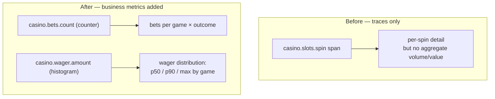

# Step 2 — Business metrics

**Goal:** turn the money-path you instrumented in Step 1 into **business
metrics** you can chart and alert on. Traces answer "what happened on this one
spin"; metrics answer "how many bets, and how much wagered, by game and outcome,
over time". You will run the **Problem → Opencode → Verify** loop again — this
time adding a counter (`casino.bets.count`) and a histogram
(`casino.wager.amount`) to the slots service with the `otel-instrumentation`
skill — then build a DQL tile. Budget 25 minutes.

## The concept



A span is a per-event record — great for "show me this trace", expensive to
aggregate over millions of rows. A **metric** is pre-aggregated and cheap to
query over long windows, so it is what a dashboard or SLO reads. The casino
money-path has rich spans after Step 1 but **no first-class business metrics**:
there is no cheap way to chart "bets per minute on slots" or "wager-size
distribution by outcome". You add two instruments:

| Instrument | Name | Why this type |
|---|---|---|
| Counter | `casino.bets.count` | Monotonic event count — bets placed, by game and outcome. Rolls up to a rate. |
| Histogram | `casino.wager.amount` | A **distribution** — you want p50/p90/max wager, not just a sum, so a histogram (not a counter) is the right instrument. |

Both carry the **same dimensions as the Step 1 span** — `casino.game.name` and
`casino.outcome` — so the metric and the trace share one vocabulary (and the
[Step 3 Weaver registry](step-3-weaver-pipeline.md) can guard both).

!!! note "Bounded dimensions only — on purpose"
    Dimension the metrics **only** by `casino.game.name` (4 values) and
    `casino.outcome` (3 values) — never by `player.id` or `round.id`. That is the
    same cardinality discipline you enforce at the gateway in
    [Step 5](step-5-high-cardinality.md); here you simply never emit the
    unbounded labels in the first place.

## ① Problem — no business metrics on the money-path

After Step 1 the slots service emits a `casino.slots.spin` span per request, but
the `/spin` handler **never records a metric**. Reference asset (the planted
state): `labs/advanced/step-business-metrics/before.slots-metrics.js`.

Confirm the symptom — run the [checkpoint DQL](#dynatrace-validation-checkpoint)
for `casino.bets.count` now and watch it return **no such metric**. That is your
"before": you can pull individual spins, but you cannot cheaply chart bet volume
or wager distribution.

## ② Opencode — add the counter and histogram

Drive `opencode` at the slots service with the `otel-instrumentation` skill. The
prompt names the **goal**, the **target file**, and the **skill**:

```bash
opencode run "Using the otel-instrumentation skill: in the vegas-slots-service \
/spin handler, add OpenTelemetry metrics via @opentelemetry/api metrics. Create \
a Counter 'casino.bets.count' and a Histogram 'casino.wager.amount' (unit chips) \
from a meter 'casino-slots'. On each settled spin, add 1 to the counter and \
record the bet amount to the histogram, both with attributes casino.game.name \
and casino.outcome — matching the Step 1 span. Do NOT add player.id or round.id. \
Keep the existing span and response shape."
```

## ③ Review — read the diff

Read the diff before committing. The target shape (from
`labs/advanced/step-business-metrics/after.slots-metrics.js`):

```diff
+ const { metrics } = require('@opentelemetry/api');
+ const meter = metrics.getMeter('casino-slots', '1.0.0');
+ const betsCount = meter.createCounter('casino.bets.count', {
+   description: 'Number of bets placed', unit: '{bet}',
+ });
+ const wagerAmount = meter.createHistogram('casino.wager.amount', {
+   description: 'Distribution of wagered amounts', unit: '{chip}',
+ });
  app.post('/spin', async (req, res) => {
    const bet = Number(req.body.bet);
    await tracer.startActiveSpan('casino.slots.spin', async (span) => {
      // ... existing span attributes from Step 1 ...
      const outcome = draw();
      const payout = settle(bet, outcome);
      span.setAttribute('casino.outcome', outcome.kind);
      span.setAttribute('casino.payout.amount', payout);
+     const dims = { 'casino.game.name': 'slots', 'casino.outcome': outcome.kind };
+     betsCount.add(1, dims);
+     wagerAmount.record(bet, dims);
      res.json({ outcome, payout });
      // ... existing error handling + span.end() ...
    });
  });
```

!!! warning "If the agent gets it wrong — steer it back"
    - **Uses a counter for the wager** (`casino.wager.amount` as a Counter):
      *"wager.amount must be a Histogram — I want p50/p90, not a running sum."*
    - **Adds high-cardinality dims** (`player.id`, `round.id`): *"only
      casino.game.name and casino.outcome as dimensions — drop any per-player or
      per-round label."*
    - **Creates a new meter per request** (inside the handler): *"create the meter
      and instruments once at module scope, not inside the /spin handler."*

## ④ Apply — commit → Argo CD sync

Same GitOps apply as Step 1 — the slots service is in the casino namespace:

```bash
git add . && git commit -m "feat(slots): add casino.bets.count + casino.wager.amount metrics"
git push            # to your fork's main
```

Argo CD redeploys the service (hit **Refresh** at `http://localhost:30002` to
force the sync); play a few rounds of slots so the instruments emit.

## Dynatrace validation checkpoint

Run in a Grail **Notebook** against the training tenant (filter to your cluster).

**Bet volume by game and outcome** (the counter, as a rate):

```dql
timeseries bets = sum(casino.bets.count), by: { casino.game.name, casino.outcome }, from: now() - 1h
```

**Wager-size distribution** (the histogram — p50/p90/max):

```dql
timeseries wager_p90 = percentile(casino.wager.amount, 90), by: { casino.game.name }, from: now() - 1h
```

- **Before:** both metrics are **absent** — `casino.bets.count` /
  `casino.wager.amount` do not exist; the queries return nothing.
- **After:** `casino.bets.count` returns one series per `casino.game.name` ×
  `casino.outcome` (≤ 12 series — bounded on purpose), and
  `casino.wager.amount` returns a p90 wager per game.

### Build a DQL tile

Pin the first query as a tile so you have a live "bets per minute by outcome"
chart — this is the business view a casino operator would actually watch:

1. In the Notebook, run the `casino.bets.count` query above.
2. Switch the visualization to a **line chart**, split by `casino.outcome`.
3. **Add to dashboard** → a dashboard named after your `PARTICIPANT_ID`.

!!! tip "Why a histogram for wager, a counter for bets"
    A counter answers *how many* (and its rate). A histogram answers *what
    distribution* — the p90 wager is what tells you whether a few whales or many
    small bets drive volume. Picking the instrument type to match the question is
    the core skill here; the agent will follow whichever you specify, so specify
    deliberately.

## Definition of done

- [ ] `casino.bets.count` counter and `casino.wager.amount` histogram emitted from the slots service
- [ ] Both carry **only** `casino.game.name` + `casino.outcome` (no player/round id)
- [ ] The counter DQL returns ≤ 12 bounded series
- [ ] The histogram DQL returns a p90 wager per game
- [ ] A "bets by outcome" tile is pinned to your dashboard

Next: [Step 3 — Weaver pipeline](step-3-weaver-pipeline.md).
