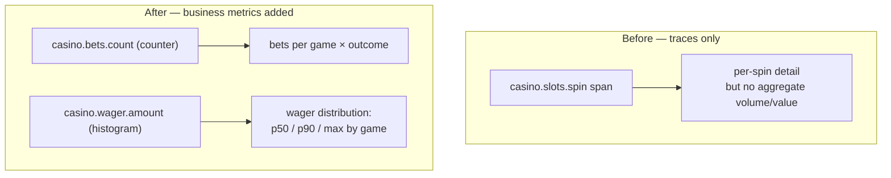

# Step 2 — Business metrics

!!! abstract "Skill `otel-instrumentation` · ⏱ 25 min · difficulty ●●○ · Core step"
    **Problem → Understand → Drive (ladder) → Review & apply → Verify.** Lean on
    the `otel-instrumentation` skill for this step. Budget ~25 min. Core step, do
    this.

**Goal:** turn the money-path you instrumented in Step 1 into **business
metrics** you can chart and alert on. Traces answer "what happened on this one
spin"; metrics answer "how many bets, and how much wagered, by game and outcome,
over time". Afterward the slots service should emit a counter
(`casino.bets.count`) and a histogram (`casino.wager.amount`), both bounded by
`casino.game.name` and `casino.outcome` — the cheap, pre-aggregated view a
casino operator watches to see bet volume and wager distribution in real time,
without scanning millions of spans.

## ① Problem — no business metrics on the money-path

After Step 1 the slots service emits a `casino.slots.spin` span per request, but
the `/spin` handler **never records a metric**. A span is a per-event record —
great for "show me this trace", expensive to aggregate over millions of rows. A
**metric** is pre-aggregated and cheap to query over long windows, so it is what
a dashboard or SLO reads. The casino money-path has rich spans after Step 1 but
**no first-class business metrics**: there is no cheap way to chart "bets per
minute on slots" or "wager-size distribution by outcome".



Reference asset (the planted state):
`labs/advanced/step-business-metrics/before.slots-metrics.js`.

Confirm the symptom — run the [checkpoint DQL](#5-verify-dynatrace-validation-checkpoint)
in ⑤ now and watch it return **no such metric**. That is your "before": you can
pull individual spins, but you cannot cheaply chart bet volume or wager
distribution.

## ② Understand the change

You add two instruments, and the type of each one is the whole point — pick it to
match the question you need to answer:

| Instrument | Name | Why this type |
|---|---|---|
| Counter | `casino.bets.count` | Monotonic event count — bets placed, by game and outcome. Rolls up to a rate. |
| Histogram | `casino.wager.amount` | A **distribution** — you want p50/p90/max wager, not just a sum, so a histogram (not a counter) is the right instrument. |

Both carry the **same dimensions as the Step 1 span** — `casino.game.name` and
`casino.outcome` — so the metric and the trace share one vocabulary (and the
[Step 3 Weaver registry](step-3-weaver-pipeline.md) can guard both).

!!! note "Bounded dimensions only — on purpose"
    Dimension the metrics **only** by `casino.game.name` (4 values) and
    `casino.outcome` (3 values) — never by `player.id` or `round.id`. That is the
    same cardinality discipline you enforce at the gateway in
    [Step 5](step-5-high-cardinality.md); here you simply never emit the
    unbounded labels in the first place.

The target shape (from
`labs/advanced/step-business-metrics/after.slots-metrics.js`) — read the inline
comments before you drive the agent:

```diff
+ const { metrics } = require('@opentelemetry/api');
+ const meter = metrics.getMeter('casino-slots', '1.0.0');  // module scope: created once
+ const betsCount = meter.createCounter('casino.bets.count', {
+   description: 'Number of bets placed', unit: '{bet}',
+ });
+ const wagerAmount = meter.createHistogram('casino.wager.amount', {  // distribution, not a sum
+   description: 'Distribution of wagered amounts', unit: '{chip}',
+ });
  app.post('/spin', async (req, res) => {
    const bet = Number(req.body.bet);
    await tracer.startActiveSpan('casino.slots.spin', async (span) => {
      // ... existing span attributes from Step 1 ...
      const outcome = draw();
      const payout = settle(bet, outcome);
      span.setAttribute('casino.outcome', outcome.kind);
      span.setAttribute('casino.payout.amount', payout);
+     const dims = { 'casino.game.name': 'slots', 'casino.outcome': outcome.kind };  // only two bounded dims
+     betsCount.add(1, dims);
+     wagerAmount.record(bet, dims);
      res.json({ outcome, payout });
      // ... existing error handling + span.end() ...
    });
  });
```

!!! tip "Keep asking why — read before you drive"
    Before you let the agent change anything, make it explain the target and its
    plan, read-only:

    ```bash
    opencode run "Using the otel-instrumentation skill: read the vegas-slots-service \
    /spin handler and the reference asset \
    labs/advanced/step-business-metrics/before.slots-metrics.js. Explain what \
    telemetry it records today and what you WOULD add to emit bet volume and wager \
    distribution — do NOT edit anything yet."
    ```

    A good answer confirms the `/spin` handler records a span but **no counter or
    histogram**, and names a span as the wrong tool for "bets per minute" (one
    record per event, expensive to aggregate). Reading first is what lets you
    catch a wrong diff in ④.

## ③ Drive opencode — the prompt ladder

Climb the ladder one rung at a time. Run a rung, read what it did, confirm the
**review check**, then go to the next rung. Do not paste all four at once —
steering between rungs is the skill.

**P1 · Orient (read-only)**

```bash
opencode run "Using the otel-instrumentation skill: read the vegas-slots-service \
/spin handler. Confirm whether a metric is recorded on each spin, and explain why \
a span alone is a poor way to answer 'bets per minute by game' (per-event record, \
expensive to aggregate over long windows). Do NOT make any edits."
```

- **What you should see:** the agent reports that `/spin` records the Step 1
  `casino.slots.spin` span but **no counter or histogram**, and explains that a
  metric is the pre-aggregated, cheap-to-query instrument for volume over time.
- **Review check:** did it confirm there is no counter or histogram yet?

**P2 · Core change**

```bash
opencode run "Using the otel-instrumentation skill: in the vegas-slots-service \
/spin handler, add a Counter 'casino.bets.count' via @opentelemetry/api metrics \
from a meter 'casino-slots' created once at module scope (not per request). On \
each settled spin, add 1 to the counter with attributes casino.game.name and \
casino.outcome only — matching the Step 1 span. Do NOT add player.id or round.id. \
Keep the existing span and response shape."
```

- **What you should see:** the counter half of the diff above — a module-scope
  `meter` and `betsCount`, incremented inside `/spin` with the two bounded dims.
- **Review check:** is the counter created once at module scope (not per request)
  with only `casino.game.name` + `casino.outcome`?

**P3 · Deepen — counter → histogram → explicit buckets**

```bash
opencode run "Using the otel-instrumentation skill: now add a Histogram \
'casino.wager.amount' (unit chips) from the same casino-slots meter, recording \
the bet amount on each settled spin with the same casino.game.name + \
casino.outcome dims. Then set explicit histogram bucket boundaries suited to \
casino bet sizes so p50/p90/max are meaningful — do not rely on the default \
buckets."
```

- **What you should see:** the histogram half of the diff, plus explicit
  `advice`/view bucket boundaries chosen for real bet sizes rather than the SDK
  defaults.
- **Review check:** is wager a **Histogram** (not a Counter) with **explicit**
  bucket boundaries?

**P4 · Steer — the cardinality trap**

```bash
opencode run "Using the otel-instrumentation skill: make these casino metrics \
richer and more useful for debugging individual players."
```

- **What you should see:** the agent will often "enrich" by adding `player.id` or
  `round.id` as a metric dimension — spot that unbounded label in the diff and
  reject it. Per-player detail belongs on the Step 1 **spans**, where cardinality
  is free; on metrics it explodes the series count.
- **Review check:** did you reject the per-player/per-round dimension and keep the
  metrics at **≤ 12 bounded series** (only `casino.game.name` + `casino.outcome`)?

## ④ Review & apply — commit → Argo CD sync

Read the diff before committing. Same GitOps apply as Step 1 — the slots service
is in the casino namespace:

```bash
git add . && git commit -m "feat(slots): add casino.bets.count + casino.wager.amount metrics"
git push            # to your fork's main
```

Argo CD redeploys the service (hit **Refresh** at `http://localhost:30002` to
force the sync); play a few rounds of slots so the instruments emit.

## ⑤ Verify — Dynatrace validation checkpoint

Run in a Grail **Notebook** against the training tenant (filter to your cluster).

**Bet volume by game and outcome** (the counter, as a rate):

```dql
timeseries bets = sum(casino.bets.count), by: { casino.game.name, casino.outcome }, from: now() - 1h
```

**Wager-size distribution** (the histogram — p50/p90/max):

```dql
timeseries wager_p90 = percentile(casino.wager.amount, 90), by: { casino.game.name }, from: now() - 1h
```

- **Before:** both metrics are **absent** — `casino.bets.count` /
  `casino.wager.amount` do not exist; the queries return nothing.
- **After:** `casino.bets.count` returns one series per `casino.game.name` ×
  `casino.outcome` (≤ 12 series — bounded on purpose), and
  `casino.wager.amount` returns a p90 wager per game.

### Build a DQL tile

Pin the first query as a tile so you have a live "bets per minute by outcome"
chart — this is the business view a casino operator would actually watch:

1. In the Notebook, run the `casino.bets.count` query above.
2. Switch the visualization to a **line chart**, split by `casino.outcome`.
3. **Add to dashboard** → a dashboard named after your `PARTICIPANT_ID`.

!!! tip "Why a histogram for wager, a counter for bets"
    A counter answers *how many* (and its rate). A histogram answers *what
    distribution* — the p90 wager is what tells you whether a few whales or many
    small bets drive volume. Picking the instrument type to match the question is
    the core skill here; the agent will follow whichever you specify, so specify
    deliberately.

!!! warning "Steer-back box — if the agent gets it wrong"
    Re-run opencode with the correction rather than hand-editing; the ⑤
    checkpoint tells you when done.

    - **Uses a counter for the wager** (`casino.wager.amount` as a Counter):
      *"wager.amount must be a Histogram — I want p50/p90, not a running sum."*
    - **Leaves the histogram on default buckets** (p90 looks coarse or useless):
      *"set explicit bucket boundaries sized for casino bets so p50/p90/max are
      meaningful."*
    - **Adds high-cardinality dims** (`player.id`, `round.id`): *"only
      casino.game.name and casino.outcome as dimensions — drop any per-player or
      per-round label; per-player detail belongs on the Step 1 span."*
    - **Creates a new meter per request** (inside the handler): *"create the meter
      and instruments once at module scope, not inside the /spin handler."*

## Definition of done

- [ ] `casino.bets.count` counter and `casino.wager.amount` histogram emitted from the slots service
- [ ] Both carry **only** `casino.game.name` + `casino.outcome` (no player/round id)
- [ ] The counter DQL returns ≤ 12 bounded series
- [ ] The histogram DQL returns a p90 wager per game
- [ ] The histogram uses **explicit bucket boundaries** sized for casino bets (not SDK defaults)
- [ ] You **rejected** the high-cardinality (`player.id`/`round.id`) dimension when the agent offered it
- [ ] A "bets by outcome" tile is pinned to your dashboard

Next: [Step 3 — Weaver pipeline](step-3-weaver-pipeline.md).
