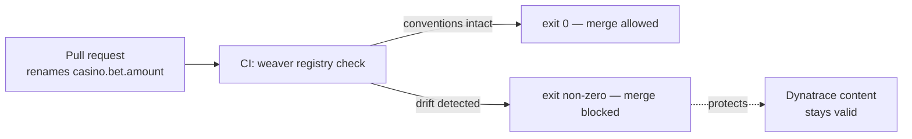

# Step 2 — Weaver pipeline

**Goal:** stop the attributes you just created in Step 1 from silently rotting.
You will turn the `casino.*` conventions into a versioned registry and a CI check
that fails the pull request on drift. Budget 25 minutes.

## The concept

Step 1 introduced `casino.*` attributes by hand. Without a guard, the next
refactor renames `casino.bet.amount` → `casino.betAmount`, or adds a `round.id`
dimension to a metric, and every dashboard, DQL query, and alert that depends on
the old name breaks — silently. [Weaver](https://github.com/open-telemetry/weaver)
makes the conventions a **versioned registry** and a **CI check**.



## The assets

From `labs/advanced/step2-weaver-semconv/`:

```
registry/
  registry_manifest.yaml     # registry name + version
  models/casino.yaml         # the casino.* attribute registry + span & metric conventions
weaver-policies/
  casino_policies.rego       # extra guards: snake_case naming + no high-card metric dims
ci/weaver-check.yml          # GitHub Actions workflow running `weaver registry check`
```

## Before — no guard

No registry, no CI check. A rename or a stray high-cardinality dimension merges
freely and Dynatrace content silently rots. This is the status quo you start
from.

## The fix — add the guard

Run the same command CI runs (exit 0 means conventions intact):

```bash
weaver registry check \
  --registry labs/advanced/step2-weaver-semconv/registry \
  --policy   labs/advanced/step2-weaver-semconv/weaver-policies
```

### Watch the guard fire

Introduce drift and confirm it is blocked:

```bash
# camelCase drift → policy deny
sed -i 's/casino.bet.amount/casino.betAmount/' registry/models/casino.yaml
weaver registry check --registry registry --policy weaver-policies
#  → FAIL: casino attribute 'casino.betAmount' must be snake_case (no camelCase)
```

A high-cardinality dimension on the payout metric (adding
`- ref: casino.round.id` under `metric.casino.payout`) is denied the same way.
Revert the edit and the check goes green again.

!!! note "The CI job gates merges"
    In the casino repo the `weaver-semconv-check` job runs on `services/**`
    changes, so drift can never reach `main`. Weaver is pinned in
    `ci/weaver-check.yml`.

## Dynatrace validation checkpoint

Weaver is a **build-time** guard, so its primary checkpoint is CI: green vs red.
The *downstream* Dynatrace evidence: because the names are stable, the **Step 1
DQL keeps returning rows across releases**.

```dql
fetch spans
| filter span.name == "casino.slots.spin"
| summarize spins = count() by { casino.outcome }
```

- **With the guard:** rows keep coming after every release — the attribute names
  never silently change.
- **Contrast (a "renamed attribute" branch with no guard):** the same DQL returns
  **zero rows** — exactly the regression Weaver would have blocked.

## Definition of done

- [ ] `weaver registry check` exits 0 on the intact registry
- [ ] A camelCase rename is denied by policy
- [ ] A high-cardinality metric dimension is denied by policy
- [ ] The `weaver-semconv-check` CI job is wired for `services/**`
- [ ] The Step 1 DQL still returns rows (names held stable)

Next: [Step 3 — Cost of observability](step-3-cost-of-observability.md).
