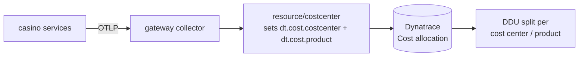

# Step 3 — Cost of observability

**Goal:** attribute your telemetry spend. You cannot manage what you cannot
attribute, so you will inject the Dynatrace cost-center attributes at the gateway
and read ingest split per cost center. Budget 20 minutes.

## The concept

Dynatrace **Cost Allocation** reads two resource attributes — `dt.cost.costcenter`
and `dt.cost.product`. Once every signal carries them, DDU consumption can be
split per team/product and charged back. Injecting at the **gateway** (not per
app) means one change covers traces, metrics, and logs for the whole cluster.



## Before — one undifferentiated bucket

The baseline gateway exports telemetry with **no** `dt.cost.*` attributes, so
**Account Management → Cost allocation** shows everything under a single bucket.
You cannot answer "how much does the casino platform cost vs the scoring
service?".

## The fix — inject the cost-center at the gateway

Apply the `resource/costcenter` processor
(`labs/advanced/step3-cost-center/cost-center-processor.yaml`), which is already
merged into the composed `labs/advanced/gateway-advanced.yaml` in the correct
pipeline position (after `k8sattributes`, before `batch`):

```bash
# set the cost center for your team, then apply the gateway with the processor wired in
kubectl -n observability set env deployment/otel-gateway-collector \
  COST_CENTER=casino-platform-training COST_PRODUCT=vegas-casino
kubectl apply -f labs/advanced/gateway-advanced.yaml
```

Every span, metric, and log the gateway exports now carries
`dt.cost.costcenter=casino-platform-training` and `dt.cost.product=vegas-casino`.

!!! note "Why resource-level, and why at the gateway"
    `dt.cost.*` are **resource** attributes — they describe the source, not a
    single event, so the `resource` processor is the right tool. Putting it at
    the gateway means you tag all three signals in one place instead of touching
    every service SDK.

## Dynatrace validation checkpoint

Cost/ingest readout — volume split by cost center over the last hour, in a Grail
Notebook:

```dql
fetch logs, from: now() - 1h
| filter isNotNull(dt.cost.costcenter)
| summarize ingested = count() by { dt.cost.costcenter, dt.cost.product }
| sort ingested desc
```

- **Before:** `dt.cost.costcenter` is null everywhere → a single undifferentiated
  bucket.
- **After:** one row per cost center/product; **Account Management → Cost
  allocation** attributes DDU consumption to `casino-platform-training`.

## Definition of done

- [ ] The `resource/costcenter` processor is wired into the gateway (after `k8sattributes`, before `batch`)
- [ ] `COST_CENTER` / `COST_PRODUCT` are set on the gateway deployment
- [ ] The DQL returns rows keyed by `dt.cost.costcenter` / `dt.cost.product`
- [ ] Cost allocation in Dynatrace splits DDU per cost center

Next: [Step 4 — High-cardinality metrics](step-4-high-cardinality.md).
