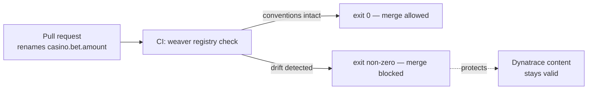

# Step 3 — Weaver pipeline

!!! abstract "Skill `otel-semantic-conventions` · ⏱ 25 min · difficulty ●●● · Stretch step (skip if tight on time)"
    **Problem → Understand → Drive (ladder) → Review & apply → Verify.** Lean on
    the `otel-semantic-conventions` skill for this step. Budget ~25 min. Stretch
    step — skip if tight on time; the money-path is already observable after
    Steps 1–2.

!!! info "Optional / stretch step"
    Weaver is a build-time governance guard, not a telemetry fix. If you are tight
    on time, skim the concept and move to [Step 4](step-4-cost-of-observability.md) —
    the money-path is already observable after Steps 1–2. Come back here when you
    want to stop those attributes from rotting.

**Goal:** stop the attributes you created in Step 1 (and reused for the Step 2
metrics) from silently rotting. You will turn the `casino.*` conventions into a
versioned Weaver registry plus a policy and a CI check that fails the pull
request on drift. Afterward the `casino.*` names are pinned by a machine-checked
contract, so every dashboard, DQL query, and alert a casino operator relies on
keeps resolving across releases instead of quietly going blank after a refactor.

## ① Problem — silent attribute rot

Step 1 introduced `casino.*` attributes by hand. Without a guard, the next
refactor renames `casino.bet.amount` → `casino.betAmount`, or adds a `round.id`
dimension to a metric, and every dashboard, DQL query, and alert that depends on
the old name breaks — silently. Nothing errors; the data just stops matching the
old name and the content goes blank. For an operator, a revenue panel that reads
zero because an attribute was renamed is indistinguishable from a real revenue
drop. [Weaver](https://github.com/open-telemetry/weaver) makes the conventions a
**versioned registry** and a **CI check** so that rename can never merge.



The planted gap is the status quo: no registry and no CI check in
`labs/advanced/step2-weaver-semconv/`, so a rename or a stray high-cardinality
dimension merges freely and Dynatrace content silently rots.

Confirm the symptom — run the checkpoint DQL in ⑤ now and watch it return rows
on the intact `casino.outcome` attribute. That is your "before": content that
works today but has nothing stopping a rename from blanking it tomorrow.

## ② Understand the change

Unlike the collector steps, the "change" here is not a telemetry diff — it is a
**build-time registry**. Weaver reads a set of YAML models that declare each
`casino.*` attribute and metric, plus rego policies that assert extra rules, and
`weaver registry check` returns non-zero the moment the code drifts from that
contract. The registry becomes the single source of truth the CI job defends, so
drift is caught in the pull request instead of in a broken dashboard weeks later.

The target shape is the asset tree, not a code diff. From
`labs/advanced/step2-weaver-semconv/`:

```
registry/
  registry_manifest.yaml     # registry name + version
  models/casino.yaml         # the casino.* attribute registry + span & metric conventions
weaver-policies/
  casino_policies.rego       # extra guards: snake_case naming + no high-card metric dims
ci/weaver-check.yml          # GitHub Actions workflow running `weaver registry check`
```

The interesting pieces:

- `registry/models/casino.yaml` — declares the four Step 1 attributes and the two
  Step 2 metrics with snake/dotted names. This is the contract.
- `weaver-policies/casino_policies.rego` — the rego guards that go beyond shape:
  they forbid camelCase names (so `casino.betAmount` is rejected) and forbid
  high-cardinality dimensions on metrics (so a `round.id` ref under a metric is
  rejected). Metric dimensions are only ever `casino.game.name` and
  `casino.outcome`.
- `ci/weaver-check.yml` — the workflow that runs `weaver registry check`, so the
  contract is enforced on every pull request, not just when someone remembers.

!!! tip "Keep asking why — read before you drive"
    Before you let the agent change anything, make it explain the target and its
    plan, read-only:

    ```bash
    opencode run "Using the otel-semantic-conventions skill: read the casino.* \
    attributes and metrics emitted by the slots service AND the existing \
    labs/advanced/step2-weaver-semconv/registry dir, and explain what a Weaver \
    registry plus CI check guards against. Do NOT edit anything."
    ```

    A good answer names the real symptom (silent attribute rot on rename or a new
    high-card dimension), the right place to change (the registry models + rego
    policy under `labs/advanced/step2-weaver-semconv/`), and the invariant
    (snake/dotted names, metric dims only `casino.game.name` / `casino.outcome`).
    Reading first is what lets you catch a wrong diff in ④.

## ③ Drive opencode — the prompt ladder

Climb the ladder one rung at a time. Run a rung, read what it did, confirm the
**review check**, then go to the next rung. Do not paste all four at once —
steering between rungs is the skill.

**P1 · Orient (read-only)**

```bash
opencode run "Using the otel-semantic-conventions skill: read the casino.* \
attributes and metrics actually emitted by the slots service AND the existing \
labs/advanced/step2-weaver-semconv/registry dir, then explain what a Weaver \
registry plus a CI check guards against (silent attribute rot). Do NOT edit \
anything — list only the casino.* keys you actually find."
```

- **What you should see:** a read-only explanation of registry-as-contract and a
  list of the `casino.*` keys the slots service really emits, with no edits made.
- **Review check:** did it list only the real `casino.*` keys (the four Step 1
  attributes + the two Step 2 metrics), not invented ones?

**P2 · Core change**

```bash
opencode run "Using the otel-semantic-conventions skill: make \
labs/advanced/step2-weaver-semconv/registry a complete Weaver registry covering \
casino.game.name, casino.bet.amount, casino.outcome, casino.payout.amount and \
the Step 2 metrics casino.bets.count / casino.wager.amount. Enforce snake/dotted \
naming. Only include casino.* keys that the slots service actually emits."
```

- **What you should see:** a complete `registry/models/casino.yaml` declaring the
  four Step 1 attributes and the two Step 2 metrics with snake/dotted names.
- **Review check:** does the registry cover exactly the emitted keys — quote each
  one (`casino.game.name`, `casino.bet.amount`, `casino.outcome`,
  `casino.payout.amount`, `casino.bets.count`, `casino.wager.amount`) and no
  invented extras?

**P3 · Deepen — wire the policy**

```bash
opencode run "Using the otel-semantic-conventions skill: add/complete \
labs/advanced/step2-weaver-semconv/weaver-policies/casino_policies.rego so it \
forbids camelCase attribute names and forbids high-cardinality metric \
dimensions (metric dims only casino.game.name and casino.outcome). Then run \
weaver registry check against the registry and policy and get exit 0."
```

- **What you should see:** a completed `weaver-policies/casino_policies.rego` and
  a clean `weaver registry check` run:

  ```bash
  weaver registry check \
    --registry labs/advanced/step2-weaver-semconv/registry \
    --policy   labs/advanced/step2-weaver-semconv/weaver-policies
  ```

- **Review check:** does the check pass clean (exit 0) on the intact registry?

**P4 · Steer — drift → CI red**

```bash
opencode run "Using the otel-semantic-conventions skill: do NOT soften the \
policy. I will introduce drift in labs/advanced/step2-weaver-semconv/registry — \
a camelCase rename and a high-cardinality metric dimension — and I expect \
weaver registry check to DENY both. Explain which rego rule fires for each and \
confirm revert restores exit 0."
```

Introduce the drift yourself and watch the check go RED:

```bash
# camelCase drift → policy deny
sed -i 's/casino.bet.amount/casino.betAmount/' registry/models/casino.yaml
weaver registry check --registry registry --policy weaver-policies
#  → FAIL: casino attribute 'casino.betAmount' must be snake_case (no camelCase)
```

A high-cardinality dimension on the payout metric (adding
`- ref: casino.round.id` under `metric.casino.payout`) is denied the same way.
Revert both edits and the check goes green again. This is the "Weaver drift →
CI-red" exercise.

- **What you should see:** both drifts rejected with non-zero exit, then exit 0
  after you revert.
- **Review check:** did both the camelCase rename AND the high-card dimension get
  DENIED, and does revert restore green?

## ④ Review & apply

There is no `kubectl` and no git-to-Argo rollout here — the "change" is a
build-time registry, so "apply" means running the same check CI runs, locally.
Read the diff first: confirm `registry/models/casino.yaml` lists only emitted
`casino.*` keys and the rego policy under `weaver-policies/` still forbids
camelCase and high-card metric dimensions. Then run the exact command CI runs
(exit 0 means conventions intact):

```bash
weaver registry check \
  --registry labs/advanced/step2-weaver-semconv/registry \
  --policy   labs/advanced/step2-weaver-semconv/weaver-policies
```

From there the `weaver-semconv-check` CI job carries the enforcement — you rely
on it to run the same check on every pull request.

!!! note "The CI job gates merges"
    In the casino repo the `weaver-semconv-check` job runs on `services/**`
    changes, so drift can never reach `main`. Weaver is pinned in
    `ci/weaver-check.yml`.

## ⑤ Verify — Dynatrace validation checkpoint

Weaver is a **build-time** guard, so its primary checkpoint is CI: green vs red.
The *downstream* Dynatrace evidence: because the names are stable, the **Step 1
DQL keeps returning rows across releases**.

```dql
fetch spans
| filter span.name == "casino.slots.spin"
| summarize spins = count() by { casino.outcome }
```

- **With the guard:** rows keep coming after every release — the attribute names
  never silently change.
- **Contrast (a "renamed attribute" branch with no guard):** the same DQL returns
  **zero rows** — exactly the regression Weaver would have blocked.

!!! warning "Steer-back box — if the agent gets it wrong"
    Re-run `opencode` with the correction rather than hand-editing; the ⑤
    checkpoint (and a clean `weaver registry check`) tells you when you are done.

    - **Invents attributes the code does not emit** → *"only include casino.*
      keys that actually appear in the slots service source and the Step 2
      metrics — quote each one."* The committed `registry/models/casino.yaml` is
      the reference answer.
    - **Softens the rego to make the check pass** → *"do not weaken the policy;
      keep forbidding camelCase and high-cardinality metric dimensions — fix the
      registry, not the rule."*
    - **Lets drift through** → *"the camelCase rename and the `casino.round.id`
      metric dimension must both be DENIED; show me the rego rule that fires for
      each."*

## Definition of done

- [ ] `weaver registry check` exits 0 on the intact registry
- [ ] The rego policy (`weaver-policies/casino_policies.rego`) is wired and
      enforced by the check
- [ ] A camelCase rename is denied by policy
- [ ] A high-cardinality metric dimension is denied by policy
- [ ] Drift demonstrably turns CI red, then green again on revert
- [ ] The `weaver-semconv-check` CI job is wired for `services/**`
- [ ] The Step 1 DQL still returns rows (names held stable)

Next: [Step 4 — Cost of observability](step-4-cost-of-observability.md).
