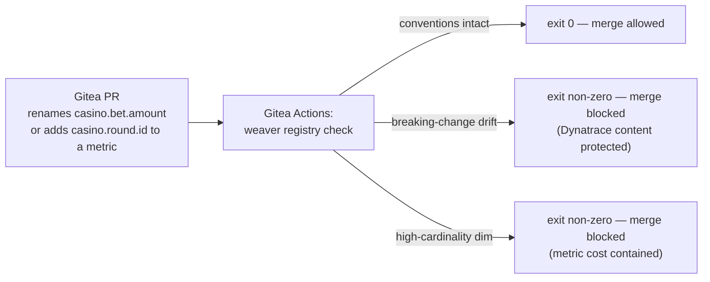

# Step 3 — Controlling OTel data: breaking changes & expensive metrics in the Gitea CI

_The `labs/advanced/` directories keep their original feature-ordinal numbering, so they run one behind these doc steps — the registry source for this page lives under `labs/advanced/step2-weaver-semconv/`, and the bring-up seeds it into your casino repo at `semconv/` (see below)._

!!! info "Optional / stretch step"
    Weaver is a build-time governance guard, not a telemetry fix. If you are tight
    on time, skim the concept and move to [Step 4](step-4-cost-of-observability.md) —
    the money-path is already observable after Steps 1–2. Come back here when you
    want to stop those attributes from rotting and keep your metrics cheap.

**Goal:** learn to **control your OTel data** on two axes, enforced by your lab's
*real* in-cluster CI (Gitea Actions — the same runner that builds the casino
images):

1. **Breaking changes on core attributes.** A camelCase rename of a `casino.*`
   attribute (`casino.bet.amount` → `casino.betAmount`) fails CI and blocks the
   merge, so every dashboard, DQL query, and alert that depends on the name keeps
   working.
2. **Expensive metrics.** Adding a high-cardinality `*.id` dimension (e.g.
   `casino.round.id`) to a metric fails CI — catching a cost explosion *before* it
   ships, not on next month's bill.

You will turn the `casino.*` conventions into a versioned
[Weaver](https://github.com/open-telemetry/weaver) registry and wire a CI check
that fails the pull request on either kind of drift. Budget 25 minutes.

## The concept

Step 1 introduced `casino.*` attributes by hand. Without a guard, the next
refactor renames an attribute or sticks a per-round id onto a metric, and either
your Dynatrace content silently breaks or your metric cardinality (and cost)
quietly explodes. Weaver makes the conventions a **versioned registry** plus a
**rego policy**, and `weaver registry check` fails the PR on drift.



## The assets

The registry + policy are authored in the training repo under
`labs/advanced/step2-weaver-semconv/`, and the bring-up (`seed-gitea.sh`) copies
them into **your** casino repo so the in-cluster runner can see them:

```
# In your Gitea repo  (http://localhost:30001/casino/casino)
semconv/
  registry/
    registry_manifest.yaml     # registry name + version
    models/casino.yaml         # the casino.* attribute registry + span & metric conventions
  weaver-policies/
    casino_policies.rego       # the two guards: snake_case naming + no high-card metric dims
.gitea/workflows/
  weaver-semconv.yml           # Gitea Actions: runs `weaver registry check` on the in-cluster runner
```

The policy (`casino_policies.rego`) already encodes **both** axes — do not reinvent
it, extend it:

```rego
# 1. Breaking change: every casino.* attribute must be snake_case dotted.
deny contains msg if {
	some group in input.groups
	some attr in group.attributes
	startswith(attr.id, "casino.")
	regex.match(`[A-Z]`, attr.id)
	msg := sprintf("casino attribute '%s' must be snake_case (no camelCase)", [attr.id])
}

# 2. Expensive metric: casino.payout.total must NOT carry any *.id dimension.
deny contains msg if {
	some group in input.groups
	group.metric_name == "casino.payout.total"
	some attr in group.attributes
	endswith(attr.ref, ".id")
	msg := sprintf("metric casino.payout.total must not carry high-cardinality dimension '%s'", [attr.ref])
}
```

!!! note "GitHub Actions copy is the maintainer reference"
    `labs/advanced/step2-weaver-semconv/ci/weaver-check.yml` is the GitHub Actions
    version, kept as a reference for the public GHCR repo. The job you actually
    watch go red in this lab is the **Gitea** one — `.gitea/workflows/weaver-semconv.yml`,
    which runs Weaver via the pinned `otel/weaver:v0.17.1` image through the runner's
    dind daemon (no composite action needed), on the same in-cluster runner that
    builds the casino images.

## Before — no guard

No registry, no CI check. A rename or a stray high-cardinality dimension merges
freely: either Dynatrace content silently rots, or a metric's cardinality blows
up unnoticed. This is the status quo you start from.

## Part 1 — Breaking changes on core attributes

### ① Opencode — author (or extend) the registry

Unlike the collector steps, the fix here is a **registry**, not a pipeline change.
Drive `opencode` with the `otel-semantic-conventions` skill to author or extend the
registry from the `casino.*` attributes already in the code — goal, target dir, skill:

```bash
opencode run "Using the otel-semantic-conventions skill: review the casino.* \
attributes used in the slots service, and make semconv/registry a complete \
Weaver registry covering casino.game.name, casino.bet.amount, casino.outcome and \
casino.payout.amount, plus the casino.payout.total metric. Enforce snake/dotted \
naming and forbid high-cardinality metric dimensions in semconv/weaver-policies."
```

Review the diff, then run the same command CI runs (exit 0 means conventions
intact). You can run it locally against the pinned image — exactly what the Gitea
job does:

```bash
# Local run via the pinned image (what CI runs; exit 0 = conventions intact).
docker run --rm -v "$PWD:/work" -w /work otel/weaver:v0.17.1 \
  registry check --registry semconv/registry --policy semconv/weaver-policies
```

!!! tip "If the agent gets it wrong — steer it back"
    If the agent invents attributes the code does not emit, reply *"only include
    casino.* keys that actually appear in the slots service source — quote each
    one."* The committed `semconv/registry/models/casino.yaml` is the reference answer.

### ② Push a camelCase rename in a Gitea PR — watch CI go red

Now drift a core attribute and prove the guard blocks the merge. Use the same
opencode → Gitea PR loop as the module exercises:

```bash
# On a branch, rename a core attribute to camelCase (the breaking change).
sed -i 's/casino.bet.amount/casino.betAmount/' semconv/registry/models/casino.yaml
git checkout -b break/rename-bet-amount
git commit -am "rename casino.bet.amount -> casino.betAmount"
git push origin break/rename-bet-amount
# then open a PR in Gitea (http://localhost:30001/casino/casino) — or let opencode open it.
```

Open the PR's **Actions** tab. The `weaver registry check` job runs and fails:

```
FAIL: casino attribute 'casino.betAmount' must be snake_case (no camelCase)
```

!!! example "Screenshot — red Gitea Actions run (to capture on the live runner)"
    On the camelCase-rename PR the **Actions** tab shows the `weaver registry check`
    job with a red ✗ and the `snake_case` deny message in its log. Capture that run
    on the live in-cluster runner (ISI-7639) as evidence for your write-up.

The PR cannot merge while the check is red. Revert the rename and the check goes
green again — the attribute name (and every DQL/dashboard built on it) is protected.

## Part 2 — Expensive metrics

High cardinality is the other way OTel data gets out of control: a `*.id`
dimension on a metric multiplies its time series by the number of distinct ids —
one per round, per player, per request — and that is what shows up on the
[cost-of-observability bill (Step 4)](step-4-cost-of-observability.md). The same
registry can refuse it.

### ③ Opencode — keep the high-cardinality guard

The committed policy already forbids any `*.id` dimension on `casino.payout.total`.
If you are extending the registry to new metrics, have opencode carry the guard
forward:

```bash
opencode run "Using the otel-semantic-conventions skill: in semconv/weaver-policies/\
casino_policies.rego, keep the rule that denies any attribute ending in '.id' as a \
dimension on counter/gauge metrics in the casino registry. Explain the cost rationale \
in a comment."
```

### ④ Push a high-cardinality dimension in a PR — watch CI go red

Add a per-round id to the payout metric and prove it is rejected:

```yaml
# In semconv/registry/models/casino.yaml, under metric.casino.payout attributes:
  - ref: casino.round.id      # <-- high-cardinality: one series per round
    requirement_level: recommended
```

```bash
git checkout -b cost/round-id-dimension
git commit -am "add casino.round.id dimension to payout metric"
git push origin cost/round-id-dimension
# open the PR in Gitea — Actions tab shows:
```

```
FAIL: metric casino.payout.total must not carry high-cardinality dimension 'casino.round.id'
```

!!! note "Either way the check goes red"
    `casino.round.id` is not a declared attribute in the registry, so depending on
    your edit Weaver may report the policy deny above *or* an unresolved-reference
    error first — both exit non-zero, both block the merge. The point is the guard
    catches the high-cardinality dimension before it ships.

The cost framing is the point: this dimension would have multiplied the payout
metric's series count by the number of distinct rounds — the exact driver you
chargeback in the [cost-center transform (B2)](catalog-b2-cost-center.md) and
surface in the [Dynatrace showback dashboard (C4)](catalog-c4-dynatrace-cost-center.md).
Weaver catches it in the PR, before a single expensive data point ships.

## Dynatrace validation checkpoint

Weaver is a **build-time** guard, so its primary checkpoint is CI: green vs red.
The *downstream* Dynatrace evidence: because the names are stable, the **Step 1
DQL keeps returning rows across releases**.

```dql
fetch spans
| filter span.name == "casino.slots.spin"
| summarize spins = count() by { casino.outcome }
```

- **With the guard:** rows keep coming after every release — the attribute names
  never silently change, and no runaway `*.id` dimension bloats the metric store.
- **Contrast (a "renamed attribute" branch with no guard):** the same DQL returns
  **zero rows** — exactly the regression Weaver would have blocked.

!!! note "Stretch / needs-live-verify — `weaver registry live-check`"
    Beyond the static registry check, Weaver can also diff a registry against a
    **live OTLP stream** (`weaver registry live-check`) to flag attributes the apps
    emit that the registry does not declare. Wiring it against the lab's live
    collector is a documented stretch goal — it is **not verified in this lab** and
    is not part of the graded CI gate. Treat it as a next step if you want runtime
    conformance on top of the build-time guard. For the **graded** runtime
    counterpart, see the capstone
    [D1 — Instrumentation Score](catalog-d1-instrumentation-score.md): Weaver
    guards names at build time; D1 scores what the apps actually emit at runtime.

## Definition of done

- [ ] `weaver registry check` exits 0 on the intact registry (run locally via the pinned image)
- [ ] A camelCase rename is denied by policy (Part 1)
- [ ] A high-cardinality `*.id` metric dimension is denied by policy (Part 2)
- [ ] The **Weaver semconv check (Gitea CI)** workflow (job `weaver registry check`) runs on your PR and goes **red** on drift
- [ ] The Step 1 DQL still returns rows (names held stable)

Next: [Step 4 — Cost of observability](step-4-cost-of-observability.md).
