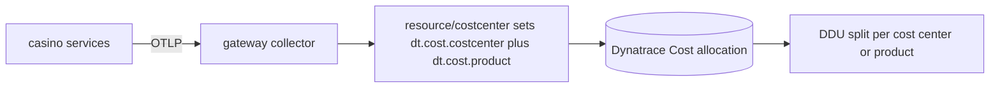

# Step 4 — Cost of observability

!!! abstract "Skill `otel-collector` · ⏱ 20 min · difficulty ●●○ · Core step"
    **Problem → Understand → Drive (ladder) → Review & apply → Verify.** Lean on
    the `otel-collector` skill for this step. Budget ~20 min. Core step, do this —
    it is the first collector step and sets the pattern for every gateway edit
    that follows.

**Goal:** attribute your telemetry spend. You cannot manage what you cannot
attribute, so you will inject the Dynatrace cost-center attributes at the gateway
and read ingest split per cost center. Afterward every span, metric, and log the
gateway exports carries `dt.cost.costcenter` and `dt.cost.product`, so Dynatrace
**Cost Allocation** can split DDU consumption per team and per product. For a
casino operator that is the difference between one opaque bill and a chargeback
that answers "how much does the casino platform cost vs the scoring service?".

## ① Problem — one undifferentiated bucket

The baseline gateway exports telemetry with **no** `dt.cost.*` attributes, so
**Account Management → Cost allocation** shows everything under a single bucket.
You cannot answer "how much does the casino platform cost vs the scoring
service?". The planted gap is concrete: the composed gateway config has no
`resource/costcenter` processor in any pipeline, and the deployment has no
`COST_CENTER` / `COST_PRODUCT` env vars set. The reference answer lives at
`labs/advanced/step3-cost-center/cost-center-processor.yaml`.



Confirm the symptom — run the checkpoint DQL in ⑤ now and watch it return no
rows keyed by cost center (`dt.cost.costcenter` is null everywhere). That is your
"before".

## ② Understand the change

Dynatrace **Cost Allocation** reads two resource attributes — `dt.cost.costcenter`
and `dt.cost.product`. Once every signal carries them, DDU consumption can be
split per team/product and charged back. Injecting at the **gateway** (not per
app) means one change covers traces, metrics, and logs for the whole cluster, so
you tag all three signals in one place instead of touching every service SDK.

The shape you are aiming for is a single `resource` processor wired into all
three pipelines, in the correct slot:

```yaml
processors:
  resource/costcenter:
    attributes:
      - key: dt.cost.costcenter       # resource attribute, from env COST_CENTER
        value: ${env:COST_CENTER}
        action: upsert
      - key: dt.cost.product          # second cost dimension, from env COST_PRODUCT
        value: ${env:COST_PRODUCT}
        action: upsert
# ...then in every pipeline (traces, metrics, logs):
#   processors: [memory_limiter, k8sattributes, resource/costcenter, batch]
#   memory_limiter FIRST, batch LAST, resource/costcenter BETWEEN them
```

!!! tip "Keep asking why — read before you drive"
    Before you let the agent change anything, make it explain the target and its
    plan, read-only:

    ```bash
    opencode run "Using the otel-collector skill: read \
    observability/collectors/gateway.yaml and tell me WHERE a resource processor \
    must sit so memory_limiter stays first and batch stays last. Do not edit \
    anything — just explain the pipeline order."
    ```

    A good answer names the slot **between `k8sattributes` and `batch`** in all
    three pipelines and refuses to move `memory_limiter` (first) or `batch`
    (last). Reading first is what lets you catch a wrong diff in ④.

## ③ Drive opencode — the prompt ladder

Climb the ladder one rung at a time. Run a rung, read what it did, confirm the
**review check**, then go to the next rung. Do not paste all four at once —
steering between rungs is the skill.

**P1 · Orient (read-only)**

```bash
opencode run "Using the otel-collector skill: read \
observability/collectors/gateway.yaml and identify WHERE a resource processor \
must sit to respect memory_limiter-first and batch-last. Answer only — make NO \
edits."
```

- **What you should see:** the agent points to the slot between `k8sattributes`
  and `batch`, in all three pipelines, and leaves the file untouched.
- **Review check:** did it point to the slot between `k8sattributes` and `batch`
  and refuse to move `memory_limiter` / `batch`?

**P2 · Core change**

```bash
opencode run "Using the otel-collector skill: in \
observability/collectors/gateway.yaml add a resource processor named \
resource/costcenter that sets the resource attribute dt.cost.costcenter from the \
env var COST_CENTER. Wire it into all three pipelines AFTER k8sattributes and \
BEFORE batch. Do not move memory_limiter (first) or batch (last)."
```

- **What you should see:** a `resource/costcenter` processor setting
  `dt.cost.costcenter` from `COST_CENTER`, placed in the correct slot in every
  pipeline.
- **Review check:** is `memory_limiter` still first and `batch` still last in
  every pipeline?

**P3 · Deepen — add the second cost dimension**

```bash
opencode run "Using the otel-collector skill: extend the resource/costcenter \
processor in observability/collectors/gateway.yaml to ALSO set dt.cost.product \
from the env var COST_PRODUCT, so DDU can be split per product as well as per \
cost center. Keep the processor in the same slot in all three pipelines."
```

- **What you should see:** the same processor now sets **both**
  `dt.cost.costcenter` and `dt.cost.product`, with no change to its pipeline
  position.
- **Review check:** does every pipeline now carry both `dt.cost.costcenter` and
  `dt.cost.product`?

**P4 · Steer — the invariant miss**

```bash
opencode run "Using the otel-collector skill: show me the resource/costcenter \
processor slot in the traces, metrics AND logs pipelines of \
observability/collectors/gateway.yaml. If it sits before k8sattributes, after \
batch, or is only in traces, move it between k8sattributes and batch in ALL \
three pipelines."
```

- **What you should see:** the agent often inserts the processor before
  `k8sattributes`, after `batch`, or only in the traces pipeline — spot the
  misplacement in the diff and steer it back.
- **Review check:** did you verify placement in all three pipelines, not just
  traces?

## ④ Review & apply — kubectl (collector namespace, not GitOps)

Read the diff first — confirm the processor lands **after `k8sattributes`, before
`batch`** in every pipeline and that `memory_limiter` stays first. The reference
answer is `labs/advanced/step3-cost-center/cost-center-processor.yaml`, already
merged into the composed `labs/advanced/gateway-advanced.yaml` in the correct
position.

The gateway lives in the `observability` namespace, which Argo CD does **not**
manage, so you apply it directly:

```bash
# set the cost center for your team, then apply the edited gateway
kubectl -n observability set env deployment/otel-gateway-collector \
  COST_CENTER=casino-platform-training COST_PRODUCT=vegas-casino
kubectl apply -f observability/collectors/gateway.yaml
```

Every span, metric, and log the gateway exports now carries
`dt.cost.costcenter=casino-platform-training` and `dt.cost.product=vegas-casino`.

!!! note "Why resource-level, and why at the gateway"
    `dt.cost.*` are **resource** attributes — they describe the source, not a
    single event, so the `resource` processor is the right tool. Putting it at
    the gateway means you tag all three signals in one place instead of touching
    every service SDK.

## ⑤ Verify — Dynatrace validation checkpoint

Cost/ingest readout — volume split by cost center over the last hour, in a Grail
Notebook:

```dql
fetch logs, from: now() - 1h
| filter isNotNull(dt.cost.costcenter)
| summarize ingested = count() by { dt.cost.costcenter, dt.cost.product }
| sort ingested desc
```

- **Before:** `dt.cost.costcenter` is null everywhere → a single undifferentiated
  bucket.
- **After:** one row per cost center/product; **Account Management → Cost
  allocation** attributes DDU consumption to `casino-platform-training`.

!!! warning "Steer-back box — if the agent gets it wrong"
    Re-run opencode with the correction rather than hand-editing; the ⑤
    checkpoint tells you when it is done.

    - **Processor before `k8sattributes` or after `batch`** → reply
      *"memory_limiter must stay first and batch last; a resource processor goes
      between k8sattributes and batch — move it there in every pipeline."*
    - **Processor only in the traces pipeline** → reply *"wire resource/costcenter
      into the metrics and logs pipelines too, in the same slot between
      k8sattributes and batch."*
    - **Only `dt.cost.costcenter` set, `dt.cost.product` missing** → reply *"also
      set dt.cost.product from env COST_PRODUCT in the same processor."*

## Definition of done

- [ ] The `resource/costcenter` processor is wired into the gateway (after `k8sattributes`, before `batch`)
- [ ] `COST_CENTER` / `COST_PRODUCT` are set on the gateway deployment
- [ ] The second `dt.cost.product` dimension is wired from `COST_PRODUCT`
- [ ] Placement is verified in all three pipelines (traces, metrics, logs), not just traces
- [ ] The DQL returns rows keyed by `dt.cost.costcenter` / `dt.cost.product`
- [ ] Cost allocation in Dynatrace splits DDU per cost center

Next: [Step 5 — High-cardinality metrics](step-5-high-cardinality.md).
