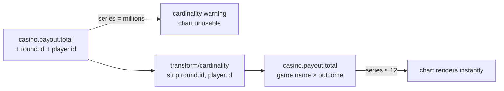

# Step 5 — High-cardinality metrics

_The `labs/advanced/` directories keep their original feature-ordinal numbering, so they run one behind these doc steps — this page's assets live under `labs/advanced/step4-high-cardinality/`._

**Goal:** find a metric whose cost is exploding, understand why, and fix it at the
collector without an app redeploy. Budget 25 minutes.

## The concept

Metrics are cheap *per series* and ruinous *per unbounded dimension*. One
`round.id` label turns a 12-series counter into millions of series. You find the
offender in Dynatrace, then strip the offending dimensions at the gateway.



## Before — the offending metric

`casino.payout.total` carries `round.id` and `player.id` (see
`labs/advanced/step4-high-cardinality/before.offending-metric.md`). Every distinct
round and player is a new series, so the series count grows without bound.

## ② Opencode — strip the dimensions at the gateway

Drive `opencode` at the gateway with the `otel-ottl` skill — stripping metric
labels is an OTTL transform, so name that skill explicitly:

```bash
opencode run "Using the otel-ottl and otel-collector skills: in \
observability/collectors/gateway.yaml add a transform/cardinality processor that \
deletes the metric datapoint attributes round.id and player.id (OTTL: \
delete_key(attributes, \"round.id\")). Wire it into the metrics pipeline only, \
after k8sattributes and before the exporter. Leave memory_limiter first and no batch processor."
```

## ③ Review — read the diff

Confirm it uses OTTL `delete_key` on the two offending attributes, sits in the
**metrics** pipeline (not traces/logs), and respects first/last. Reference
answer: `labs/advanced/step4-high-cardinality/cardinality-fix-processor.yaml`.

!!! warning "If the agent gets it wrong — steer it back"
    If it strips the wrong keys or adds the processor to every pipeline, reply
    *"only the metrics pipeline, and only delete round.id and player.id — keep
    casino.game.name and casino.outcome."*

## ④ Apply — kubectl

```bash
kubectl apply -f observability/collectors/gateway.yaml
```

The gateway strips `round.id` / `player.id` and the counter collapses back to
`casino.game.name × casino.outcome` (≤ 12 series).

!!! tip "You did not lose the per-round view"
    Per-round drill-down still exists — on the **spans** from Step 1, where
    cardinality is free. Metrics answer "how much, by bounded dimension"; traces
    answer "what happened on this specific round". Use each for what it is cheap
    at.

## Dynatrace validation checkpoint

Cardinality readout — distinct series on the metric over the last hour, in a Grail
Notebook:

```dql
timeseries cnt = count(), by: { casino.game.name, casino.outcome }, from: now() - 1h
| fieldsAdd metric = "casino.payout.total"
| summarize series = count()
```

Or inspect the dimension cardinality directly in **Metrics → casino.payout.total
→ Dimensions**.

- **Before:** the dimension count climbs continuously (thousands → millions); the
  chart is unusable and a cardinality warning appears.
- **After:** a flat ~12 series (4 games × 3 outcomes); the chart renders instantly
  and ingest cost drops.

## Definition of done

- [ ] You identified `round.id` / `player.id` as the offending dimensions
- [ ] The `transform/cardinality` processor is wired into the metrics pipeline
- [ ] The series count is flat at ~12 after the fix
- [ ] You can still drill into a single round via the Step 1 spans

Next: [Step 6 — PII in logs](step-6-pii-logs.md).
