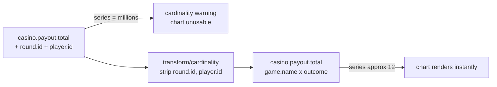

# Step 5 — High-cardinality metrics

!!! abstract "Skill `otel-ottl` (+ `otel-collector`) · ⏱ 25 min · difficulty ●●● · Core step"
    **Problem → Understand → Drive (ladder) → Review & apply → Verify.** Lean on
    the `otel-ottl` skill for this step (with `otel-collector` for the pipeline
    wiring). Budget ~25 min. Core step, do this.

**Goal:** find a metric whose cost is exploding, understand why, and fix it at the
collector without an app redeploy. Afterward `casino.payout.total` should carry
only its two bounded dimensions — `casino.game.name` and `casino.outcome` — and
collapse to a flat ~12 series instead of growing without bound. That matters to a
casino operator because an unbounded metric is both unusable on a chart and a
runaway ingest bill; the fix buys back both the chart and the cost.

## ① Problem — the series count never stops climbing

Metrics are cheap *per series* and ruinous *per unbounded dimension*. One
`round.id` label turns a 12-series counter into millions of series: every distinct
round is a new series, so the count grows forever and Dynatrace raises a
cardinality warning while the chart becomes unusable.



The offender is `casino.payout.total`: it carries `round.id` and `player.id` (see
`labs/advanced/step4-high-cardinality/before.offending-metric.md`). Every distinct
round and player is a new series, so the series count grows without bound.

Confirm the symptom — run the checkpoint DQL in ⑤ now and watch it return a
series count climbing continuously with a cardinality warning. That is your
'before'.

## ② Understand the change

The fix is a strip-at-the-gateway move: you cannot cheaply redeploy the app to
drop labels, but you *can* delete the offending metric datapoint attributes in the
collector before they reach the backend. Stripping metric labels is an OTTL
transform, so the right tool is a `transform/cardinality` processor on the
**metrics** pipeline. The discipline is to delete only the unbounded keys and keep
the two bounded dimensions — `casino.game.name` and `casino.outcome` — which are
what makes the metric useful.

```yaml
# metrics pipeline only — NOT traces/logs
processors:
  transform/cardinality:
    metric_statements:
      - context: datapoint
        statements:
          - delete_key(attributes, "round.id")   # unbounded — millions of series
          - delete_key(attributes, "player.id")  # unbounded — one series per player
# pipeline order: memory_limiter first ... k8sattributes -> transform/cardinality -> batch (last)
```

The interesting lines are the two `delete_key` calls (they remove exactly the
unbounded keys and nothing else) and the pipeline placement: after `k8sattributes`
so enrichment still runs, before `batch` so batching sees the reduced series, with
`memory_limiter` first and `batch` last.

!!! tip "Keep asking why — read before you drive"
    Before you let the agent change anything, make it explain the target and its
    plan, read-only:

    ```bash
    opencode run "Using the otel-ottl and otel-collector skills: read \
    observability/collectors/gateway.yaml and the metric datapoint attributes on \
    casino.payout.total. Explain which attributes are unbounded and why, and what \
    a transform/cardinality processor would change — do NOT edit anything."
    ```

    A good answer names `round.id` and `player.id` as the unbounded keys, confirms
    `casino.game.name` and `casino.outcome` are the bounded ones to keep, and puts
    the processor on the metrics pipeline only. Reading first is what lets you
    catch a wrong diff in ④.

## ③ Drive opencode — the prompt ladder

Climb the ladder one rung at a time. Run a rung, read what it did, confirm the
**review check**, then go to the next rung. Do not paste all four at once —
steering between rungs is the skill. The arc here is iterative stripping: strip one
dimension, see it is still high, strip the second.

**P1 · Orient (read-only)**

```bash
opencode run "Using the otel-ottl and otel-collector skills: read \
observability/collectors/gateway.yaml and name which metric datapoint attributes \
on casino.payout.total are unbounded and why one round.id turns a 12-series \
counter into millions. Do NOT edit anything."
```

- **What you should see:** the agent reads the gateway and reports `round.id` and
  `player.id` as unbounded, explaining that one series per round explodes the count.
- **Review check:** did it identify BOTH offending keys and confirm
  `casino.game.name` / `casino.outcome` are the bounded ones to KEEP?

**P2 · Core change — strip one**

```bash
opencode run "Using the otel-ottl and otel-collector skills: in \
observability/collectors/gateway.yaml add a transform/cardinality processor that \
deletes ONLY the metric datapoint attribute round.id (OTTL: \
delete_key(attributes, \"round.id\")). Wire it into the metrics pipeline only, \
after k8sattributes and before batch. Leave memory_limiter first and batch last."
```

- **What you should see:** a new `transform/cardinality` processor with a single
  `delete_key(attributes, "round.id")`, wired into the metrics pipeline; `round.id`
  is gone.
- **Review check:** is it in the METRICS pipeline only (not traces/logs)?

**P3 · Deepen — still high → strip the 2nd**

```bash
opencode run "Using the otel-ottl and otel-collector skills: re-check \
casino.payout.total in Dynatrace — the series count is still high because \
player.id remains. In observability/collectors/gateway.yaml also delete_key the \
metric datapoint attribute player.id in the same transform/cardinality processor, \
collapsing the metric to ~12 series. Keep it on the metrics pipeline only."
```

- **What you should see:** a second `delete_key(attributes, "player.id")` in the
  same processor; the series collapses to a flat ~12 (4 games × 3 outcomes).
- **Review check:** does the series count drop to ~12 after the second strip?

**P4 · Steer — the over-strip miss**

```bash
opencode run "Using the otel-ottl and otel-collector skills: review the \
transform/cardinality processor in observability/collectors/gateway.yaml. It must \
delete ONLY round.id and player.id, KEEP casino.game.name and casino.outcome, and \
apply to the metrics pipeline ONLY — not traces or logs. Fix it if it over-stripped \
a bounded dimension or touched another pipeline."
```

- **What you should see:** the agent confirms (or restores) that only `round.id`
  and `player.id` are deleted, the two bounded dims survive, and traces/logs are
  untouched.
- **Review check:** did you confirm the two bounded dims survive and traces/logs
  are untouched?

## ④ Review & apply

Read the diff before you apply: confirm it uses OTTL `delete_key` on the two
offending attributes, sits in the **metrics** pipeline (not traces/logs), and
respects first/last. Reference answer:
`labs/advanced/step4-high-cardinality/cardinality-fix-processor.yaml`.

Apply the gateway directly (observability namespace, not GitOps):

```bash
kubectl apply -f observability/collectors/gateway.yaml
```

The gateway strips `round.id` / `player.id` and the counter collapses back to
`casino.game.name × casino.outcome` (≤ 12 series).

!!! tip "You did not lose the per-round view"
    Per-round drill-down still exists — on the **spans** from Step 1, where
    cardinality is free. Metrics answer "how much, by bounded dimension"; traces
    answer "what happened on this specific round". Use each for what it is cheap
    at.

## ⑤ Verify — Dynatrace validation checkpoint

Cardinality readout — distinct series on the metric over the last hour, in a Grail
Notebook:

```dql
timeseries cnt = count(), by: { casino.game.name, casino.outcome }, from: now() - 1h
| fieldsAdd metric = "casino.payout.total"
| summarize series = count()
```

Or inspect the dimension cardinality directly in **Metrics → casino.payout.total
→ Dimensions**.

- **Before:** the dimension count climbs continuously (thousands → millions); the
  chart is unusable and a cardinality warning appears.
- **After:** a flat ~12 series (4 games × 3 outcomes); the chart renders instantly
  and ingest cost drops.

!!! warning "Steer-back box — if the agent gets it wrong"
    Re-run opencode with the correction rather than hand-editing; the ⑤ checkpoint
    tells you when done.

    - **Series still high after P2 → P3 not applied:** reply *"the series count is
      still high because player.id remains — also delete_key player.id in the same
      transform/cardinality processor."*
    - **A useful dimension vanished / only ~1 series left → over-stripped:** reply
      *"keep casino.game.name and casino.outcome — delete only round.id and
      player.id."*
    - **Traces or logs changed → wrong pipeline:** reply *"only the metrics
      pipeline, and only delete round.id and player.id — keep casino.game.name and
      casino.outcome."*

## Definition of done

- [ ] You identified `round.id` / `player.id` as the offending dimensions
- [ ] The `transform/cardinality` processor is wired into the metrics pipeline
- [ ] You iteratively stripped the 2nd dimension (`player.id`) after seeing the
      count was still high
- [ ] The bounded dims (`casino.game.name` / `casino.outcome`) are preserved and
      the transform is metrics-pipeline-only
- [ ] The series count is flat at ~12 after the fix
- [ ] You can still drill into a single round via the Step 1 spans

Next: [Step 6 — PII in logs](step-6-pii-logs.md).
