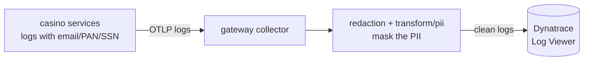
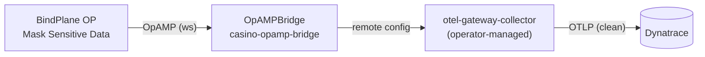

# Step 5 — PII in logs

**Goal:** stop shipping player PII to Dynatrace. You will redact it at the
collector first, then escalate to centrally managed redaction with BindPlane OP
over the OTel Operator's OpAMP bridge when hand-rolled regex stops scaling.
Budget 30 minutes.

## The concept

The casino logs player email, credit-card PAN, and SSN. Shipping that to
Dynatrace is a compliance incident. Clean it at the collector (regex) first, then
hand the config to BindPlane when per-service rules and audit requirements
outgrow hand-maintained YAML.



## Before — raw PII in the Log Viewer

The baseline gateway exports logs verbatim. A player-service line like:

```
charged player john.doe@example.com card 4111 1111 1111 1111 ssn 123-45-6789
```

lands in the Dynatrace Log Viewer **with the PII intact**.

## The fix — redact at the collector

Apply the `redaction` + `transform/pii` processors
(`labs/advanced/step5-pii-redaction/redaction-processor.yaml`), wired into the logs
pipeline in the composed gateway:

```bash
kubectl apply -f labs/advanced/gateway-advanced.yaml
```

The same line now arrives as:

```
charged player ***EMAIL_REDACTED*** card ***PAN_REDACTED*** ssn ***SSN_REDACTED***
```

## Escalate — BindPlane OP via the OpAMP bridge

When regex-by-hand no longer scales (new PII shapes, per-service rules, audit
trail), hand config to **BindPlane OP** over OpAMP. The OTel Operator's OpAMP
bridge connects the operator-managed collectors to BindPlane, so redaction config
is authored and pushed centrally instead of edited in YAML per collector.



```bash
# 1. BindPlane OP server in-cluster (pin the chart version for the training).
helm repo add bindplane https://observiq.github.io/bindplane-op-helm
helm upgrade --install bindplane bindplane/bindplane -n observability --create-namespace

# 2. Connection token for the bridge (BindPlane → Settings → OpAMP / install command).
kubectl -n observability create secret generic bindplane-opamp \
  --from-literal=BINDPLANE_OPAMP_TOKEN='<token-from-bindplane>'
kubectl -n observability set env opampbridge/casino-opamp-bridge --from=secret/bindplane-opamp

# 3. The OpAMP bridge.
kubectl apply -f labs/advanced/step5-pii-redaction/bindplane-opamp/opampbridge.yaml
```

In BindPlane, attach a **Mask Sensitive Data** processor to the casino log source
and push — the bridge delivers it to `otel-gateway-collector` with no manual YAML.

!!! note "Gotchas"
    - The bridge image tag (`operator-opamp-bridge:0.127.0`) tracks the operator
      release line — keep it consistent with `OTEL_OPERATOR_VERSION` in
      `observability/versions.env` (currently `v0.162.0`).
    - `componentsAllowed` is an allow-list: BindPlane cannot push a component the
      bridge does not permit — a safety rail for the training cluster.
    - This **supersedes** the hand-rolled `redaction`/`transform/pii` once
      BindPlane owns the config; keep the Step 5 processors as the "before
      BindPlane" baseline.

## Dynatrace validation checkpoint

PII leak scan over the last hour — expect **zero** rows after the fix, in a Grail
Notebook:

```dql
fetch logs, from: now() - 1h
| filter k8s.namespace.name == "casino"
| filter matchesValue(content, "*@*.*") or matchesValue(content, "*-**-****")
| summarize leaks = count()
```

- **Before:** `leaks > 0` — raw email/PAN/SSN visible in the Log Viewer.
- **After (redaction):** `leaks == 0`; sampled lines show `***…_REDACTED***`.
- **After (BindPlane):** same clean result, now driven by the pushed BindPlane
  config; the OpAMPBridge reports **healthy + effective-config** in Dynatrace.

## Definition of done

- [ ] Raw email/PAN/SSN confirmed in the Log Viewer before the fix
- [ ] `redaction` + `transform/pii` wired into the logs pipeline
- [ ] The leak-scan DQL returns `leaks == 0`
- [ ] BindPlane OP + OpAMP bridge deployed; a Mask Sensitive Data config pushed
- [ ] The OpAMPBridge reports healthy + effective-config

Next: [Step 6 — Tail sampling](step-6-tail-sampling.md).
