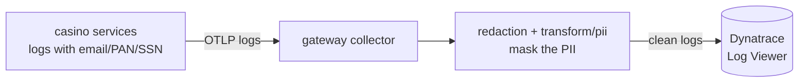
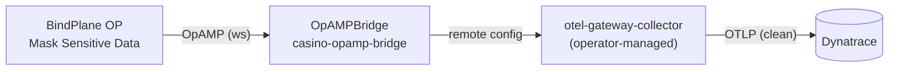

# Step 6 — PII in logs

!!! abstract "Skill `otel-ottl` (+ `otel-collector`) · ⏱ 30 min · difficulty ●●● · Core step"
    **Problem → Understand → Drive (ladder) → Review & apply → Verify.** Lean on
    the `otel-ottl` skill for this step (with `otel-collector` for pipeline wiring).
    Budget ~30 min. Core step, do this — the BindPlane escalation at the end is an
    optional stretch.

**Goal:** stop shipping player PII to Dynatrace. You will redact it at the
collector first — masking email, credit-card PAN, and SSN in log bodies — so the
Dynatrace Log Viewer holds clean, compliant logs. Do it iteratively: mask email,
re-scan, then close the remaining PAN + SSN leaks until the leak-scan returns
zero. Afterward you can escalate to centrally managed redaction with BindPlane OP
over the OTel Operator's OpAMP bridge when hand-rolled regex stops scaling. For a
casino operator this is the difference between a routine log pipeline and a
reportable compliance incident.

## ① Problem — raw PII in the Log Viewer

The casino logs player email, credit-card PAN, and SSN. Shipping that to
Dynatrace is a compliance incident. The baseline gateway exports logs verbatim,
so a player-service line like:

```
charged player john.doe@example.com card 4111 1111 1111 1111 ssn 123-45-6789
```

lands in the Dynatrace Log Viewer **with the PII intact** — three distinct PII
shapes (email, credit-card PAN, SSN) all leaking in one line. Clean it at the
collector (regex) first, then hand the config to BindPlane when per-service rules
and audit requirements outgrow hand-maintained YAML. The reference answer lives
at `labs/advanced/step5-pii-redaction/redaction-processor.yaml`.



Confirm the symptom — run the checkpoint DQL in ⑤ now and watch it return
`leaks > 0`. That is your "before".

## ② Understand the change

Masking log PII is a **transform**, not a sampling or routing decision — you
rewrite the log body in flight before it leaves the collector. That is why this
belongs on `log.body` in the **logs pipeline only**: trace and metric pipelines
carry different payloads, and masking trace attributes would both miss the leak
and corrupt unrelated telemetry. Two processors do the work: `redaction` for
structured masking and `transform/pii` using OTTL `replace_pattern` on
`log.body` for the regex shapes. They sit after `k8sattributes` (so attribution
is intact) and before `batch`, with `memory_limiter` first and `batch` last.

The target shape in `observability/collectors/gateway.yaml`:

```yaml
processors:
  transform/pii:                     # OTTL transform — rewrites the log body in place
    log_statements:
      - context: log
        statements:
          # replace_pattern(log.body, <regex>, <mask>) — one rule per PII shape
          - replace_pattern(body, "[\\w.]+@[\\w.]+", "***EMAIL_REDACTED***")
          - replace_pattern(body, "\\d{4} \\d{4} \\d{4} \\d{4}", "***PAN_REDACTED***")
          - replace_pattern(body, "\\d{3}-\\d{2}-\\d{4}", "***SSN_REDACTED***")
service:
  pipelines:
    logs:                            # logs pipeline ONLY — not traces, not metrics
      processors: [memory_limiter, k8sattributes, redaction, transform/pii, batch]
```

!!! tip "Keep asking why — read before you drive"
    Before you let the agent change anything, make it explain the target and its
    plan, read-only:

    ```bash
    opencode run "Using the otel-collector and otel-ottl skills: read \
    observability/collectors/gateway.yaml and a sample casino log line. Explain \
    which PII shapes are present and where masking should go — do NOT edit anything."
    ```

    A good answer names all three PII shapes (email, PAN, SSN) and says masking
    belongs on `log.body` in the logs pipeline only, after k8sattributes and
    before batch. Reading first is what lets you catch a wrong diff in ④.

## ③ Drive opencode — the prompt ladder

Climb the ladder one rung at a time. Run a rung, read what it did, confirm the
**review check**, then go to the next rung. Do not paste all four at once —
steering between rungs is the skill.

**P1 · Orient (read-only)**

```bash
opencode run "Using the otel-collector and otel-ottl skills: read \
observability/collectors/gateway.yaml and a sample casino log line. Enumerate the \
THREE PII shapes present (email, credit-card PAN, SSN) and confirm masking belongs \
on log.body in the logs pipeline only. Do NOT edit anything."
```

- **What you should see:** a read-only summary naming email, credit-card PAN, and
  SSN, and stating the logs-pipeline-only placement on `log.body`.
- **Review check:** did it name all three shapes and the logs-pipeline-only
  placement?

**P2 · Core change — mask email first**

```bash
opencode run "Using the otel-collector and otel-ottl skills: in \
observability/collectors/gateway.yaml add a transform/pii processor with OTTL \
replace_pattern on log.body that masks EMAIL only. Wire it into the logs pipeline \
only, after k8sattributes and before batch. Keep memory_limiter first and batch \
last."
```

- **What you should see:** a sampled line with the email masked
  (`***EMAIL_REDACTED***`), PAN and SSN still visible.
- **Review check:** is it on `log.body` in the LOGS pipeline only?

**P3 · Deepen — re-scan, SSN still leaks → mask all three**

```bash
opencode run "Using the otel-collector and otel-ottl skills: the leak-scan DQL \
still returns rows because credit-card PAN and SSN are unmasked in \
observability/collectors/gateway.yaml. Add the PAN and SSN replace_pattern rules \
(and the redaction processor) on log.body so all three shapes are masked and \
leaks == 0. Logs pipeline only, after k8sattributes, before batch."
```

- **What you should see:** `***EMAIL_REDACTED*** / ***PAN_REDACTED*** /
  ***SSN_REDACTED***` — all three shapes masked on the sampled line.
- **Review check:** does the leak-scan return `leaks == 0`?

**P4 · Steer — the wrong-target miss**

```bash
opencode run "Using the otel-collector and otel-ottl skills: verify in \
observability/collectors/gateway.yaml that masking is on log.body in the LOGS \
pipeline only — not on trace attributes and not on other pipelines — and that all \
three shapes (email, PAN, SSN) are masked. Fix anything that drifted."
```

- **What you should see:** the agent sometimes masks TRACE attributes instead of
  `log.body`, or applies to all pipelines, or masks only two of three shapes.
  Spot it and steer back: *"mask all three — email, PAN, SSN — on log.body in the
  logs pipeline only."*
- **Review check:** did you re-run the leak-scan and confirm zero **after**
  steering, not before?

## ④ Review & apply

Read the diff first — confirm the masking is on the **logs** pipeline, covers
email/PAN/SSN on `log.body`, and sits between `k8sattributes` and `batch` with
`memory_limiter` first and `batch` last. Reference answer:
`labs/advanced/step5-pii-redaction/redaction-processor.yaml`. Then apply the
gateway collector:

```bash
kubectl apply -f observability/collectors/gateway.yaml
```

The same line now arrives as:

```
charged player ***EMAIL_REDACTED*** card ***PAN_REDACTED*** ssn ***SSN_REDACTED***
```

### Escalate — BindPlane OP via the OpAMP bridge (optional / stretch)

!!! info "Optional / stretch"
    The collector redaction above already satisfies the Definition of done. This
    BindPlane escalation is a stretch exercise for cohorts with time — skip it to
    go straight to [Step 7](step-7-tail-sampling.md).

When regex-by-hand no longer scales (new PII shapes, per-service rules, audit
trail), hand config to **BindPlane OP** over OpAMP. The OTel Operator's OpAMP
bridge connects the operator-managed collectors to BindPlane, so redaction config
is authored and pushed centrally instead of edited in YAML per collector.



```bash
# 1. BindPlane OP server in-cluster (pin the chart version for the training).
helm repo add bindplane https://observiq.github.io/bindplane-op-helm
helm upgrade --install bindplane bindplane/bindplane -n observability --create-namespace

# 2. Connection token for the bridge (BindPlane → Settings → OpAMP / install command).
kubectl -n observability create secret generic bindplane-opamp \
  --from-literal=BINDPLANE_OPAMP_TOKEN='<token-from-bindplane>'
kubectl -n observability set env opampbridge/casino-opamp-bridge --from=secret/bindplane-opamp

# 3. The OpAMP bridge.
kubectl apply -f labs/advanced/step5-pii-redaction/bindplane-opamp/opampbridge.yaml
```

In BindPlane, attach a **Mask Sensitive Data** processor to the casino log source
and push — the bridge delivers it to `otel-gateway-collector` with no manual YAML.

!!! note "Gotchas"
    - The bridge image tag (`operator-opamp-bridge:0.127.0`) tracks the operator
      release line — keep it consistent with `OTEL_OPERATOR_VERSION` in
      `observability/versions.env` (currently `v0.162.0`).
    - `componentsAllowed` is an allow-list: BindPlane cannot push a component the
      bridge does not permit — a safety rail for the training cluster.
    - This **supersedes** the hand-rolled `redaction`/`transform/pii` once
      BindPlane owns the config; keep the Step 5 processors as the "before
      BindPlane" baseline.

## ⑤ Verify — Dynatrace validation checkpoint

PII leak scan over the last hour — expect **zero** rows after the fix, in a Grail
Notebook:

```dql
fetch logs, from: now() - 1h
| filter k8s.namespace.name == "casino"
| filter matchesValue(content, "*@*.*") or matchesValue(content, "*-**-****")
| summarize leaks = count()
```

- **Before:** `leaks > 0` — raw email/PAN/SSN visible in the Log Viewer.
- **After (redaction):** `leaks == 0`; sampled lines show `***…_REDACTED***`.
- **After (BindPlane):** same clean result, now driven by the pushed BindPlane
  config; the OpAMPBridge reports **healthy + effective-config** in Dynatrace.

!!! warning "Steer-back box — if the agent gets it wrong"
    - **Only two of three shapes masked** → *"mask all three — email, PAN, SSN —
      on log.body in the logs pipeline only."*
    - **Masks trace attributes instead of log bodies** → *"mask all three —
      email, PAN, SSN — on log.body in the logs pipeline only."*
    - **Applied to all pipelines** → *"put the transform on the logs pipeline
      only, after k8sattributes and before batch."*

    Re-run opencode with the correction rather than hand-editing; the ⑤ leak-scan
    checkpoint tells you when it returns `leaks == 0`.

## Definition of done

- [ ] Raw email/PAN/SSN confirmed in the Log Viewer before the fix
- [ ] `transform/pii` masks EMAIL only on log.body in the logs pipeline (P2 pass)
- [ ] PAN + SSN patterns (and `redaction`) added iteratively after the email-only
      pass so all three shapes are masked (P3 pass)
- [ ] Masking is on `log.body` in the logs pipeline only — not trace attributes,
      not other pipelines (P4 steer confirmed)
- [ ] `redaction` + `transform/pii` wired into the logs pipeline
- [ ] The leak-scan DQL returns `leaks == 0`
- [ ] BindPlane OP + OpAMP bridge deployed; a Mask Sensitive Data config pushed
- [ ] The OpAMPBridge reports healthy + effective-config

Next: [Step 7 — Tail sampling](step-7-tail-sampling.md).
