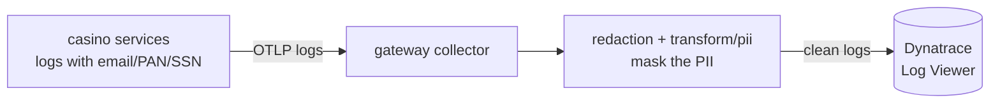

# Step 6 — PII in logs

_The `labs/advanced/` directories keep their original feature-ordinal numbering, so they run one behind these doc steps — this page's assets live under `labs/advanced/step5-pii-redaction/`._

**Goal:** stop shipping player PII to Dynatrace. You will redact it at the
collector first, then escalate to centrally managed redaction with BindPlane OP
over the OTel Operator's OpAMP bridge when hand-rolled regex stops scaling.
Budget 30 minutes.

## The concept

The casino logs player email, credit-card PAN, and SSN. Shipping that to
Dynatrace is a compliance incident. Clean it at the collector (regex) first, then
hand the config to BindPlane when per-service rules and audit requirements
outgrow hand-maintained YAML.



## Before — raw PII in the Log Viewer

The baseline gateway exports logs verbatim. A player-service line like:

```
charged player john.doe@example.com card 4111 1111 1111 1111 ssn 123-45-6789
```

lands in the Dynatrace Log Viewer **with the PII intact**.

## ② Opencode — redact at the collector

Drive `opencode` at the gateway with the `otel-collector` + `otel-ottl` skills —
masking log PII is a transform, so name OTTL explicitly:

```bash
opencode run "Using the otel-collector and otel-ottl skills: in \
observability/collectors/gateway.yaml add redaction for player PII in LOG bodies — \
mask email, credit-card PAN, and SSN patterns (a transform/pii processor with \
OTTL replace_pattern on log.body, plus the redaction processor). Wire it into the \
logs pipeline only, after k8sattributes and before the exporter. Keep memory_limiter \
first and do not add a batch processor."
```

## ③ Review — read the diff

Confirm the masking is on the **logs** pipeline, covers email/PAN/SSN, and sits
after `k8sattributes`. Reference answer:
`labs/advanced/step5-pii-redaction/redaction-processor.yaml`.

!!! warning "If the agent gets it wrong — steer it back"
    If it leaves one PII shape unmasked or masks trace attributes instead of log
    bodies, reply *"mask all three — email, PAN, SSN — on log.body in the logs
    pipeline only."* Always re-run the leak-scan DQL to confirm `leaks == 0`.

## ④ Apply — kubectl

```bash
kubectl apply -f observability/collectors/gateway.yaml
```

The same line now arrives as:

```
charged player ***EMAIL_REDACTED*** card ***PAN_REDACTED*** ssn ***SSN_REDACTED***
```

## Escalate — when hand-rolled regex stops scaling

The collector redaction above already satisfies the Definition of done. But
regex-by-hand does not scale: new PII shapes, per-service rules, and an audit
trail each mean more YAML edited per collector. The fleet answer is to author the
config **once** in **BindPlane OP** and push it to the collectors over OpAMP —
via the OTel Operator's **OpAMP bridge**, optionally through an **OpAMP gateway
(relay)** for segmented clusters.

That full deploy-and-connect walkthrough — BindPlane install, the relay, the
bridge CRD, and the central *Mask Sensitive Data* push — lives in its own
appendix so this ladder stays focused on the collector-side fix:

➡️ **[Central config: the OpAMP bridge + a BindPlane gateway](bindplane-opamp.md)**
(optional / stretch).

## Dynatrace validation checkpoint

PII leak scan over the last hour — expect **zero** rows after the fix, in a Grail
Notebook:

```dql
fetch logs, from: now() - 1h
| filter k8s.namespace.name == "casino"
| filter matchesValue(content, "*@*.*") or matchesValue(content, "*-**-****")
| summarize leaks = count()
```

- **Before:** `leaks > 0` — raw email/PAN/SSN visible in the Log Viewer.
- **After (redaction):** `leaks == 0`; sampled lines show `***…_REDACTED***`.

The optional [BindPlane appendix](bindplane-opamp.md) reaches the same clean
result driven by centrally pushed config instead of hand-edited YAML.

## Definition of done

- [ ] Raw email/PAN/SSN confirmed in the Log Viewer before the fix
- [ ] `redaction` + `transform/pii` wired into the logs pipeline
- [ ] The leak-scan DQL returns `leaks == 0`
- [ ] _(Stretch)_ Central config pushed via the [BindPlane appendix](bindplane-opamp.md)

Next: [Step 7 — Tail sampling](step-7-tail-sampling.md).
