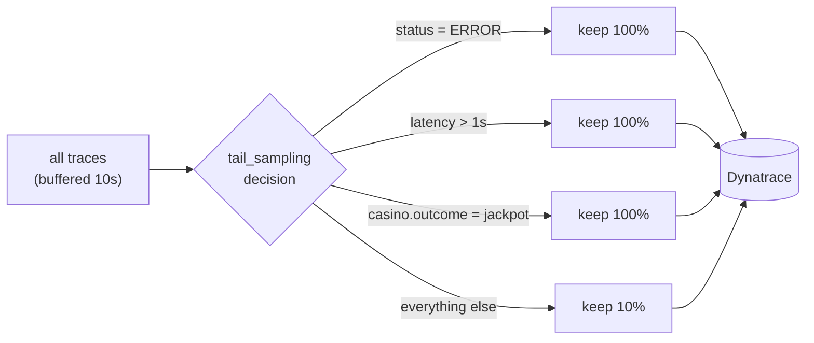

# Step 6 — Tail sampling

**Goal:** cut trace ingest cost sharply while keeping every trace that matters —
errors, slow traces, and jackpots. Budget 25 minutes.

## The concept

Sampling is a strategy, not a failure — 100% is rarely the answer, but blind head
sampling (deciding SDK-side, before the trace exists) throws away the errors you
most need. **Tail** sampling buffers the whole trace, then keeps **all** errors /
slow traces / jackpots and samples the boring majority down to 10%.



## Before — export everything

No sampling at the gateway — every trace is exported. Trace ingest cost scales
linearly with casino load, and most of it is fast, successful, uninteresting
spins.

## The fix — tail sampling at the gateway

Apply the `tail_sampling` processor
(`labs/advanced/step6-tail-sampling/tail-sampling-processor.yaml`), wired into the
traces pipeline in the composed gateway:

```bash
kubectl apply -f labs/advanced/gateway-advanced.yaml
```

Policies: `status_code=ERROR` → 100%, `latency > 1s` → 100%,
`casino.outcome=jackpot` → 100%, everything else → 10% probabilistic. The
`decision_wait` buffer is 10s — long enough to assemble a full trace before
deciding.

!!! warning "Single-instance requirement"
    Tail sampling must see **all** spans of a trace on one collector instance.
    The training gateway is `replicas: 1`, so this holds. If you scale the
    gateway out, you **must** front it with a `loadbalancing` exporter tier keyed
    on traceID — otherwise decisions are made on partial traces and you drop
    spans from traces you meant to keep.

## Dynatrace validation checkpoint

Confirm errors are retained while overall volume drops, in a Grail Notebook:

```dql
fetch spans, from: now() - 1h
| summarize kept = count() by { status = if(request.status == "failed", "error", "ok") }
```

- **Before:** error traces are a small % of total, matching their natural rate;
  total volume is high.
- **After:** total trace volume drops sharply, but the **absolute** count of
  error / slow / jackpot traces is **unchanged** (100% retention) — error
  analysis stays complete while cost falls. Verify a known error trace is still
  fully present end-to-end.

## Definition of done

- [ ] The `tail_sampling` processor is wired into the traces pipeline (after `k8sattributes`/`resource`, before `batch`)
- [ ] The four policies are in place (error / slow / jackpot → 100%, else 10%)
- [ ] Total trace volume drops after the fix
- [ ] The absolute error/slow/jackpot count is unchanged
- [ ] A known error trace is still complete end-to-end

You have finished the advanced self-paced track — instrumentation, a
convention guard, cost attribution, cardinality control, PII redaction, and
sampling, each proven in Dynatrace. Back to [Getting started](getting-started.md)
or the facilitator-led [M0–M5 modules](../setup.md).
