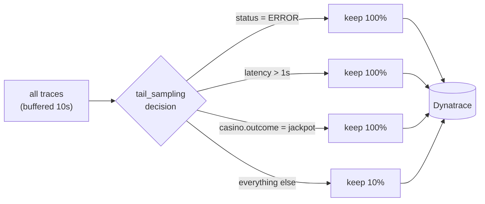

# Step 7 — Tail sampling

!!! abstract "Skill `otel-collector` · ⏱ 25 min · difficulty ●●○ · Core step"
    **Problem → Understand → Drive (ladder) → Review & apply → Verify.** Lean on
    the `otel-collector` skill for this step. Budget ~25 min. Core step, do this.

**Goal:** cut trace ingest cost sharply while keeping every trace that matters —
errors, slow traces, and jackpots. Afterward the gateway exports a small, cheap
slice of the boring majority but 100% of every high-value trace, so an operator
can still debug a failed spin or audit a jackpot payout end-to-end while the
ingest bill drops. You will build the policy set iteratively — error-only first,
then add the retention classes you find missing — because that is how the miss
teaches itself.

## ① Problem — exporting everything

No sampling at the gateway — every trace is exported. Trace ingest cost scales
linearly with casino load, and most of it is fast, successful, uninteresting
spins. There is no `tail_sampling` processor anywhere in the traces pipeline
today, so you are paying full price to store traffic nobody will ever look at,
while the errors and jackpots you actually care about are buried in the noise at
their natural low rate.

The reference answer for the finished processor lives at
`labs/advanced/step6-tail-sampling/tail-sampling-processor.yaml` — read it only
after you have driven the change yourself.

Confirm the symptom — run the checkpoint DQL in ⑤ now and watch it return the
full, unsampled volume with error traces at just their natural rate. That is your
"before".

## ② Understand the change

Sampling is a strategy, not a failure — 100% is rarely the answer, but blind head
sampling (deciding SDK-side, before the trace exists) throws away the errors you
most need, because at decision time you cannot yet know a trace will fail or run
slow. **Tail** sampling buffers the whole trace first, then decides: keep **all**
errors / slow traces / jackpots and sample the boring majority down to 10%.
Because the decision happens after the trace is assembled, the policies can look
at the real outcome.



The finished processor sits in the **traces** pipeline, after
`k8sattributes`/`resource` (so attributes like `casino.outcome` are present when
the policy evaluates) and before `batch`, with `memory_limiter` still first:

```yaml
processors:
  tail_sampling:
    decision_wait: 10s          # buffer long enough to assemble a full trace before deciding
    policies:
      - name: errors            # status_code=ERROR → keep 100%
        type: status_code
        status_code: { status_codes: [ERROR] }
      - name: slow              # latency > 1s → keep 100%
        type: latency
        latency: { threshold_ms: 1000 }
      - name: jackpots          # casino.outcome=jackpot → keep 100%
        type: string_attribute
        string_attribute: { key: casino.outcome, values: [jackpot] }
      - name: boring-majority   # everything else → probabilistic 10%
        type: probabilistic
        probabilistic: { sampling_percentage: 10 }
```

!!! tip "Keep asking why — read before you drive"
    Before you let the agent change anything, make it explain the target and its
    plan, read-only:

    ```bash
    opencode run "Using the otel-collector skill: read the TRACES pipeline in \
    observability/collectors/gateway.yaml and tell me whether any sampling happens \
    today, then explain why blind head sampling would discard the errors I most need \
    versus tail sampling buffering the whole trace first. Do NOT edit anything."
    ```

    A good answer confirms there is **no** `tail_sampling` processor today (every
    trace is exported) and articulates the head-vs-tail distinction. Reading first
    is what lets you catch a wrong diff in ④.

## ③ Drive opencode — the prompt ladder

Climb the ladder one rung at a time. Run a rung, read what it did, confirm the
**review check**, then go to the next rung. Do not paste all four at once —
steering between rungs is the skill.

**P1 · Orient (read-only)**

```bash
opencode run "Using the otel-collector skill: read the TRACES pipeline in \
observability/collectors/gateway.yaml and confirm there is NO sampling today — \
every trace is exported. Then explain why blind head sampling would throw away \
the errors I most need, versus tail sampling buffering the whole trace before \
deciding. Do NOT edit anything."
```

- **What you should see:** the agent reports no `tail_sampling` processor exists and every trace is currently exported, with a clear head-vs-tail explanation.
- **Review check:** did it confirm no `tail_sampling` exists today and articulate the head-vs-tail difference?

**P2 · Core change — error-only first**

```bash
opencode run "Using the otel-collector skill: in observability/collectors/gateway.yaml \
add a tail_sampling processor to the TRACES pipeline with decision_wait 10s and just \
TWO policies — status_code=ERROR keep 100%, and everything else probabilistic at 10%. \
Place it after k8sattributes/resource and before batch; keep memory_limiter first."
```

- **What you should see:** errors are retained in full and overall trace volume drops, but slow and jackpot traces are being sampled away with the rest.
- **Review check:** is the `tail_sampling` processor in the TRACES pipeline with `decision_wait` 10s, after `k8sattributes`/`resource` and before `batch`, with `memory_limiter` still first?

**P3 · Deepen — jackpots dropped → add the missing policies**

```bash
opencode run "Using the otel-collector skill: in observability/collectors/gateway.yaml \
ADD two more policies to the existing tail_sampling processor — latency>1s keep 100% \
and casino.outcome=jackpot keep 100% — so all three high-value classes are retained \
alongside the error policy, leaving the boring majority at probabilistic 10%. Keep \
decision_wait 10s and the processor's place in the TRACES pipeline."
```

- **What you should see:** first verify in Dynatrace (⑤) that slow and jackpot traces were being dropped under the error-only pass; after this rung all four policies are present and jackpots/slow traces are retained again.
- **Review check:** are errors, slow (>1s), AND jackpots each keeping 100%, with only the boring majority at 10%?

**P4 · Steer — the retention miss**

```bash
opencode run "Using the otel-collector skill: in observability/collectors/gateway.yaml \
make sure errors, slow (>1s), and jackpots each keep 100% — only the remaining boring \
traces sample to 10%. Do NOT turn the error, latency, or jackpot policies into \
probabilistic sampling, and do NOT drop the jackpot policy when simplifying."
```

- **What you should see:** the agent sometimes *samples* errors (instead of keeping 100%) or drops the jackpot policy when asked to "simplify" — catch it and steer back. Also confirm the single-instance requirement below still holds.
- **Review check:** after steering, is the **absolute** error/slow/jackpot count unchanged (all three at 100% retention)?

## ④ Review & apply

Read the diff first — confirm all four policies are present, `decision_wait` is
10s, and the processor is in the **traces** pipeline after
`k8sattributes`/`resource`, before `batch`, with `memory_limiter` first.
Reference answer: `labs/advanced/step6-tail-sampling/tail-sampling-processor.yaml`.
The gateway collector is applied directly with `kubectl` (not via Argo):

```bash
kubectl apply -f observability/collectors/gateway.yaml
```

!!! warning "Steer-back box — if the agent gets it wrong"
    Re-run opencode with the correction rather than hand-editing; the ⑤
    checkpoint tells you when you are done.

    - **It samples errors (probabilistic on the error policy)** → *"errors, slow
      (>1s), and jackpots must each keep 100% — only the remaining 'boring'
      traces sample to 10%."*
    - **It drops the jackpot policy when asked to "simplify"** → *"keep the
      `casino.outcome=jackpot` policy at 100%; all three high-value classes stay."*
    - **The processor lands in the wrong place** → *"put `tail_sampling` in the
      traces pipeline after `k8sattributes`/`resource` and before `batch`, with
      `memory_limiter` first."*

!!! warning "Single-instance requirement"
    Tail sampling must see **all** spans of a trace on one collector instance.
    The training gateway is `replicas: 1`, so this holds. If you scale the
    gateway out, you **must** front it with a `loadbalancing` exporter tier keyed
    on traceID — otherwise decisions are made on partial traces and you drop
    spans from traces you meant to keep.

## ⑤ Verify — Dynatrace validation checkpoint

Confirm errors are retained while overall volume drops, in a Grail Notebook:

```dql
fetch spans, from: now() - 1h
| summarize kept = count() by { status = if(request.status == "failed", "error", "ok") }
```

- **Before:** error traces are a small % of total, matching their natural rate;
  total volume is high.
- **After:** total trace volume drops sharply, but the **absolute** count of
  error / slow / jackpot traces is **unchanged** (100% retention) — error
  analysis stays complete while cost falls. Verify a known error trace is still
  fully present end-to-end.

## Definition of done

- [ ] The `tail_sampling` processor is wired into the traces pipeline (after `k8sattributes`/`resource`, before `batch`)
- [ ] The four policies are in place (error / slow / jackpot → 100%, else 10%)
- [ ] Iteratively added the latency and jackpot policies after the error-only pass
- [ ] Verified 100% retention of all three classes (error / slow / jackpot) after steering
- [ ] Total trace volume drops after the fix
- [ ] The absolute error/slow/jackpot count is unchanged
- [ ] A known error trace is still complete end-to-end

You have finished the advanced self-paced track — a warmed-up coding agent,
money-path instrumentation, business metrics, a convention guard, cost
attribution, cardinality control, PII redaction, and sampling, each driven
through the **Problem → Opencode → Verify** loop and proven in Dynatrace. Back to
[Getting started](getting-started.md) or the facilitator-led
[M0–M5 modules](../setup.md).
