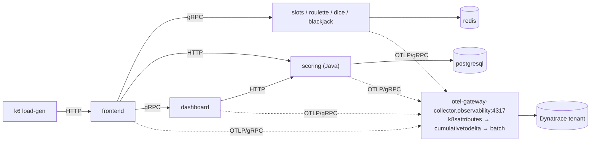

# Beyond the Honeymoon: OTel in Practice

Welcome to the Perform hands-on training. The Vegas Casino application you are
running today ships with deliberately broken observability. In three hours you
take it from broken traces to a production-grade OpenTelemetry pipeline — SDK
first, collector second — and watch every fix land in Dynatrace.

## The honeymoon problem

Every OpenTelemetry rollout follows the same curve. The honeymoon: a quickstart
gets traces flowing, dashboards light up, everyone is happy. Then reality
arrives — a service drops off the trace, a metric dimension explodes into
millions of series, an email address shows up in a log — and nobody knows which
config surface fixes it, because the config was never really *owned*. It was
copied.

Today you take ownership. The casino has real defects, planted on purpose. You
diagnose them in Dynatrace, fix them in configuration — never in application
code — and verify each fix in the tenant.

## What you will build

| Hour | Module | You will… |
|---|---|---|
| 0:00–0:15 | [M0 — Environment setup](setup.md) | Codespace up, kind cluster healthy, Dynatrace connected, casino deployed |
| 0:15–0:45 | [M1 — Tour the broken casino](module-1.md) | Diagnose the trace-context defect; fix W3C propagation |
| 0:45–1:15 | [M2 — SDK configuration by file](module-2.md) | Move the Java service to declarative `otel-config.yaml` |
| 1:25–2:05 | [M3 — The collector as control point](module-3.md) | Fix high-cardinality metrics and PII logs at the source and the collector |
| 2:05–2:35 | [M4 — Sampling strategy](module-4.md) | Cut ingest cost with tail sampling; keep RED metrics with spanmetrics |
| 2:35–2:55 | [M5 — Operating at scale](module-5.md) | Leave with the enterprise readiness checklist |

## The environment

Everything runs in **your GitHub Codespace** — nothing is installed on your
laptop but a browser:

- **kind cluster** in your Codespace, one per attendee
- **Vegas Casino** — Node.js, Python, Go and Java microservices (namespace `casino`)
- **OTel collectors** — a DaemonSet for node logs and a gateway collector that
  enriches and exports to Dynatrace (namespace `observability`)
- **Dynatrace** — shared tenant; your cluster is identified by your unique
  `K8S_CLUSTER_NAME`
- **GitOps** — an in-cluster Git host (Gitea) and Argo CD sync the `casino`
  namespace. You fix defects by editing a manifest and committing — the same
  loop you would use in production

## How to use this guide

- **Command blocks** are meant to be pasted into the Codespace terminal.
- **Dynatrace check** sections tell you exactly what to look for in the tenant.
  A fix that does not show up in Dynatrace did not happen.
- Each module ends with a **Definition of done**. A helper will check you off
  before you move on.
- Solutions for each defect hunt are collapsed — try the hunt first, then
  click to reveal.

**Start here:** open [M0 — Environment Setup](setup.md).
