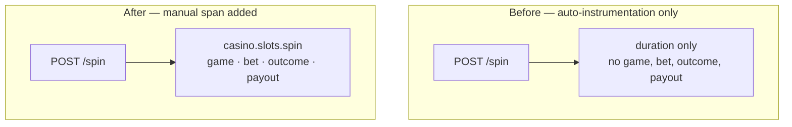

# M2 — Instrument the casino: declarative config + AI-agent spans

**Goal:** two instrumentation skills in one module — (A) take the Java Scoring
Service from code-first SDK configuration to a declarative `otel-config.yaml`,
injected with zero code changes; (B) use the `opencode` AI agent to add the
**money-path span** (`casino.slots.spin`) to the slots service, so the bet /
outcome / payout becomes visible in Dynatrace. 60 minutes.

## Concepts (5 min)

There are three ways to configure an SDK, in increasing order of scale:

1. **Env vars** — `OTEL_EXPORTER_OTLP_ENDPOINT`, `OTEL_PROPAGATORS`, … Fine
   for a handful of settings; becomes env-var soup at fleet scale.
2. **Code** — an `OpenTelemetryConfig` class building the SDK by hand. Maximum
   control, but every configuration change is a rebuild and redeploy of the
   application.
3. **Declarative file** — one `otel-config.yaml`, version-controlled,
   reviewed, and mounted into the workload. The
   [schema](https://opentelemetry.io/docs/languages/sdk-configuration/declarative-configuration/)
   is shared across languages; today the **Java zero-code agent** implements
   it via `OTEL_CONFIG_FILE`.

!!! warning "The one rule everyone gets bitten by"
    When the SDK reads a config **file**, environment variables are **ignored
    unless the file references them** with `${ENV_VAR}`. This is the single
    most common "why is my config ignored?" question in the lab.

## Exercise A — declarative config for the Java scoring service

### The problem: config welded into code

The Scoring Service (Java, Spring Boot) configures OTel **in code** —
`services/scoring/.../config/OpenTelemetryConfig.java` builds its own tracer
provider with a hard-coded OTLP exporter. Consequences you can observe right
now in Dynatrace:

- **Traces** from `vegas-scoring-service` flow (the code exports them).
- **No JVM metrics** — the code never wires a meter provider.
- **No logs** — the code never wires a logger provider. Java logs go to
   stdout, unstructured, invisible to OTLP.

Want to change the sampler? Rebuild the jar. Want logs? Write Java. This is
the anti-pattern the declarative file replaces.

### The lab: zero-code instrumentation via the operator

Your cluster runs the OpenTelemetry Operator (namespace `observability`). It
can inject the Java agent into any workload — no Dockerfile change, no code.

You make this change the same way as M1: drive **opencode**, review its diff,
and ship it as a **PR/MR on your git host** that Argo CD syncs. If you have not cloned the
casino repo for opencode yet, run the [one-time setup from M1](module-1.md#the-fix-drive-it-with-opencode-ship-it-through-gitea)
(`gitea-token.sh` → `clone-casino.sh` → `cd ~/casino && opencode`) first.

### ② Opencode — create the config and wire the deployment

Drive the agent with one prompt that names the **goal**, the two **target files**,
and the **skill**:

```bash
opencode run "Using the otel-instrumentation skill: give the Java \
vegas-scoring-service declarative, zero-code OTel via the operator. (1) Create \
k8s/21-scoring-otel.yaml holding a ConfigMap 'scoring-otel-config' whose \
otel-config.yaml (file_format 1.1) wires resource identity + host/process/ \
container detectors, tracecontext+baggage propagators, and tracer/meter/logger \
providers all exporting OTLP to \
http://otel-gateway-collector.observability.svc.cluster.local:4317 (tls \
insecure), plus an Instrumentation CR 'casino-java' setting OTEL_CONFIG_FILE=/ \
etc/otel/otel-config.yaml. (2) Edit k8s/20-scoring.yaml: add the pod annotation \
instrumentation.opentelemetry.io/inject-java: casino-java, the OTEL_CONFIG_FILE \
env var, and mount the ConfigMap at /etc/otel. Keep the existing container spec \
otherwise unchanged."
```

### ③ Review — read the diff

Read both files opencode writes before you ship them. The new
**`k8s/21-scoring-otel.yaml`** should converge on:

```yaml
apiVersion: v1
kind: ConfigMap
metadata:
  name: scoring-otel-config
data:
  otel-config.yaml: |
    file_format: "1.1"

    resource:
      attributes:
        - name: service.name
          value: vegas-scoring-service
        - name: service.namespace
          value: vegas-casino
      detectors:            # fill in host/process/container identity
        - host:
        - process:
        - container:

    propagator:
      composite:
        - tracecontext:
        - baggage:

    tracer_provider:
      sampler:
        parent_based:
          root:
            always_on: {}          # M9 revisits this
      processors:
        - batch:
            exporter:
              otlp:
                endpoint: http://otel-gateway-collector.observability.svc.cluster.local:4317
                tls:
                  insecure: true

    meter_provider:
      readers:
        - periodic:
            exporter:
              otlp:
                endpoint: http://otel-gateway-collector.observability.svc.cluster.local:4317
                tls:
                  insecure: true

    logger_provider:
      processors:
        - batch:
            exporter:
              otlp:
                endpoint: http://otel-gateway-collector.observability.svc.cluster.local:4317
                tls:
                  insecure: true
---
apiVersion: opentelemetry.io/v1alpha1
kind: Instrumentation
metadata:
  name: casino-java
spec:
  java:
    env:
      - name: OTEL_CONFIG_FILE
        value: /etc/otel/otel-config.yaml
```

!!! note "SDK `batch` ≠ Collector `batch`"
    The `batch` span/log processors in this file are part of the **SDK** and are not
    deprecated. It is the *Collector's* `batch` processor that is deprecated — you will
    see its replacement (exporter-level `sending_queue.batch`) in [M5](module-3.md).

Every block maps to a concept from M1: resource identity, propagation,
per-signal pipelines (tracer / meter / logger providers), each with its own
batch processor and OTLP exporter.

Note what the file does **not** contain: any of the `OTEL_*` env vars from the
deployment. If we needed one, it would have to appear as `${VAR}` inside the
file to be honored at all.

And the three edits opencode makes to **`k8s/20-scoring.yaml`**:

1. Add the injection annotation to the **pod template** metadata (the
   `template.metadata.annotations` block — create it if missing):

    ```yaml
    instrumentation.opentelemetry.io/inject-java: "casino-java"
    ```

2. Add the env var pointing at the mounted file, in the container env block:

    ```yaml
    - name: OTEL_CONFIG_FILE
      value: /etc/otel/otel-config.yaml
    ```

3. Mount the ConfigMap — add to the container `volumeMounts` and the pod
   `volumes`:

    ```yaml
    # container:
    volumeMounts:
      - name: scoring-otel-config
        mountPath: /etc/otel
        readOnly: true
    # pod spec:
    volumes:
      - name: scoring-otel-config
        configMap:
          name: scoring-otel-config
    ```

!!! warning "If the agent gets it wrong — steer it back, don't hand-fix"
    Common misses and the one-line correction to reply with:

    - **`meter_provider` or `logger_provider` dropped** (only traces wired):
      *"the file must wire all three — tracer_provider, meter_provider, and
      logger_provider — each exporting OTLP to the gateway, or JVM metrics and
      logs will still be missing."*
    - **ConfigMap not mounted** / annotation on the wrong metadata block: *"the
      inject-java annotation goes on the pod template metadata, and the ConfigMap
      must mount at /etc/otel in the container."*
    - **Edited the wrong deployment**: *"the only deployment to touch is
      k8s/20-scoring.yaml (vegas-casino-scoring)."*

    Re-run opencode with the correction — the verify checkpoint tells you when
    it is done.

### ④ Apply — opencode → PR/MR → merge → Argo CD sync

Ship both files through **your git host** (GitLab fork default, Gitea fallback;
the casino namespace is GitOps-owned). Let opencode run the git loop, or do it
by hand from inside `~/casino` (Gitea fallback: `gitea-pr.sh "feat(scoring):
declarative zero-code OTel via operator"`):

```bash
gitea-pr.sh "feat(scoring): declarative zero-code OTel via operator"
```

**Review and merge the PR/MR in your git host's UI.** Argo CD syncs the merged
`main` (hit **Refresh** at `http://localhost:30002` to force it); watch the rollout:

```bash
kubectl -n casino rollout status deploy/vegas-casino-scoring
kubectl -n casino get pods -l app.kubernetes.io/name=vegas-casino -o name | grep scoring
```

!!! tip "Ship it — Branch A (config/manifest)"
    The ConfigMap and Instrumentation CR are manifests under `k8s/`, so merging
    is enough — no CI, no image build, Argo CD syncs the YAML directly. Full
    flow: [the GitOps loop](setup.md#ship-it).

!!! tip "Not rolling?"
     Argo CD only syncs files it can render. YAML-indentation errors in the
     ConfigMap (the `|` block) are the usual suspect — check the Argo CD app
     status at http://localhost:30002 before you debug anything else.

### ⑤ Verify in Dynatrace

Give it a minute, then with your cluster filter:

1. **Metrics** — search metric names for `jvm_` or open the scoring service's
   infrastructure view: **JVM runtime metrics appear for
   `vegas-scoring-service`** — they were absent before, because the meter
   provider only exists now, in the file.
2. **Logs** — open **Logs**, filter `service.name = vegas-scoring-service`:
   structured logback lines now arrive, each correlated with a trace.
3. **Traces** — still flowing frontend → game → scoring, as in M1.

??? note "Known wrinkle — you may see double export"
    The application still contains its legacy programmatic config
    (`OpenTelemetryConfig.java`), which keeps exporting its own manual spans.
    If a trace shows near-duplicate scoring spans, that is the old code path,
    not your file config. In production you would delete the programmatic
    config and let the file be the single source of truth; for the lab it is
    harmless — the *new* signals (JVM metrics, logs) come only from the file.

## Exercise B — the money-path span, driven by the AI agent

Auto-instrumentation gives you the HTTP and DB edges for free, but the
*business logic* — the bet, the RNG draw, the payout decision — is a black box.
A spin shows up as a featureless `POST /spin` server span with nothing you can
slice by. You add a child span that carries the domain:



The slots service (`vegas-slots-service`, Node.js) ships **deliberately
under-instrumented**: its `/spin` handler computes outcome and payout with no
manual span and no domain attributes, and losing-edge errors are swallowed (no
span event, no error status). Reference asset (the planted state):
`labs/advanced/step1-agent-instrumentation/before.slots-index.js`.

### ② Opencode — drive the fix

Clone your casino repo if you have not (the
[one-time setup from M1](module-1.md#the-fix-drive-it-with-opencode-ship-it-through-gitea)),
`cd` into `~/casino`, and drive the agent at the slots service source with the
`otel-instrumentation` skill — the prompt names the **goal**, the **target
file**, and the **skill**:

```bash
opencode run "Using the otel-instrumentation skill: in the vegas-slots-service \
/spin handler, wrap the draw and payout in a child span 'casino.slots.spin' with \
@opentelemetry/api. Set attributes casino.game.name, casino.bet.amount, \
casino.outcome, casino.payout.amount; add a 'jackpot' span event on a jackpot; \
set span error status on failures. Keep the existing response shape."
```

### ③ Review — read the diff

In build mode `opencode` writes the change straight into the working tree. **Read
the diff before you ship it.** The target shape (from
`after.slots-index.js`):

```diff
+ const { trace, SpanStatusCode } = require('@opentelemetry/api');
+ const tracer = trace.getTracer('casino-slots', '1.0.0');
  app.post('/spin', async (req, res) => {
-   const bet = Number(req.body.bet);
-   const outcome = draw();
-   const payout = settle(bet, outcome);
-   res.json({ outcome, payout });
+   const bet = Number(req.body.bet);
+   await tracer.startActiveSpan('casino.slots.spin', async (span) => {
+     try {
+       span.setAttribute('casino.game.name', 'slots');
+       span.setAttribute('casino.bet.amount', bet);
+       const outcome = draw();
+       const payout = settle(bet, outcome);
+       span.setAttribute('casino.outcome', outcome.kind);        // win | lose | jackpot
+       span.setAttribute('casino.payout.amount', payout);
+       if (outcome.kind === 'jackpot') span.addEvent('jackpot', { 'casino.payout.amount': payout });
+       res.json({ outcome, payout });
+     } catch (err) {
+       span.setStatus({ code: SpanStatusCode.ERROR, message: err.message });
+       span.recordException(err);
+       throw err;
+     } finally {
+       span.end();
+     }
+   });
  });
```

!!! tip "Why these exact attribute names?"
    `casino.game.name`, `casino.bet.amount`, `casino.outcome`, `casino.payout.amount`.
    This exercise **creates** these attributes; [M4 (Weaver)](advanced/step-3-weaver-pipeline.md)
    **guards** them, and [M3](advanced/step-2-business-metrics.md) **reuses**
    `casino.game.name` / `casino.outcome` as the dimensions on the business
    metrics. Keep the names exactly as above or the M4 registry check will flag
    drift.

!!! warning "If the agent gets it wrong — steer it back, don't hand-fix"
    - **Attribute dropped or renamed** (`casino.game` instead of
      `casino.game.name`): *"use exactly these four keys, dotted:
      casino.game.name, casino.bet.amount, casino.outcome, casino.payout.amount."*
    - **No error path**: *"wrap the body in try/catch and set
      SpanStatusCode.ERROR + recordException on failure."*
    - **Response shape changed**: *"keep the existing `res.json({ outcome, payout })`
      response untouched."*

    Re-run `opencode` with the correction rather than hand-editing — the verify
    checkpoint below tells you when the agent is done.

The same pattern applies to roulette/dice/blackjack. The Java `scoring` service
runs under the OTel Java agent (zero-code), so there you add
`@WithSpan("casino.scoring.settleRound")` and `@SpanAttribute` annotations
(`opentelemetry-instrumentation-annotations`) rather than hand-building the span:

```java
@WithSpan("casino.scoring.settleRound")
public Payout settleRound(@SpanAttribute("casino.game.name") String game,
                          @SpanAttribute("casino.bet.amount") long bet) {
    // ... scoring logic ...
}
```

### ④ Apply — opencode → PR/MR → merge → Argo CD sync

This time you edited **slots service source** (`apps/casino/**`), not a
manifest — so it is **Branch B**: ship it from inside `~/casino` through your git
host (Gitea fallback: `gitea-pr.sh "feat(slots): add casino.slots.spin money-path
span"`), but merging triggers an image build, not a direct sync.

!!! tip "Ship it — Branch B (`apps/casino/**` code)"
    Open the PR/MR and **merge it** — in Gitea the image CI does **not** run on
    the PR. Merging `apps/casino/**` to `main` triggers the image CI (Gitea
    Actions `casino-images`); **watch that run go green** — it builds the images,
    tags `:<sha>`, and writes `:<sha>` back into `k8s/`. Only then does Argo CD
    sync and the slots pods roll to the new image (hit **Refresh** at
    `http://localhost:30002` to nudge the poll). Full flow:
    [the GitOps loop](setup.md#ship-it).

Once the new image is rolled out, play a few rounds of slots to generate traffic.

### ⑤ Verify — Dynatrace validation checkpoint

Run in a Grail **Notebook** against the training tenant (filter to your cluster):

```dql
fetch spans
| filter k8s.cluster.name == "<PARTICIPANT_ID>"
| filter span.name == "casino.slots.spin"
| summarize spins = count(), avgPayout = avg(toDouble(casino.payout.amount)) by { casino.outcome }
```

- **Before:** the query returns **no rows** — the span does not exist, the
  money-path is invisible.
- **After:** one row per `casino.outcome` (`win` / `lose` / `jackpot`) with
  payout aggregates, and the `casino.slots.spin` span appears as a **child of
  `POST /spin`** in the distributed trace.

!!! tip "Dig deeper — catalog theme A"
    [A1–A5 in the extra-exercises catalog](advanced/catalog.md) build directly on
    this span: broken-trace repair, log↔trace correlation, multi-language
    port, exception span-events, baggage propagation.

## Definition of done — M2

- [ ] You can explain the three config surfaces and when each wins
- [ ] You can state the env-var rule for file mode without looking it up
- [ ] You drove the declarative-config change with opencode and shipped it as a
      **merged PR/MR** — `k8s/21-scoring-otel.yaml` (ConfigMap + Instrumentation
      CR) plus the `k8s/20-scoring.yaml` wiring
- [ ] JVM metrics and logs from `vegas-scoring-service` visible in Dynatrace
- [ ] The `casino.slots.spin` child span wraps draw+payout, carries
      `casino.game.name` / `casino.bet.amount` / `casino.outcome` /
      `casino.payout.amount`, records jackpot events and error status, and its
      DQL returns one row per outcome
- [ ] Traces still connected end-to-end

Next: [M3 — Business metrics](advanced/step-2-business-metrics.md).
