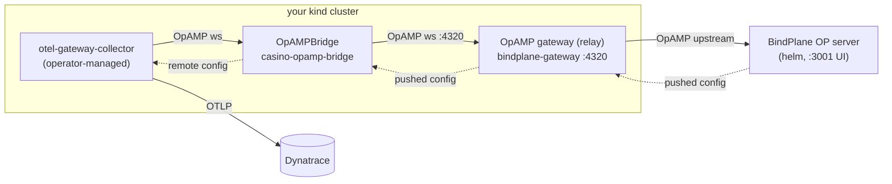

# M10 — Operating at scale + fleet management with OpAMP/BindPlane

**Goal:** compress what you just did into an operating model you can take
home — then do the two fleet exercises the manual workflow cannot scale to:
put your gateway collector under **OpAMP** management (OpAMP bridge →
BindPlane gateway) and **change the pipeline centrally from BindPlane**,
watching the collector reconfigure live. 35 minutes, demo + hands-on.

Every change here is still driven by `opencode` — same agent loop
(**① Problem → ② Opencode → ③ Review → ④ Apply → ⑤ Verify**).

## What you actually did today

| Module | Defect | Fix surface | Driven by | Verified by |
|---|---|---|---|---|
| M1 | Trace-context break (`x-vegas-trace` vs W3C) | SDK propagators (`OTEL_PROPAGATORS`), PR/MR on your git host | `opencode` + `otel-instrumentation` | Connected flame graph |
| M2 | Config welded into code; invisible money-path | Declarative `otel-config.yaml` + zero-code agent; `casino.slots.spin` span, git PR/MR | `opencode` + `otel-instrumentation` | JVM metrics + logs + money-path DQL |
| M3 | No business metrics on the money-path | Counter + histogram in the slots service, git PR/MR | `opencode` | Bets-by-outcome dashboard tile |
| M4 | Attribute drift / expensive metric dimensions | Weaver registry + CI check | `opencode` + `otel-semantic-conventions` | Red CI run on drift |
| M5 | — (collector concepts, no defect) | Pipeline reading; the three invariants | — | Invariants recited |
| M6 | High-cardinality metrics (`player_id`, `round.id`) | SDK knob (PR/MR) + collector `transform/cardinality` | `opencode` (`otel-instrumentation`, `otel-collector`/`otel-ottl`) | Series flat at ~12 |
| M7 | PII in logs (raw email/IP/PAN/SSN) | SDK verbosity knob (PR/MR) + collector redaction | `opencode` | Leak-scan DQL `leaks == 0` |
| M8 | Ingest not attributable | `resource/costcenter` on the gateway (your cost-center id) | `opencode` + `kubectl apply` | `dt.cost.costcenter` in DQL |
| M9 | Cost/fidelity of ingest | `tail_sampling` + `spanmetrics` on the gateway | `opencode` + `kubectl apply` | Errors/jackpots kept at ~10–20% volume |
| M10 | Fleet config by hand | OpAMP bridge → BindPlane; pipeline changed centrally | `opencode` | Collector reconfigures live |

One pattern under all of it: **the defect was never in the application logic —
it was in configuration nobody owned.** Observability went production-grade
the moment configuration became a reviewed artifact in Git — and the moment
the agent, not the human, produced the reviewed diff.

## Step 1 — opencode-driven scale hardening on the gateway

Before you fleet-manage anything, harden the one collector you have. Drive
the agent at the gateway config (Codespace repo) with the `otel-collector`
skill:

```bash
opencode run "Using the otel-collector skill: in observability/collectors/gateway.yaml, \
size the gateway for a bad day — raise the otlp_http exporter sending_queue queue_size to \
50000 (it holds UNBATCHED requests, so size it generously), keep retry_on_failure, keep \
memory_limiter first with limit_mib 400, and keep sending_queue.batch as the only batching. \
Change nothing else."
```

Review the diff, then the config-as-product discipline:

```bash
bash observability/validate.sh
kubectl apply -f observability/collectors/gateway.yaml
kubectl -n observability rollout status deploy/otel-gateway-collector
```

!!! warning "If the agent gets it wrong — steer it back"
    - **Adds a `batch` processor**: *"no batch processor — batching is
      `sending_queue.batch` on the exporter only."*
    - **Touches processor order**: *"memory_limiter stays first; enrichment
      before filtering; nothing after the exporter."*

## Exercise A — deploy the OpAMP bridge and connect the collector to the BindPlane gateway

Hand-editing collector YAML does not scale past one collector. **OpAMP** is
the remote-management protocol for OTel collectors; **BindPlane OP** is a
managed-configuration platform that authors config once and pushes it to the
fleet over OpAMP — versioned, staged, with history and rollback. Your gateway
is operator-managed, so the OTel Operator's **OpAMPBridge** CR speaks OpAMP on
its behalf, through the **OpAMP gateway (relay)**.

The full topology and gotchas are in the
[OpAMP/BindPlane appendix](advanced/bindplane-opamp.md);
the lab assets live in
[`labs/advanced/step5-pii-redaction/bindplane-opamp/`](https://github.com/henrikrexed/Otel-Training/blob/main/labs/advanced/step5-pii-redaction/bindplane-opamp/)
(`opampbridge.yaml`, `opamp-gateway.yaml`). You reuse them — this exercise is
about connecting *your* collector, not building new assets.



### ① Deploy BindPlane OP and the relay

```bash
# BindPlane OP server, pinned chart (alpha — do not float):
helm repo add bindplane https://observiq.github.io/bindplane-op-helm
helm repo update
helm upgrade --install bindplane bindplane/bindplane \
  -n observability --create-namespace --version 1.24.0
kubectl -n observability rollout status deploy/bindplane
kubectl -n observability port-forward svc/bindplane 3001:3001   # UI: http://localhost:3001

# Connection token from BindPlane → Settings → OpAMP (install command):
kubectl -n observability create secret generic bindplane-gateway \
  --from-literal=BINDPLANE_OPAMP_TOKEN='<token-from-bindplane>'
kubectl -n observability create secret generic bindplane-opamp \
  --from-literal=BINDPLANE_OPAMP_TOKEN='<token-from-bindplane>'

# The OpAMP gateway (relay) — lab asset, applied from your Codespace repo:
kubectl apply -f labs/advanced/step5-pii-redaction/bindplane-opamp/opamp-gateway.yaml
kubectl -n observability rollout status deploy/bindplane-gateway
```

### ② Opencode — author the bridge config

Now drive the agent to produce the bridge CR (based on the lab asset
`labs/advanced/step5-pii-redaction/bindplane-opamp/opampbridge.yaml`):

```bash
opencode run "Using the otel-collector skill: write opampbridge-casino.yaml — an \
opentelemetry.io/v1alpha1 OpAMPBridge CR named casino-opamp-bridge in namespace observability, \
modeled on labs/advanced/step5-pii-redaction/bindplane-opamp/opampbridge.yaml: image \
ghcr.io/open-telemetry/opentelemetry-operator/operator-opamp-bridge:0.162.0 (matches operator v0.162.0, \
no leading v), endpoint ws://bindplane-gateway.observability.svc.cluster.local:4320/v1/opamp \
(keep the commented :3001 direct fallback), header Authorization: \${env:BINDPLANE_OPAMP_TOKEN}, \
capabilities AcceptsRemoteConfig + ReportsEffectiveConfig + ReportsHealth (+ ReportsRemoteConfig), \
and componentsAllowed allow-list: receivers [otlp], processors [transform, memory_limiter, redaction, \
tail_sampling, filter], exporters [otlp_http]."
```

### ③ Review — check the safety rails in the diff

- `endpoint` points at the **relay** `:4320` (not the server `:3001`).
- The bridge image tag (`0.162.0`) matches the operator release line.
- `componentsAllowed` is a tight allow-list — BindPlane cannot push a
  component the bridge does not permit.

!!! warning "If the agent gets it wrong — steer it back"
    - **Wrong endpoint** (`:3001` active, `:4320` commented): *"we run the
      relay — the bridge must point at `ws://bindplane-gateway...:4320/v1/opamp`."*
    - **Missing allow-list or AcceptsRemoteConfig: false**: *"the bridge must
      accept remote config and report its effective config — that is the whole
      exercise."*

### ④ Apply

```bash
kubectl -n observability set env opampbridge/casino-opamp-bridge \
  --from=secret/bindplane-opamp
kubectl apply -f opampbridge-casino.yaml
kubectl -n observability rollout status opampbridge/casino-opamp-bridge
```

### ⑤ Verify — the collector appears in BindPlane

1. Open the BindPlane UI (http://localhost:3001) — `otel-gateway-collector`
   shows up under connected agents (the bridge reports it upstream through the
   relay).
2. Because `ReportsEffectiveConfig: true`, BindPlane shows the collector's
   **live running config** — no manual YAML read needed.
3. Collector log shows the OpAMP connection:

```bash
kubectl -n observability logs deploy/otel-gateway-collector --tail=20 | grep -i opamp
```

## Exercise B — change the pipeline centrally from BindPlane

Once the collector is OpAMP-managed, **you stop editing `gateway.yaml`
locally for managed components** — BindPlane owns that config now. Change the
pipeline from BindPlane and watch the collector reconfigure **live** — no
`kubectl apply`, no git commit, no rollout.

### ① Opencode — author the central config change

Pick a small, observable pipeline change — e.g. relax the M9 baseline sampling
from 10% to 20%, or add a `transform` processor that stamps a
`casino.managed_by=bindplane` resource attribute. Have the agent produce the
collector config fragment you will push:

```bash
opencode run "Using the otel-collector and otel-ottl skills: produce the collector config \
fragment that changes the tail_sampling baseline policy sampling_percentage from 10 to 20 \
(in the traces pipeline), as it would appear in the collector's config YAML. Output only the \
processors: tail_sampling: block."
```

### ② Push it from BindPlane

1. In the BindPlane UI, open the `otel-gateway-collector` agent → its
   configuration → edit the pushed config with your fragment (or attach the
   equivalent curated processor, e.g. a `transform` processor).
2. **Save and roll out** the config to the agent.

### ③ Watch the collector reconfigure live

```bash
# the bridge applies the remote config — the collector reloads WITHOUT a pod restart:
kubectl -n observability logs deploy/otel-gateway-collector --tail=50 | grep -iE 'opamp|remote config|reloading'
kubectl -n observability get pods -l app.kubernetes.io/component=gateway-collector
```

In BindPlane, `ReportsEffectiveConfig` now shows the pushed config as the
collector's effective config. Give it a few minutes of traffic and verify in
Dynatrace that the change took effect (e.g. trace volume moves toward ~20%
baseline instead of 10%):

```dql
fetch spans, from: now() - 15m
| filter k8s.cluster.name == "<PARTICIPANT_ID>"
| summarize spans = count(), by: { bin(timestamp, 5m) }
| sort timestamp asc
```

**The teaching point:** local edits (`kubectl apply`, git commits) are how you
manage one collector. OpAMP + BindPlane are how you manage a **fleet** — one
authored, versioned, staged config pushed to hundreds of collectors, with
history and one-click rollback. Same discipline you practiced in M5–M9;
the product scales it. (In a real fleet you would not run both the local
`gateway.yaml` and BindPlane for the same components — BindPlane is the single
source of truth once connected.)

!!! warning "If the collector does not reconfigure"
    Check the bridge allow-list first — `componentsAllowed` rejects any pushed
    component not in the list. Then check the bridge/agent health in the
    BindPlane UI, and `kubectl -n observability get opampbridge casino-opamp-bridge`.

And one *mechanic* under all five: you never hand-edited a running cluster. Every
fix followed the **Problem → Opencode → Verify** loop — observe the symptom in
Dynatrace, drive the **opencode** agent at the target file with the right skill,
review its diff, then ship it:

| Fix surface | How it shipped |
|---|---|
| **Casino config / manifests** — Branch A (`k8s/**` — env + YAML; M1, M2 config, M9 head sampling) | opencode → PR/MR on your git host → **merge** → Argo CD syncs `main`. [Full flow](setup.md#ship-it) |
| **Casino app code** — Branch B (`apps/casino/**` — M2 span, M6/M7 source fixes) | opencode → PR/MR → **merge → image CI builds + `:<sha>` write-back (wait for green)** → Argo CD syncs. [Full flow](setup.md#ship-it) |
| **Collector** (`observability/collectors/gateway.yaml` — M6/M7 backstops, M8 cost, M9 tail sampling) | opencode → `validate.sh` → `kubectl apply` (the `observability` namespace is not Argo-managed) |

Steering the agent back when its diff was wrong — *"memory_limiter stays first, no
batch processor"* — was the real skill: the DQL checkpoint told you when it was done.

## The enterprise readiness checklist

The checklist below is the take-home from *Beyond the Honeymoon: OTel at
Enterprise Scale*. Every item maps to something you touched today.

### Configuration safety

- [ ] **One file, in Git, per workload** — declarative SDK config
      (`otel-config.yaml`), not env-var soup, not code (M2).
- [ ] **Validate before apply** — offline validation is the gate
      (`bash observability/validate.sh` → `otelcol validate` under the hood).
      You saw why: a config that *looks* right can crash-loop a live
      collector while validation passes on the wrong assumption.
- [ ] **Pin versions** — collector, operator, SDKs: `observability/versions.env`
      exists so upgrades are a deliberate act, not an accident (the casino's dependency baseline was itself a pinned, verified upgrade).
- [ ] **Literal bools and escaped env** — collector config gotchas that pass
      validation and fail at runtime; the gateway CR in this repo documents
      two of them in comments. Read your collector's comments; write yours.
- [ ] **Every change is a reviewed PR, not a live edit** — app-code fixes go
      opencode → PR/MR on your git host → merge → Argo CD sync (never `kubectl` into a
      GitOps-owned namespace); collector fixes go opencode → validate →
      `kubectl apply`. The agent drafts; you review the diff and own the merge.

### Pipeline hygiene

- [ ] **Canonical processor order** — `memory_limiter` first, no `batch` processor,
      enrichment before filtering (M5).
- [ ] **Cardinality budget** — every metric dimension is a decision; unbounded
      dimensions are rejected at design time or dropped at the control point
      (M6).
- [ ] **PII policy at a control point** — source-side redaction first,
      collector-side enforcement as the backstop (M7).
- [ ] **Sampling as an explicit policy** — keep-errors / keep-slow /
      probabilistic-baseline, with spanmetrics so RED survives (M9).
- [ ] **Cost attribution at the control point** — `dt.cost.costcenter` /
      `dt.cost.product` stamped once at the gateway, on all three signals (M8).

### Fleet operations

- [ ] **Staged rollouts** — canary collector first, then the fleet; history
      and one-click rollback. You practiced the manual discipline (validate →
      apply → verify) and then productized it with **OpAMP + BindPlane**:
      deploy the bridge, connect the collector, push the pipeline change
      centrally (this module's Exercises A/B).
- [ ] **Persistent queues + backpressure** — the gateway exporter ships with
      `sending_queue` and `retry_on_failure`; size them for your backend's
      worst bad day (Step 1 of this module), and let `memory_limiter` shed before the OOM does.
- [ ] **Propagate, always** — W3C tracecontext everywhere; proprietary
      formats only as an explicit, documented exception (M1).

## Where to go next

- The **OTel spec for declarative SDK configuration** — the file format from
  M2, heading toward every language.
- **Collector blueprints** — don't start from blank YAML; start from a
  reviewed reference (this repo's gateway CR is one).
- The **OpAMP spec** and the [BindPlane appendix](advanced/bindplane-opamp.md)
  for the relay-vs-direct decision and the alpha gotchas.
- The book: *Beyond the Honeymoon: OTel at Enterprise Scale* — the full
  lifecycle of a signal, from first span to fleet policy.

## Definition of done — M10

- [ ] Scale hardening on the gateway driven by `opencode`, validated, applied
- [ ] BindPlane OP (pinned chart) + OpAMP relay deployed; OpAMPBridge applied
      (config authored by `opencode` from the lab asset)
- [ ] `otel-gateway-collector` visible in the BindPlane UI with its effective
      config reported
- [ ] A pipeline change pushed **from BindPlane**; collector reconfigured live
      (OpAMP log lines, no pod restart) and verified in DQL
- [ ] You can say in one sentence when local `kubectl apply` is right (one
      collector, one cluster) vs when central OpAMP management is right (fleet)

## Wrap-up

You took a broken casino to a production-grade, centrally managed pipeline
across one module arc (M0–M10, with two 15-minute breaks): every fix observed
in Dynatrace, produced by the `opencode`
agent, reviewed as a diff, landed through Git (app) or `kubectl` (collector),
verified with DQL — and finally pushed from a fleet manager. Your Codespace
and every config you wrote stay yours.

Fill in the session survey before you leave — and if you produce casino
telemetry at work now, you know exactly which honeymoon you are ending.

[← Back to the welcome page](index.md)
