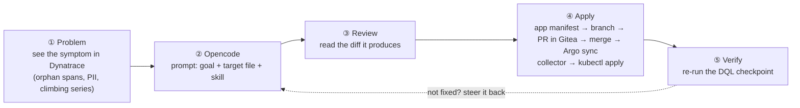
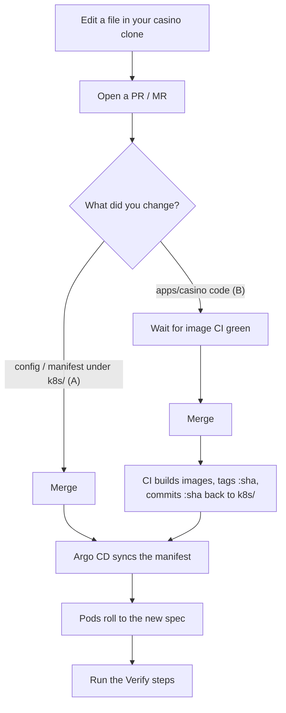
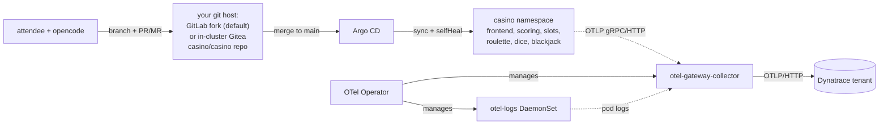

# M0 — Environment Setup

**Goal:** Codespace up, cluster healthy, Dynatrace connected, casino deployed,
`opencode` authenticated **with the observability skills installed**, and you
can play the casino. Budget 20 minutes; helpers circulate.

!!! info "Every module M1–M10 drives the `opencode` AI agent"
    This workshop is **opencode-first**: you never hand-author a fix from a
    blank file — you observe the symptom in Dynatrace, drive `opencode` to
    produce the fix, review the diff, apply it (PR/MR on your git host → Argo CD
    for app manifests, `kubectl apply` for the collector), and verify with DQL. M0
    makes sure the agent and its skills actually work before M1 needs them.
    The pattern is the **Problem → Opencode → Review → Apply → Verify** loop
    introduced at the end of this page and reused by every module.

## 1. Fork the casino on GitLab, then start the Codespace

The shipped default is the **Dynatrace-solution GitLab**: you fork the casino
project into the shared GitLab and your Codespace's Argo CD syncs from
**your** fork (`GITOPS_PROVIDER=gitlab`). The in-cluster **Gitea** is the
documented offline / air-gapped fallback (`GITOPS_PROVIDER=gitea`) — the lab
loop is identical either way, only the git host differs.

1. Sign in to the shared GitLab at `https://<gitlab-host>/` with the account
   from your welcome email (`<gitlab-host>` is the Dynatrace-solution GitLab
   named in that email).
2. Open the upstream project `https://<gitlab-host>/otel-training/casino` and
   click **Fork** into your own namespace. You now own
   `https://<gitlab-host>/<attendee>/casino`, containing the Kubernetes
   manifests under `k8s/`.
3. In **your fork** → **Settings → Access Tokens**, mint a token scoped
   **`read_repository`** (Argo CD pulls from the fork) + **`write_repository`**
   (you push your edits back). Copy it now — GitLab will not show it again.
4. In GitHub → **Settings → Codespaces → Repository secrets**, set
   `GITLAB_REPO_URL=https://<gitlab-host>/<attendee>/casino.git` and
   `GITLAB_TOKEN=<the token from step 3>` (`GITLAB_USERNAME` is optional and
   defaults to `oauth2`, valid for GitLab tokens over HTTPS).
5. Open the training repository you received in your welcome email, click
   **Code → Codespaces → Create codespace on main**, and wait for post-create
   setup to finish — the terminal shows the kind cluster being created.
   Typically 3–5 minutes with a prebuild. Seeing `GITOPS_PROVIDER=gitlab` plus
   your two GitLab secrets, post-create installs Argo CD and points the casino
   Application at **your fork**. (If the `GITLAB_*` secrets are absent, the
   bootstrap falls back to in-cluster Gitea and prints how to switch — see
   [§4](#ship-it).)

!!! note "You never paste a token into the repo"
    Tokens live only as Codespace secrets and are read at runtime. Nothing is
    written to disk or committed. If you ever find yourself pasting a token
    into a file, stop — that is not the flow.

Your Codespace secrets were injected by the organizers. Check they are present:

```bash
env | grep -E 'DT_TENANT|DT_OPERATOR_TOKEN|DT_INGEST_TOKEN|PARTICIPANT_ID' | cut -d= -f1
```

Expected output: the four variable **names** (values stay hidden in lists):

```
DT_TENANT
DT_OPERATOR_TOKEN
DT_INGEST_TOKEN
PARTICIPANT_ID
```

!!! note "Renamed from `DT_API_TOKEN`"
    The operator token is now `DT_OPERATOR_TOKEN`. If your Codespace secret is
    still named `DT_API_TOKEN`, bring-up continues (the installer accepts it as a
    deprecated fallback) — but rename the secret when you can. See the full
    contract in [Environment variables](#environment-variables) below.

!!! note "Your `PARTICIPANT_ID` is your identity"
    Everyone shares one Dynatrace tenant. `PARTICIPANT_ID` is the one value you
    set to be unique: it names your kind cluster and becomes `k8s.cluster.name`
    on every piece of telemetry you send. Keep it DNS-label-safe (lowercase
    letters, digits, `-` — no spaces or uppercase). **Always filter Dynatrace by
    your cluster name** — that is how you see your casino and not your
    neighbor's. (Override: `KIND_CLUSTER_NAME` takes precedence if you ever need
    to name the cluster directly; most attendees never set it.)

## Prepare `opencode` (the agent every module drives)

Every module from M1 on drives the **`opencode`** AI coding agent against your
casino and collectors. Get it ready **once**, here in M0, so a later failure
is a *telemetry* problem, never a *tooling* one.

### 1. Confirm `opencode` answers

`opencode` is baked into the Codespace image and wired at start-up to the
facilitator-hosted LLM proxy (the two `WORKSHOP_*` secrets — see the
[Environment variables](#environment-variables) table below). Every module
from M1 on drives it, so confirm it is alive now:

```bash
opencode --version                 # the CLI is baked into the image
test -f .workshop-llm.env && echo "proxy credential minted" || \
  echo "no proxy credential — re-run: bash .devcontainer/bootstrap/dispense-llm.sh"
opencode run "reply with the single word READY"   # returns a model completion
```

No `.workshop-llm.env`, or `opencode run` hangs or errors? Post-create setup
skipped the dispense (the `WORKSHOP_*` secrets were absent, or the dispenser was
unreachable) — see
[Troubleshooting](troubleshooting.md#workshop-llm-proxy-opencode) before going on.
Nothing else in this guide works until `opencode run` returns a completion.

### 2. Install the observability Agent Skills

The agent reasons correctly about OpenTelemetry and Dynatrace only when its
**Agent Skills** are loaded — otherwise it guesses. The bootstrap installs three
sets into `~/.config/opencode/skills/`; confirm them with the readiness gate, and
if the gate fails, (re-)run the installer (it is idempotent):

```bash
bash .devcontainer/bootstrap/verify-opencode-skills.sh   # exit 0 = all three sets loadable
bash .devcontainer/bootstrap/install-opencode-skills.sh  # (re)install if the gate failed
opencode debug skill                                     # the raw skill list opencode sees
```

You are looking for three families in that list:

| Family | Prefix | What it gives the agent |
|---|---|---|
| Dynatrace-for-AI | `dt-*` | DQL syntax, observability patterns, Kubernetes/cloud topology |
| OpenTelemetry | `otel-*` | `otel-instrumentation`, `otel-ottl`, `otel-dynatrace` |
| dtctl | `dtctl` | driving the `dtctl` CLI to read and apply Dynatrace config |

!!! warning "If the OpenTelemetry (`otel-*`) family is missing — install it, don't skip it"
    The skill install is **non-fatal** at bootstrap, so a GitHub blip can leave the
    OpenTelemetry set out (exactly the gap to close before M2). On a machine
    with Node you can add it directly from the published package:

    ```bash
    npx skills add henrikrexed/observability-agent-skills@v1.0.0
    ```

    Both paths land the skills in `~/.config/opencode/skills/`. Re-run
    `verify-opencode-skills.sh` until it exits 0 before you continue.

### 3. Wire `opencode` to your git host (the git loop)

App-code fixes ship the same way the rest of the lab does — **edit → PR/MR →
merge → Argo CD sync** — but driven by `opencode` against your git host. Set
the loop up **once** now.

**GitLab path (the default):** clone your fork and open merge requests on it:

```bash
git clone "$GITLAB_REPO_URL" ~/casino     # auth with your GITLAB_TOKEN
cd ~/casino && opencode
# later, after opencode edited the source: push a branch and open an MR on
# https://<gitlab-host>/<attendee>/casino — merging main triggers Argo CD
```

**Gitea fallback (offline / air-gapped):** the helper scripts are already on
your `PATH`:

```bash
gitea-token.sh      # mint a scoped Gitea token -> ~/.workshop-gitea.env (0600)
clone-casino.sh     # clone casino/casino -> ~/casino, wire creds + the DCO hook
```

Later, from inside `~/casino` after `opencode` has edited the source, ship the
change (`opencode` can run the git loop for you). On the **Gitea fallback** the
PR helper does it end to end:

```bash
gitea-pr.sh "fix(slots): propagate trace context across the scoring hop"
```

`gitea-pr.sh` branches `opencode/<slug>`, commits with a DCO sign-off, pushes, and
opens a pull request against `main` — printing the PR URL. On the **GitLab
default** you push the branch yourself and open the **MR** in your fork's web
UI; either way the helper/agent produces a signed-off commit on a branch. **Review and merge it in
your git host's UI** (see [§4 — Ship it](#ship-it) for
the Gitea and GitLab URLs); merging `main` is what triggers the Argo CD sync.
Never push straight to `main`. (Full walkthrough: [§4](#ship-it).)

### 4. One safe read-only task

Prove the agent can *read* through its skills before you let it change anything —
this lists config, it does not apply:

```bash
opencode run "Using the dtctl skill, name the Dynatrace environment dtctl is \
pointed at and show me one read-only command to list existing dashboards. Do not \
apply anything."
```

A good answer names your `DT_TENANT` and proposes a read verb (e.g.
`dtctl get dashboards`) **without running a mutation**. If it tries to `apply` or
`delete`, steer it back: *"read-only only — just show the command, don't run it."*
That corrective reply is the exact muscle every module uses.

### The agent loop you will use all day

Every module from here on follows **one** canonical pattern —
**① Problem → ② Opencode → ③ Review → ④ Apply → ⑤ Verify**. You never
hand-author the fix from a blank file: you observe the symptom in Dynatrace,
then drive `opencode` with a **copy-pasteable prompt** that names the **goal**,
the **target file**, and the **skill** to lean on. Learn the loop once here;
every module is a variation on it.



**Apply differs by target.** App manifests (`k8s/*.yaml` in your Gitea repo
`casino/casino`) are GitOps-owned: Argo CD `selfHeal` reverts hand-drift, so
you fix them with **branch → commit → push → PR in Gitea → merge** (the
`gitea-pr.sh` helper from §3 runs that loop for you), and Argo CD syncs `main`
(hit **Refresh** at http://localhost:30002 to force it). Collector config
(`observability/collectors/gateway.yaml` in your Codespace repo) is **not**
Argo-managed: validate offline (`bash observability/validate.sh`), then
`kubectl apply` it directly.

!!! tip "When the agent gets it wrong — steer it back, don't hand-fix"
    `opencode` is not deterministic. If the diff misses a field, puts a
    processor in the wrong order, or invents a name, **reply with the specific
    correction** rather than editing by hand — e.g. *"`memory_limiter` must
    stay the first processor; put your new processor after `k8sattributes`."*
    Steering the agent is the skill this workshop teaches; the DQL checkpoint
    tells you when it is done. Every module includes an *"if the agent gets it
    wrong"* note with the exact one-line corrections for that step.

## Environment variables

This is the **one canonical contract** for every variable the training consumes.
The single [`.env.sample`](https://github.com/henrikrexed/Otel-Training/blob/main/.env.sample)
at the repo root mirrors it — if anything disagrees, this table wins.

| Variable | Type | Consumed by | Required? |
|---|---|---|---|
| `DT_TENANT` | Tenant base URL (`https://<id>.live.dynatrace.com`) | Operator (`<DT_TENANT>/api`) **and** OTel collectors (`<DT_TENANT>/api/v2/otlp`) — one URL, two uses | Required for all Dynatrace labs |
| `DT_OPERATOR_TOKEN` | **Platform token** (`dt0s16`), `fleet-management:*` + `settings:objects:*` scopes | Dynatrace Operator → DynaKube `apiToken` (`deploy/dynatrace/install.sh`) | Required for K8s monitoring (M10) |
| `DT_INGEST_TOKEN` | **Platform token** (`dt0s16`), `openpipeline:{traces,metrics,logs,events}:ingest` + `storage:metrics:write` | **Two** consumers: OTel collectors' OTLP exporter (`Bearer` header) **and** operator `dataIngestToken` | Required for telemetry export (M5–M9) |
| `DT_PLATFORM_TOKEN` | Platform token (`dt0s16`), scopes below | `dtctl` **only** — never the operator | **Optional** — dtctl labs only; everything else works without it |
| `DT_PLATFORM_URL` | Gen3 SaaS apps URL (`https://<id>.apps.dynatrace.com`) | `dtctl` on Gen3 SaaS | Optional — derived from `DT_TENANT` when unset |
| `PARTICIPANT_ID` | DNS-label-safe id | kind cluster name, `k8s.cluster.name`, DynaKube name | Required (blank → `otel-training`, collides in a class) |
| `KIND_CLUSTER_NAME` | cluster name | optional override; wins over `PARTICIPANT_ID` | Optional |

!!! warning "The three `DT_*` tokens are all platform tokens but **not** interchangeable"
    On this Gen3 tenant `DT_OPERATOR_TOKEN`, `DT_INGEST_TOKEN`, and
    `DT_PLATFORM_TOKEN` are all **platform tokens** (`dt0s16`) — but each carries a
    **different scope set** and is minted separately: the operator token needs
    `fleet-management:*` + `settings:objects:*`, the ingest token needs
    `openpipeline:*:ingest` + `storage:metrics:write`, and `DT_PLATFORM_TOKEN` is
    used only by `dtctl`. Minting one where another is expected will fail auth.
    The old single `DT_API_TOKEN` is a deprecated alias for `DT_OPERATOR_TOKEN`
    only. (The Dynatrace **Operator ≥ 1.10.0** is what accepts platform tokens in
    the `apiToken`/`dataIngestToken` Secret keys; `install.sh` pins `1.11.1`.)

### `DT_PLATFORM_TOKEN` — scopes, user permissions, and whether you need it

`DT_PLATFORM_TOKEN` is **optional**. It is used by **`dtctl` only** (the catalog
appendix's dtctl labs — DQL, SLOs, dashboards, alerts). The whole M0–M10 path and
every non-dtctl exercise work without it, so skip it unless you are running those.

When you do mint it, it is a **platform token (`dt0s16`)** with this **minimum
scope set** — least-privilege for the dtctl labs (read Grail telemetry **and
Smartscape entities** + manage settings and documents), nothing more:

| Scope | Why `dtctl` needs it |
|---|---|
| `storage:buckets:read` | list Grail buckets for DQL |
| `storage:logs:read` · `storage:metrics:read` · `storage:spans:read` · `storage:events:read` · `storage:bizevents:read` · `storage:entities:read` | `dtctl query` / `dtctl exec` over each data kind |
| `storage:smartscape:read` | `dtctl query` over Smartscape entities — `smartscapeNodes …` reads table `smartscape.nodes`, e.g. `smartscapeNodes "K8S_CLUSTER" \| filter name == "<PARTICIPANT_ID>"` (GH#114; live-verified, ISI-7732) |
| `settings:objects:read` · `settings:objects:write` | create/read SLOs and metric/Davis alerts (catalog C2/C3) |
| `document:documents:read` · `document:documents:write` | create/read dashboards & notebooks (catalog C1) |

!!! warning "The token's **user** must already hold these permissions"
    A Dynatrace platform token can only carry scopes its **creating user**
    already has. If your account lacks (say) `settings:objects:write`, a token
    you mint with that scope checked will still be refused it, and the dtctl
    SLO/alert labs will 403. This includes `storage:smartscape:read`: without it
    in the token scope **or** the IAM policy, `dtctl query 'smartscapeNodes …'`
    fails with `NOT_AUTHORIZED_FOR_TABLE … Missing OAuth scope
    'storage:smartscape:read' on table 'smartscape.nodes'` (live-verified on a
    Gen3 tenant 2026-11-23 — ISI-7732 / GH#114). So the same permissions above
    must be bound to your user in **Account Management → Identity & access
    management → Policies** before you mint the token. On a shared training
    tenant the facilitator normally does this for you.

`dtctl` talks to the **apps** host (`https://<id>.apps.dynatrace.com`), not the
`live` tenant base. Set `DT_PLATFORM_URL` to it explicitly, or leave it blank and
it is **derived from `DT_TENANT`** (`<id>.live.…` → `<id>.apps.…`).
`bash .devcontainer/bootstrap/verify-dtctl.sh` does this derivation and makes a
live authenticated call, so a bad token or missing scope fails there, loudly,
instead of mid-lab.

#### Configure dtctl

The bootstrap configures this for you — `verify-dtctl.sh` (run by `postCreate`)
persists a `training` context to `~/.config/dtctl/config` pointing dtctl at your
tenant's **apps** host. You only touch this if a dtctl lab reports
**`no context`** (`dtctl get dashboards` ... `no current context`), which means
the context was never written (e.g. the codespace was created before `DT_TENANT`
was set). Fix it in one of two ways:

**Re-run the bootstrap step (preferred):**

```bash
bash .devcontainer/bootstrap/verify-dtctl.sh   # idempotent; (re)writes the context
```

**Or configure it by hand.** `dtctl` talks to the **apps** host — derive it from
`DT_TENANT` (`<id>.live.…` → `<id>.apps.…`), then set the context. The token step
needs a `DT_PLATFORM_TOKEN` (`dt0s16`, scopes above); **don't** reuse the
operator/ingest tokens — they carry different scopes and dtctl will 403:

```bash
# derive the apps URL from DT_TENANT (or use $DT_PLATFORM_URL if you set it)
APPS_URL="${DT_PLATFORM_URL:-${DT_TENANT/.live./.apps.}}"

# point dtctl at the environment (no token needed just to set the context)
dtctl config set-context training --environment "$APPS_URL" --safety-level readwrite-all
dtctl config use-context training

# attach credentials once you have a DT_PLATFORM_TOKEN
dtctl config set-credentials training-token --token "$DT_PLATFORM_TOKEN"
dtctl config set-context training --environment "$APPS_URL" \
  --token-ref training-token --safety-level readwrite-all
dtctl config use-context training
```

Verify it took: `dtctl config get-contexts` lists `training` as current, and
`dtctl get dashboards -o toon --plain` returns without a `no context` error.

Without `DT_PLATFORM_TOKEN` the context still exists (dtctl knows *where* it is),
so the `no context` wall is gone — but read/apply calls need the credentials line
above. (The bootstrap prints this exact snippet when it configures an
environment-only context.) See also
[Troubleshooting → dtctl `no context`](troubleshooting.md#dtctl-no-context).

Two variables below are **not** Dynatrace tokens — they belong to the `opencode`
LLM dispenser (unrelated to the DT tenant). They are **required from M0 on**:
M0–M10 are opencode-first, and the agent is useless without its proxy key.

| Variable | Type | Consumed by | Required? |
|---|---|---|---|
| `WORKSHOP_DISPENSER_URL` | URL | `dispense-llm.sh` → `opencode` LLM proxy key | Required for the M0–M10 opencode loop |
| `WORKSHOP_ROOM_PASSWORD` | shared secret (`X-Room-Password`) | `dispense-llm.sh` → dispenser auth | Required for the M0–M10 opencode loop |

!!! info "Davis CoPilot / OAuth (optional, not required)"
    If your cohort runs the optional **Davis CoPilot** exercise it uses a separate
    Dynatrace **OAuth client** (`dt0s02`) — deliberately kept out of the required
    token set above. Most attendees do not need it.

### Running locally (not in Codespaces)

In GitHub Codespaces you set the variables above as **Codespaces secrets** and
never touch a file. To run the same dev container **locally** (VS Code Dev
Containers / Docker Desktop) there is **one** `.env` flow — no `source`, no
`make`, rebuild-only:

1. Copy the single canonical sample and fill it in:

    ```bash
    cp .env.sample .env       # repo root; .env is gitignored
    ```

2. Edit `.env` (at minimum set `PARTICIPANT_ID`; add the `DT_*` tokens for the
   Dynatrace labs).
3. **Rebuild the container** (*Dev Containers: Rebuild Container*). That is it —
   `bootstrap/load-env.sh` (sourced by postCreate/postStart) exports every
   non-empty value from `.env` into the bootstrap **and** wires your interactive
   terminals, so `make up` / `kubectl` see them with no extra step.

!!! note "One sample, one file"
    There is exactly one env sample: the **repo-root** `.env.sample`. The old
    `.devcontainer/.env.example` was removed — don't look for a second one.
    Empty lines in `.env` never override a value already in the environment (so a
    committed-blank `.env` can't clobber a Codespaces secret).

### Local minimum (Docker Desktop / Linux host)

A local run needs real headroom — the Codespace requests **4 vCPU / 8 GB RAM /
32 GB disk** and your Docker engine should match:

| Resource | Minimum | Where to set |
|---|---|---|
| CPUs | **4** | Docker Desktop → Settings → Resources (WSL2: `.wslconfig`) |
| Memory | **8 GB** | Docker Desktop → Settings → Resources (WSL2: `.wslconfig`) |
| Disk | **32 GB** free | Docker Desktop → Settings → Resources |
| `fs.inotify.max_user_watches` | **524288** | host sysctl (Linux/WSL2) |
| `fs.inotify.max_user_instances` | **512** | host sysctl (Linux/WSL2) |

Raise the inotify limits on a Linux/WSL2 host (kind, kubectl, and the collectors
all register file watchers and fail silently when exhausted):

```bash
sudo sysctl -w fs.inotify.max_user_watches=524288
sudo sysctl -w fs.inotify.max_user_instances=512
# persist across reboots:
echo -e 'fs.inotify.max_user_watches=524288\nfs.inotify.max_user_instances=512' \
  | sudo tee /etc/sysctl.d/99-otel-training.conf
```

`bootstrap/preflight.sh` checks all of the above on every container start and
prints the exact remediation for anything below floor (it only **warns** — it
never blocks the container from opening). It also flags any **stray** kind
cluster whose name doesn't match this run, so you don't end up with a second,
differently-named cluster eating memory:

```bash
# delete every kind cluster except the one this run uses:
CLEANUP_STRAY=1 bash .devcontainer/bootstrap/create-cluster.sh
```

## 2. Verify the kind cluster

```bash
kubectl get nodes
```

Expected: one node named `<PARTICIPANT_ID>-control-plane`, status `Ready`.

```bash
kubectl get pods -A
```

Expected: pods `Running` (or `Completed` for Jobs) in:

| Namespace | What lives there |
|---|---|
| `casino` | the Vegas Casino services, Redis, PostgreSQL, k6 load-gen |
| `observability` | `otel-gateway-*` (gateway collector) and `otel-logs-*` (DaemonSet) |
| `dynatrace` | Dynatrace Operator + `<name>-activegate-0` |
| `gitea` | your in-cluster Git host |
| `argocd` | Argo CD |

If pods are missing, run the bootstrap (idempotent) and ask a helper if it
does not converge:

```bash
bash gitops/bootstrap/bootstrap-gitops.sh
```

## 3. Connect to the Dynatrace tenant

1. Get your tenant URL and open it in a browser tab:

    ```bash
    echo $DT_TENANT
    ```

2. Sign in with the credentials from your handout.
3. Press **Ctrl/Cmd+K**, search "Notebooks", and open **Notebooks**. Create a new
   notebook and add a **DQL** section — this is the query surface you will read
   all your telemetry from today, instead of clicking through curated UI views.

!!! abstract "The one scoping rule — filter by your cluster, every time"
    Everyone shares one Dynatrace tenant, so **every query from here on opens
    with your own cluster filter** — that is how you see your casino and not your
    neighbor's. Thanks to `PARTICIPANT_ID`, your telemetry carries
    `k8s.cluster.name == "<PARTICIPANT_ID>"` on every span, metric, and log.

    In the Dynatrace UI, replace `<PARTICIPANT_ID>` with your actual value (run
    `echo $PARTICIPANT_ID` once, or let the terminal fill it in, see below) and keep this as the **first `filter` line** of
    every query:

    ```dql
    | filter k8s.cluster.name == "<PARTICIPANT_ID>"
    ```

4. **Confirm your telemetry is arriving — and that it is yours.** Paste this into
   the DQL section and run it. It lists every service sending spans *from your
   cluster* in the last 30 minutes:

    ```dql
    fetch spans, from: now() - 30m
    | filter k8s.cluster.name == "<PARTICIPANT_ID>"
    | summarize spans = count(), by: { service.name }
    | sort spans desc
    ```

    **Don't want to type your ID?** Your shell already has `PARTICIPANT_ID`.
    Run this in the terminal and it prints the same query with your value
    filled in, ready to copy into the DQL section (a cluster created without a
    `PARTICIPANT_ID` is named `otel-training`, hence the default):

    ```bash
    cat <<EOF
    fetch spans, from: now() - 30m
    | filter k8s.cluster.name == "${PARTICIPANT_ID:-otel-training}"
    | summarize spans = count(), by: { service.name }
    | sort spans desc
    EOF
    ```

    **What you should see:** your casino services — `vegas-frontend-service`,
    `vegas-slots-service`, `vegas-scoring-service`, and the other games — each
    with a nonzero count. The k6 load generator is already playing the casino for
    you, so traces flow without you touching the UI. (First telemetry can take a
    couple of minutes to land.)

!!! tip "DQL returns entities too (Smartscape) — a UI-independent my-cluster-is-there check"
    Grail holds more than telemetry: the **Smartscape entities** (clusters,
    namespaces, pods, services, …) are queryable with the same DQL in the same
    notebook. Use this as a UI-independent way to confirm your cluster is there —
    it sidesteps the UI navigation-path churn from issue #68:

    ```dql
    smartscapeNodes "K8S_CLUSTER"
    | filter name == "<PARTICIPANT_ID>"
    ```

    Optional — list the namespaces in your cluster:

    ```dql
    smartscapeNodes "K8S_NAMESPACE"
    | filter k8s.cluster.name == "<PARTICIPANT_ID>"
    | fieldsKeep `tags:k8s.labels`, k8s.cluster.name, name
    ```

5. **Prove the scope isolates you.** Drop the cluster filter for a moment and
   count the distinct clusters on the tenant — you will see everyone's:

    ```dql
    fetch spans, from: now() - 30m
    | summarize spans = count(), by: { k8s.cluster.name }
    | sort spans desc
    ```

    Your `PARTICIPANT_ID` is one row among many. That is exactly why the cluster
    filter is the first line of every query from here on.

!!! note "Running DQL needs Grail read access"
    Notebook queries run as **you** (your signed-in session), not via a token — so
    the whole M0–M10 path needs no `DT_PLATFORM_TOKEN`. They do need Grail **read**
    scopes (`storage:spans:read`, `storage:logs:read`, …) bound to your user; on a
    shared training tenant the facilitator grants these for you. The Smartscape
    entity queries above (`smartscapeNodes …`) additionally need the
    **`storage:smartscape:read`** user scope, which the facilitator grants alongside
    the other Grail read scopes — since the notebook runs as the signed-in user,
    no token change is involved. (The optional `dtctl` catalog labs are the only
    ones that also need `DT_PLATFORM_TOKEN` —
    see [`DT_PLATFORM_TOKEN`](#dt_platform_token-scopes-user-permissions-and-whether-you-need-it).)

## 4. Ship it — the GitOps loop {#ship-it}

Your lab mechanic for the whole session: **branch → commit → push → PR/MR on
your git host → merge → Argo CD deploys it** (M1 walks this end to end with
`opencode`). No `kubectl apply` into the `casino` namespace (Argo CD's
self-heal would revert it anyway). Every exercise ends by sending you back here,
so this is the one place the full flow is written down.

**Two loops, one tail — which one you are in depends on _what_ you edited:**

- **Branch A — config / manifest** (env vars and Kubernetes YAML under `k8s/`;
  the module exercises that edit a deployment). Edit → PR/MR → merge → **Argo CD
  syncs the YAML directly**. No CI, no image build — the change is live as soon
  as Argo syncs.
- **Branch B — casino application code** (`apps/casino/**`; the catalog
  **A-series** instrumentation labs and any lab that edits service source).
  Edit → PR/MR → **wait for the image CI (Gitea Actions `casino-images`) to go
  green** → merge → **wait for the image build + `:<sha>` write-back commit** →
  Argo CD syncs → pods roll to the new image → test. Those extra steps are real:
  nothing changes in the cluster until the new image is built and its `:<sha>`
  tag is committed back into `k8s/`.



!!! note "Argo CD is poll-only — if nothing happens, Refresh → Sync"
    Argo CD polls your fork on an interval; there is no webhook, so a just-merged
    change can take a minute to appear. To skip the wait, open the `casino`
    Application at http://localhost:30002 and click **Refresh**, then **Sync**. A
    stuck sync almost always means a YAML render error — check the Application
    status before you debug anything else.

**The shape of the lab** — everything runs in one kind cluster inside your
Codespace:



| Component | Namespace | Role in the lab |
|---|---|---|
| Casino services | `casino` | Frontend + per-game services (slots, roulette, dice, blackjack) + scoring, Redis, PostgreSQL, k6 load-gen. The thing you are observing. |
| Your git host | external GitLab (default) / `gitea` (fallback) | Holds the `casino/casino` repo — manifests under `k8s/`, service source under `apps/casino/`. You open PRs (Gitea) / MRs (GitLab) here. |
| Argo CD | `argocd` | Polls your fork and applies it. `selfHeal` reverts hand-drift. |
| OTel Operator | `observability` | Manages the gateway collector and the logs DaemonSet as CRDs. |
| Gateway collector | `observability` | The single control point — every collector fix in M5–M9 lands here. |
| Dynatrace Operator | `dynatrace` | Kubernetes monitoring + ActiveGate. |

!!! note "Lite profile — a smaller casino"
    On a tight Codespace you can bring the casino up in its **`lite`** profile:
    `CASINO_PROFILE=lite bash .devcontainer/bootstrap/deploy-environment.sh`.
    Lite drops the **roulette** and **dice** services, narrows the k6 load-gen,
    and makes the Dynatrace **ActiveGate** optional (app telemetry still flows
    through the OTel collector). Default is **`full`**. Details:
    `deploy/casino/README.md` in the repo.

**Default path — your GitLab fork.** With `GITOPS_PROVIDER=gitlab` (the shipped
default; set in §1) the git host is **not** the in-cluster Gitea on 30001 — open
your GitLab fork's web URL instead (printed in the GitOps bootstrap banner).
Ports 30000 (casino) and 30002 (Argo CD) are unchanged.

**Offline / air-gapped fallback — in-cluster Gitea.** Without the `GITLAB_*`
secrets the bootstrap runs `GITOPS_PROVIDER=gitea`; the loop is identical, only
the git host differs.

All UIs are forwarded to your codespace and appear, labelled, in the
**Ports** panel (`Casino app` → 30000, `Git host` → 30001, `Argo CD UI` → 30002):

| Endpoint | URL | Credentials |
|---|---|---|
| Casino app | http://localhost:30000 | register a player in the UI |
| Git host — GitLab fork (default) | `https://<gitlab-host>/<attendee>/casino` | your GitLab account from the welcome email |
| Git host — Gitea (offline fallback) | http://localhost:30001 | `attendee` / `trainingpass123` |
| Argo CD | http://localhost:30002 | `admin` / password: see below |

**Lost a URL or password?** Bring-up prints this table at the end, but the
output is long. Read every login back — URLs **and** passwords for Argo CD,
Gitea, the casino and Dynatrace — any time, straight from your cluster:

```bash
bash .devcontainer/bootstrap/print-env-details.sh
```

It is read-only and safe to re-run; it reads the Argo CD password live from the
`argocd-initial-admin-secret` so it stays correct after a rebuild. (If you want
just the raw Argo CD password, `kubectl -n argocd get secret
argocd-initial-admin-secret -o jsonpath='{.data.password}' | base64 -d; echo`
still works.)

1. Open your git host and sign in, then find the repo `casino/casino` — it
   contains the Kubernetes manifests under `k8s/` for the `casino` namespace.
   This is where you will fix defects — on a branch, via a PR/MR (M1 shows the
   full loop).
2. Open Argo CD at http://localhost:30002 — the `casino` Application shows
   `Healthy` / `Synced`.

## 5. Play the casino

The casino frontend (`vegas-casino-frontend`) is exposed through the Gateway API
data plane on **NodePort 30000** — no `kubectl port-forward` needed. In the
Codespaces **Ports** panel it shows up labelled **Casino app**; click the globe
icon on port **30000** (or open **http://localhost:30000**).

Open http://localhost:30000, register a player account, and play a few rounds —
try the slots and another game. Any game works; the point is generating
telemetry.

!!! warning "The login is fake — use made-up values"
    The casino has no real auth or user database. The register form (**Player
    Name**, **Email**, **Profile Type**, **Starting Balance**) just seeds a local
    session so you have something to play with, so **type made-up values** —
    invent a name, use a throwaway address like `you@example.com`, pick any
    **Starting Balance**. For **Profile Type**, choose **Dynatracer** if you work
    at Dynatrace, **Partner** or **Customer** if that is your relationship,
    otherwise **Other**; it only tags your telemetry (`user.profile_type`) and
    changes nothing about the lab.

    What you type never leaves your Codespace **except as telemetry** — spans,
    metrics, and logs flow to the shared training tenant that every attendee
    uses. And this casino ships with a planted privacy defect: the frontend runs
    `AUDIT_LOG_VERBOSITY: verbose`, so your **raw email and client IP** land in
    `login_audit` log lines on that shared tenant until you fix it in
    [M7 — Scrubbing PII from logs](advanced/step-6-pii-logs.md).
    One more reason to keep the email fake.

> 30000 is published by the kind control-plane node and forwarded to the
> codespace, the same way the Gitea fallback (30001) and Argo CD (30002) UIs are.

Leave the casino open in a browser tab and use a terminal (+ icon) for
everything else.

Sanity-check the entry point from inside the cluster:

```bash
kubectl -n casino run curl-check --rm -i --restart=Never --image=curlimages/curl:8.10.1 -- \
  curl -fsS http://vegas-casino-frontend:3000/health
```

Expected: a health response from the frontend.

### In-game cheats

Every game UI ships a cheat side panel — deliberately. In roulette, the
**Enable Cheats** button pinned to the left edge of the page opens the
*Configuration Lab*:

| Toggle | `CheatType` | Boost |
|---|---|---|
| 🎯 Ball Control | `ballControl` | 30% |
| ⚙️ Wheel Bias | `wheelBias` | 25% |
| 🧲 Magnetic Field | `magneticField` | 40% |
| 📊 Sector Prediction | `sectorPrediction` | 35% |

A toggle only *marks* the bet — the spin `POST /api/games/roulette/spin`
leaves the browser carrying `CheatActive` / `CheatType`, and the backend
applies the boost only while the OpenFeature flag
**`roulette.cheat-detection`** is enabled (flip it via flagd or the
`FLAG_ROULETTE_CHEAT_DETECTION` env var; it is on by default). When honored,
a **multiple (spread) bet** is re-rolled in your favor with the listed
probability. Slots, dice and blackjack ship equivalent panels (e.g. dice
`probabilityManipulation` / `rollPrediction`, blackjack `cardCounting` /
`dealerTell`, slots reel synchronization).

The cheats exist to be *observed*: a rigged spin stamps the roulette span
with the `game.cheat_active`, `game.cheat_type` and `game.cheat_boosted`
attributes, so the manipulation is visible in the trace. Filter Distributed
Tracing on `game.cheat_active = true` and compare boosted vs clean rounds —
the [A-series catalog exercises](advanced/catalog.md) hunt exactly this kind
of planted signal.

## 6. Verify the telemetry path

Every service exports OTLP to the gateway collector, which enriches and
forwards to Dynatrace:

```bash
kubectl -n observability get otelcol
kubectl -n observability logs deploy/otel-gateway-collector --tail=5
```

Expected: `otel-gateway` and `otel-logs` both `Running`, no export errors in
the gateway log.

### Check the load generator

A k6 load generator plays the casino for you. It logs **only failures**, so
quiet logs mean healthy:

```bash
kubectl -n casino get deploy vegas-casino-loadgen
kubectl -n casino logs deploy/vegas-casino-loadgen -c k6 --tail=20
```

Healthy: the deployment is `1/1` and the log shows only k6's progress line,
for example `3/3 VUs, 146 complete and 0 interrupted iterations`.

Failing: you also see lines such as
`FAIL login: POST http://.../api/user/login -> 502`, naming the URL and status
that broke.

## Definition of done — M0

- [ ] `kubectl get nodes` shows one Ready node
- [ ] All pods Running in `casino`, `observability`, `dynatrace`, `gitea`, `argocd`
- [ ] `opencode run "reply with the word READY"` returns a completion (proxy auth works)
- [ ] `npx skills add henrikrexed/observability-agent-skills@v1.0.0` ran (or the bootstrap installer fallback), and `opencode debug skill | grep -E 'otel-|dt-|dtctl'` prints the three skill families
- [ ] The scoped `fetch spans | filter k8s.cluster.name == "<PARTICIPANT_ID>"` query returns your casino services in Dynatrace
- [ ] Your cluster appears as a Smartscape entity via `smartscapeNodes "K8S_CLUSTER" | filter name == "<PARTICIPANT_ID>"` in the notebook
- [ ] Your git host reachable (GitLab fork, or Gitea fallback at http://localhost:30001), repo `casino/casino` visible
- [ ] Casino UI reachable at http://localhost:30000 and you played a round
- [ ] `otel-gateway` log shows no export errors

Stuck? Check the [Troubleshooting](troubleshooting.md) page, or flag a helper.

Next: [M1 — Tour the broken casino](module-1.md).
