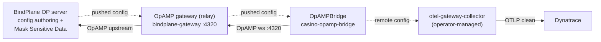

# Central config — BindPlane OP via the OpAMP bridge + gateway (relay)

Lab assets for the advanced-track appendix
**[Central config: the OpAMP bridge + a BindPlane gateway](../../../../docs-site/advanced/bindplane-opamp.md)**.

When hand-maintained regex redaction stops scaling (new PII shapes, per-service
rules, audit requirements), escalate to **BindPlane OP** as the central config
manager. Config is authored once and **pushed** to the operator-managed collectors
over OpAMP — via the OTel Operator's **OpAMP bridge**, through an **OpAMP gateway
(relay)** for segmented/firewalled clusters.

> **Alpha:** the BindPlane OpAMP Gateway and its `BINDPLANE_*` flags are
> version-sensitive. Pin the chart/image versions below and re-verify flag names
> against the release you deploy.

## Topology



- **OpAMPBridge** (`opampbridge.yaml`) — runs in-cluster, an OpAMP **client**
  only; speaks on behalf of the operator-managed collectors.
- **OpAMP gateway / relay** (`opamp-gateway.yaml`) — an OpAMP **server**
  downstream (bridges connect on `:4320`) and an OpAMP **client** upstream to the
  BindPlane server. Needed for segmented/firewalled fleets; skip it and point the
  bridge at the server `:3001` when the cluster can reach BindPlane directly (see
  the commented fallback in `opampbridge.yaml`).

## Files

| File | What it is |
|------|-----------|
| `opampbridge.yaml` | `OpAMPBridge` CRD; `endpoint` → relay `:4320` (commented `:3001` direct fallback), image `:0.162.0`, `componentsAllowed` allow-list |
| `opamp-gateway.yaml` | Relay Deployment + Service exposing OpAMP `:4320`, registering upstream to the BindPlane server |

## Deploy

```bash
# 1. BindPlane OP server in-cluster (Helm; pin the chart version for the training).
helm repo add bindplane https://observiq.github.io/bindplane-op-helm
helm repo update
helm upgrade --install bindplane bindplane/bindplane \
  -n observability --create-namespace --version 1.24.0

# 2. Connection tokens (from BindPlane: Settings → OpAMP / install command).
kubectl -n observability create secret generic bindplane-gateway \
  --from-literal=BINDPLANE_OPAMP_TOKEN='<token-from-bindplane>'
kubectl -n observability create secret generic bindplane-opamp \
  --from-literal=BINDPLANE_OPAMP_TOKEN='<token-from-bindplane>'

# 3. The OpAMP gateway (relay), then the bridge.
kubectl apply -f opamp-gateway.yaml
kubectl -n observability rollout status deploy/bindplane-gateway
kubectl -n observability set env opampbridge/casino-opamp-bridge \
  --from=secret/bindplane-opamp
kubectl apply -f opampbridge.yaml
```

In BindPlane, attach a **Mask Sensitive Data** processor to the casino log source
and push; the config flows server → relay → bridge → `otel-gateway-collector` with
no manual YAML edit.

## Notes / gotchas

- The bridge image tag (`operator-opamp-bridge:0.162.0`) tracks the operator
  release line; keep it consistent with `OTEL_OPERATOR_VERSION` (`v0.162.0`) in
  `observability/versions.env` — the bridge image omits the leading `v`.
- `componentsAllowed` is an allow-list: BindPlane cannot push a component the
  bridge does not permit — a safety rail for the training cluster.
- This **supersedes** the hand-rolled `redaction`/`transform/pii` once BindPlane
  owns the config; keep the Step-6 processors as the "before BindPlane" baseline
  for the exercise.
- Gateway vs direct: relay (`:4320`) for segmented/firewalled fleets; direct
  server (`:3001`) when reachable. Do not run both for the same bridge.
