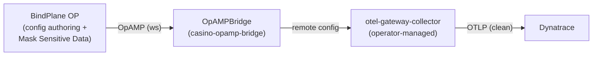

# Step 5 escalation — BindPlane OP via OTel Operator + OpAMP bridge

When hand-maintained regex redaction stops scaling (new PII shapes, per-service rules,
audit requirements), escalate to **BindPlane OP** as the central config manager. The OTel
Operator's **OpAMP bridge** connects the cluster's operator-managed collectors to BindPlane
over the OpAMP protocol, so redaction config is authored/pushed centrally instead of edited
in YAML per collector.

## Topology



## Deploy

```bash
# 1. BindPlane OP server in-cluster (Helm; pin the chart version for the training).
helm repo add bindplane https://observiq.github.io/bindplane-op-helm
helm upgrade --install bindplane bindplane/bindplane \
  -n observability --create-namespace

# 2. Connection token for the bridge (from BindPlane: Settings → OpAMP / install command).
kubectl -n observability create secret generic bindplane-opamp \
  --from-literal=BINDPLANE_OPAMP_TOKEN='<token-from-bindplane>'
kubectl -n observability set env opampbridge/casino-opamp-bridge \
  --from=secret/bindplane-opamp

# 3. The OpAMP bridge.
kubectl apply -f labs/advanced/step5-pii-redaction/bindplane-opamp/opampbridge.yaml
```

In BindPlane, attach a **Mask Sensitive Data** processor to the casino log source and push
the config; the bridge delivers it to `otel-gateway-collector` with no manual YAML edit.

## Notes / gotchas

- The bridge image tag (`operator-opamp-bridge:0.127.0`) tracks the operator release line;
  keep it consistent with `OTEL_OPERATOR_VERSION` in `observability/versions.env`.
- `componentsAllowed` is an allow-list: BindPlane cannot push a component the bridge does
  not permit — a safety rail for the training cluster.
- This **supersedes** the hand-rolled `redaction`/`transform/pii` once BindPlane owns the
  config; keep the Step-5 processors as the "before BindPlane" baseline for the exercise.
